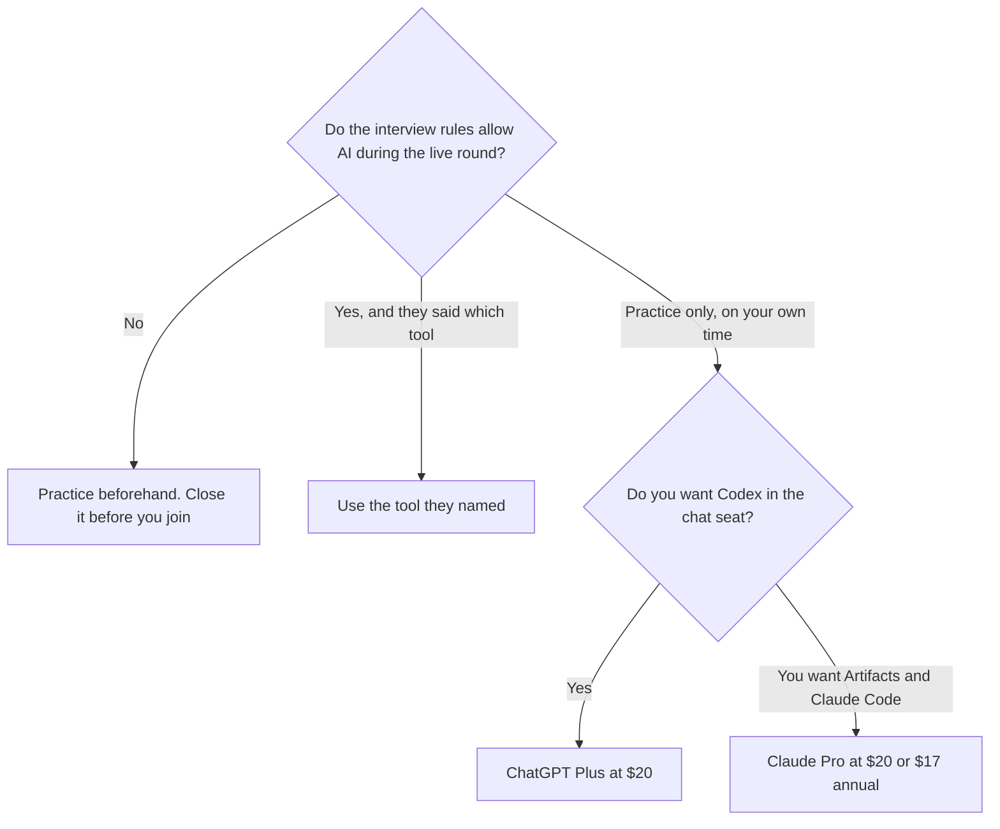

**Use ChatGPT Plus when you want projects, custom GPTs, and Codex in the same $20 seat for practice. Use Claude Pro when you want Artifacts, a long explanation, and Claude Code included at $20 a month or $17 billed annually.** Both are practice tools. If the company forbids AI during the interview, you close the tab before the interview starts. This page does not claim either model passes more interviews.

The editor you may use on the job is a different purchase: [Cursor vs GitHub Copilot for teams](/blog/cursor-vs-github-copilot-for-teams-2026/). The general coding comparison against Gemini is [ChatGPT vs Gemini for coding](/blog/chatgpt-vs-gemini-for-coding-2026/). The container for saved problem sets is [Claude Projects vs ChatGPT Projects](/blog/claude-projects-vs-chatgpt-projects-2026/).

Prices are US list prices excluding tax from directory pages checked October 16, 2026. Published October 24, 2026. We did not score interview performance.

## Practice seats, not a live assistant

| | [ChatGPT](/tools/chatgpt/) | [Claude](/tools/claude/) |
|---|---|---|
| Free, for a first week of practice | Unlimited GPT-6 text chats, with limits on uploads and tools | Chat, files, code execution, Artifacts, usage limits, up to 5 Projects |
| The practice seat | Plus $20 a month: projects, custom GPTs, expanded Codex | Pro $20 a month, or $17 billed annually ($200 up front). Claude Code is included |
| When practice is your job for a month | Pro at $100, $200, or $500. That is a usage band, not a tutor | Max at $100 (5× Pro) or $200 (20×) |
| What to save | A Project per pattern: arrays, SQL, system design prompts you wrote | A Project with the problems you are allowed to practice, plus Artifacts for the walkthrough |
| What stays out of the interview | The product, if the rules say so | The product, if the rules say so |

A year of Claude Pro on the annual card is $200. A year of ChatGPT Plus is 12 × $20 = $240. The $40 difference is not a reason to pick a model for a loop interview. Pick the surface you will actually practice in. Go, at $8, can draft an explanation, and the directory says it may include ads. Ads are a poor fit next to a resume. The ChatGPT ladder is [ChatGPT Go vs Plus vs Pro](/blog/chatgpt-go-vs-plus-vs-pro-2026/). The Claude page is [Claude review](/blog/claude-review-2026/).

## How to practice without fooling yourself

**Explain, then code.** Paste a problem you have the right to use. Ask for hints in steps. Write the solution yourself before you ask for a full sample. A sample you cannot reconstruct on a whiteboard was a reading, not practice. The person who decides you understand it is you. That habit is [what human-in-the-loop AI is](/blog/what-is-human-in-the-loop-ai-2026/).

**Keep a project, not a graveyard of chats.** One Project for the patterns you miss. When the model invents an API, that is [a hallucination](/blog/what-is-ai-hallucination-2026/). Check it against the language docs. The pass is [how to fact-check AI writing](/blog/how-to-fact-check-ai-writing-2026/), applied to code.

**The editor, if you are preparing for the job rather than the whiteboard.** [GitHub Copilot](/tools/github-copilot/) Free includes 2,000 completions a month. Pro is $10 a month. Verified students can get a student plan. We do not have a separate student price in the pages we checked. [Cursor](/tools/cursor/) Plus for new individuals is $8 a month, or $80 a year. Buy an editor when you are practicing inside a repo. Do not buy it to hide a chat beside a shared interviewer screen. The Copilot card is [GitHub Copilot pricing explained](/blog/github-copilot-pricing-explained-2026/).

**System design.** Ask either tool to list the tradeoffs you should be ready to say out loud. Delete any capacity number you cannot derive. Invented throughput is worse than a blank box.

ChatGPT Business, at $20 a user a month billed annually for two or more users, matters when you are pasting proprietary prompt material from an employer. A personal search for "binary tree practice" does not need a company workspace. If the problem came from a current employer's private repo, do not paste it into a personal free account. Read the data settings first.

## FAQ

### Which one should I use during the interview?

The one the interviewer allows. If they allow none, use none. Practicing the night before is a different setting from a live loop. This page will not help you conceal a tool on a call.

### Is Max or Pro worth it for a two-week crunch?

Only if you are hitting the cap on the $20 plan every day. Max at $100 is five times Claude Pro usage, on the card. ChatGPT Pro at $100 is a different product's heavy tier. A capped evening is not automatically a $100 problem. Wait until the limit is real.

### Can I upload a company's take-home?

Only if the company said you may use AI and you may upload the files. A take-home that says "your work only" means your work only. The model is not a co-author you forgot to mention.

### Will Artifacts or Codex make me faster in the room?

They make practice faster when you use them to check an approach you already tried. They do not replace writing the code where the interviewer can see you think. The job-side editor comparison is the teams page linked above.

## Last verified

October 16, 2026 for ChatGPT, Claude, GitHub Copilot, and Cursor prices named above. No interview pass rates are recorded. Published October 24, 2026.

**Sources:** [ChatGPT pricing](https://chatgpt.com/pricing), [Claude pricing](https://claude.com/pricing), [GitHub Copilot](https://github.com/features/copilot).

*Published by Andrew for [AI Tools Optimizer](https://aitoolsoptimizer.com).*

[Claude](/tools/claude/) is in the [chatbots and assistants directory](/tools/category/chatbots-assistants/). Directory pages may use affiliate links. A purchase through them may earn us a commission at no extra cost to you.
