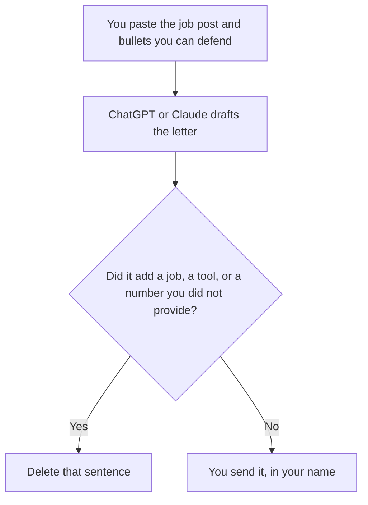

**Use ChatGPT or Claude to draft a cover letter only from the job post you paste and the jobs you actually held. Then you send it.** A letter that adds a title, a metric, or an employer you did not provide is a different person's career. We did not score which model sounds more hireable.

The short-note cousin of this page is [ChatGPT vs Claude for email](/blog/chatgpt-vs-claude-for-email-2026/). The seat ladder on the OpenAI side is [ChatGPT Go vs Plus vs Pro](/blog/chatgpt-go-vs-plus-vs-pro-2026/). A claim the model added, including a skill you do not have, gets the same treatment as any other invented fact: [how to fact-check AI writing](/blog/how-to-fact-check-ai-writing-2026/).

Prices are US list prices excluding tax from directory pages checked October 16, 2026. Published October 24, 2026. This page is not career, legal, or immigration advice. You are responsible for every sentence that reaches an employer.

## Which seat matches the letter

| The letter you actually need | Start here | What you still do |
|---|---|---|
| One letter, from a post and a resume you paste | [ChatGPT](/tools/chatgpt/) Free, or [Claude](/tools/claude/) Free | Delete any employer, date, or metric that was not in the paste |
| You will reuse the same resume facts across several posts | ChatGPT Plus at $20 a month, with projects | Replace the job post every time. Do not keep last week's company in the letter |
| The resume and the post live in a long Project you want beside the draft | Claude Pro at $20 a month, or $17 billed annually | Read the Project. A stale bullet in the Project becomes a stale letter |
| You want a grammar pass after the facts are true | [Grammarly](/tools/grammarly/) Pro at $12 a member a month billed annually, or $30 monthly | Grammarly does not know your job history. It will not catch a fake metric that is spelled correctly |
| You hit a free limit mid-draft | ChatGPT Go at $8 a month | Finish the letter. A top tier is not a better biography |

Go may include ads, on the ChatGPT card. A cover letter is not a reason to treat an ad as a career tip. Business, at $20 a user a month billed annually with a two-user minimum, matters when the paste includes someone else's personnel file and your policy forbids a personal account. A letter about your own work usually stays on Free, Go, Plus, or Claude Pro.

## What $20 is buying

**ChatGPT Plus** adds projects, so the resume facts can sit in one place while you swap the job post. Pro at $100 and above is a capacity tier. One letter does not require it. The tool page is [ChatGPT](/tools/chatgpt/). The review is [ChatGPT review](/blog/chatgpt-review-2026/).

**Claude Pro** is the better Claude path when the source is long: a job description, a portfolio note, and a list of constraints ("do not mention the layoff," "keep it under 300 words"). Free can take a short paste, with usage limits. The capacity split is [Claude Pro vs Max](/blog/claude-pro-vs-max-2026/). The review is [Claude review](/blog/claude-review-2026/).

**Grammarly** is the edit after the facts are locked. It is the wrong first tool. A polished false sentence is worse than a plain true one.

**A note you keep.** [Notion AI](/tools/notion-ai/) Business is $20 a seat a month if the master bullet list lives in Notion. Plus at $10 is not the full AI tier on the directory card. The letter is a copy. The bullet list is the record. The record is [what a system of record for AI is](/blog/what-is-a-system-of-record-for-ai-2026/).

A prompt that holds the line:

"Write a cover letter from the job post and the bullets I pasted. Use only employers, dates, and numbers that appear in the bullets. If a requirement in the post is not in the bullets, write Missing and do not claim it. Keep it under the word count I set. Do not invent enthusiasm about a product I did not name."

## What not to delegate

Do not ask the model to explain a gap with a story you did not live. Do not paste a colleague's review or a confidential metric. Do not accept a salary figure the model remembers from some other posting. If you name a number, it comes from the post or from you.

The employer's side of this document, the requisition, is [how to write a job description with AI](/blog/how-to-write-a-job-description-with-ai-2026/). Your letter should answer that requisition. It should not rewrite it into a job they did not open.

## FAQ

### Which one writes a better letter?

We did not measure that. Use the account where your real bullets already live, and read the draft against those bullets. If you will not check the employers, neither product has written your letter.

### Can I paste the whole resume?

Yes. Then delete anything the draft says that the resume does not say. A model will often "upgrade" a title. The title on the resume is the title.

### Is Plus or Pro required?

No. Free on both products can draft one letter. Pay when the limit stops the draft, or when you want projects so the facts stay put. The top tiers are for heavier work than a page.

### What if the job post asks for a skill I lack?

The draft should say Missing, and you decide whether to apply. A sentence that implies you have the skill is a claim you will be asked to defend. Leave it out.

## Last verified

October 16, 2026 for ChatGPT, Claude, Grammarly, and Notion AI. Published October 24, 2026.

**Sources:** [ChatGPT pricing](https://chatgpt.com/pricing/), [Claude pricing](https://claude.com/pricing), [Grammarly pricing](https://www.grammarly.com/plans).

*Published by Andrew for [AI Tools Optimizer](https://aitoolsoptimizer.com).*

[Claude](/tools/claude/) is in the [writing directory](/tools/category/writing/). Directory pages may use affiliate links. A purchase through them may earn us a commission at no extra cost to you.
