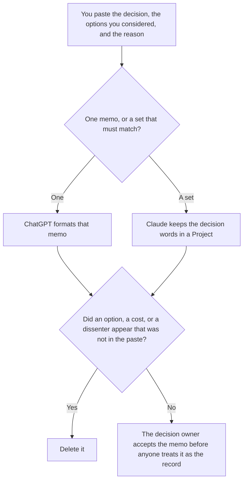

**Use ChatGPT when you are formatting one decision memo from a decision, options, and a reason a person already wrote. Use Claude when several memos must use the same words for the same decision, and those words live in a Project.** The model may order sections. It may not pick the decision, add an option, or invent a dissenter. A procedure for later, which is a different page, is [ChatGPT vs Claude for runbooks](/blog/chatgpt-vs-claude-for-runbooks-2026/). The timeline of something that already broke is [Claude vs ChatGPT for incident timelines](/blog/claude-vs-chatgpt-for-incident-timelines-2026/).

ChatGPT's Plus and Business prices are from learn.chatgpt.com/docs/pricing on October 24, 2026, with the annual Business dollar recorded the same day in the Team pricing article. Claude's prices are from claude.com/pricing that day. Notion and Cursor prices are from directory pages checked October 16, 2026. Published October 24, 2026. We did not score memos.

## Which memo is in front of you

| The page | Start here | First paid step | The limit |
|---|---|---|---|
| One decision, from a paste | [ChatGPT](/tools/chatgpt/) | Plus is $20 a month | No option that was not in the paste |
| A set of memos that must share words | [Claude](/tools/claude/) | Pro is $17 a month billed annually, $200 up front, or $20 monthly | The Project holds your words. It does not make the decision |
| The page leadership will reopen | [Notion AI](/tools/notion-ai/) | Business is $20 a seat a month | Plus at $10 is not the full AI tier |
| A number you want checked against a sheet in the repo | [Cursor](/tools/cursor/) | Plus is $8 a month, or $80 a year | You review the diff. The memo does not merge it |

A memo that "recommends" a path you did not choose is a different document. Label it Draft, not accepted, and do not file it as the decision. If the reason is missing, the memo says Reason not recorded.

ChatGPT Go is $8 a month on the October 24 plan page. Plus is the seat for a saved memo. Business is $25 a user a month billed monthly, for two or more users, on that page. The annual Business figure of $20 a user a month is the one recorded the same day in [ChatGPT Team pricing explained](/blog/chatgpt-team-pricing-explained-2026/). The review is [ChatGPT review](/blog/chatgpt-review-2026/).

Claude Free can format a short paste. Pro is the seat with Projects. Team standard seats are $20 a seat a month billed annually, or $25 monthly, for 2 to 150 people, as recorded the same day in [Claude Team pricing explained](/blog/claude-team-pricing-explained-2026/). A memo set does not require Max. The review is [Claude review](/blog/claude-review-2026/).

## What the memo is allowed to contain

The decision you wrote, the options you listed, the reason you gave, and the date. If a cost was not in the paste, the memo says Cost not in the source. It does not estimate one. The runbook that follows a decision is a separate page, written from steps a person has run.

**ChatGPT Plus** is the one-memo path. Paste the decision in the words you want repeated. A version that adds "risks to consider" you did not paste is the version you delete.

**Claude Pro** is the set. Put the approved verbs at the top: decided, deferred, rejected. When a word changes, change it once, then read every memo that used it.

**Notion Business** is where the accepted memo lives if that is the wiki. Link the date the owner accepted it.

**Cursor Plus** is how you check a figure the memo quotes, against a file, as a diff you read.

A prompt that holds the line:

"Format this decision memo from the decision, the options, and the reason I pasted. If the decision line is missing, write Decision not recorded. Do not add an option. Do not recommend a different path."

## What not to delegate

Do not ask which option is best. Do not paste a private personnel note so the memo "has color." Do not publish because the headings look complete. The decision owner accepts it. A formatted page is not a decision.

## FAQ

### Which one writes a safer memo?

We did not measure that. ChatGPT fits one memo from a paste. Claude fits a set that must share words. The memo is safer when every option traces to a line a person wrote, and missing costs say so.

### Do I need both?

You need the seat that matches the size of the set. Running both and merging the paragraphs is how a decision changes in one memo and stays in its neighbor. File one accepted version.

### How is this different from a runbook?

The memo records what was decided. The runbook records the steps to carry it out. A runbook can cite the memo. It does not replace the decision line. If the steps are not yet written, this page is still the memo.

### Who may call the memo final?

The decision owner, after the decision line matches what they are willing to defend. A shared link is not acceptance. A confident recommendation is not a decision you made.

## Last verified

October 24, 2026 for ChatGPT's plan page and for Claude. The Business annual dollar and the Team seat dollars are from the same-day articles linked above. October 16, 2026 for Notion and Cursor. Published October 24, 2026.

**Sources:** [ChatGPT and Codex pricing](https://learn.chatgpt.com/docs/pricing), [Claude pricing](https://claude.com/pricing), [Notion pricing](https://www.notion.com/pricing), [Cursor pricing](https://cursor.com/help/account-and-billing/pricing).

*Published by Andrew for [AI Tools Optimizer](https://aitoolsoptimizer.com).*

[ChatGPT](/tools/chatgpt/) is in the [chatbots and assistants directory](/tools/category/chatbots-assistants/). Directory pages may use affiliate links. A purchase through them may earn us a commission at no extra cost to you.
