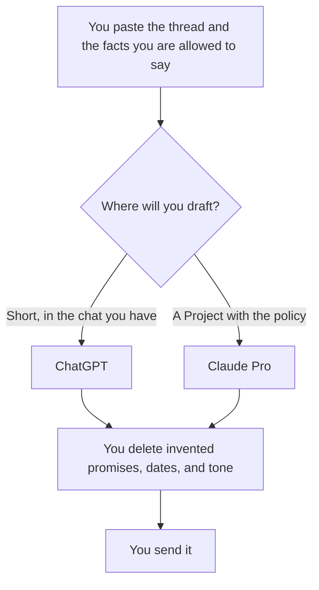

**Use ChatGPT when the email is one of many small drafts in the chat you already pay for. Use Claude when the email has to follow a long thread, a Project, or a document you want kept next to the prompt.** Both can draft. Neither should send. The person who hits send is the product. The method, once you have picked a seat, is [how to write customer emails with AI](/blog/how-to-write-customer-emails-with-ai-2026/).

The general three-way is [ChatGPT vs Gemini vs Claude](/blog/chatgpt-vs-gemini-vs-claude-2026/). If the inbox is Gmail and you want the assistant inside it, that is a Google seat: [Gemini vs ChatGPT for Google Workspace](/blog/gemini-vs-chatgpt-for-google-workspace-2026/).

Prices are US list prices excluding tax from directory pages checked October 16, 2026. Published October 24, 2026. We did not score which model writes a warmer email.

## Which seat matches the mail

| The mail | Start here | First paid step | Leave this for later |
|---|---|---|---|
| Short replies, a few a day | [ChatGPT](/tools/chatgpt/) Go or Plus | Go is $8. Plus is $20 | Claude Max |
| A thread plus a policy doc you will reuse | [Claude](/tools/claude/) Pro, in a Project | $20 a month, or $17 billed annually ($200 up front) | A second chat subscription "for tone" |
| The sentence, after the facts are right | [Grammarly](/tools/grammarly/) | Free for grammar. Pro is $12 a member a month billed annually | Asking it what the refund policy is |
| You live in Gmail and Docs | [Gemini](/tools/gemini/) | Free with a Google account. Google AI Pro is $19.99 | Plus, if you will not leave Google |
| The draft should become a page the team reuses | [Notion AI](/tools/notion-ai/) Business | $20 a seat | Plus at $10, which is not the full AI tier |

## What you are paying for

**ChatGPT.** Free includes text chat. Go is $8 and adds usage. It may include ads. Plus is $20 and adds projects, custom GPTs, and higher limits. Pro starts at $100. Business is $20 a user a month billed annually, or $25 monthly, for two or more users, and does not train on business data by default. For email, Plus is the seat if you want projects. Go is enough if the drafts are short and you can tolerate the limits. Do not buy Pro to answer email. The ladder is [ChatGPT Go vs Plus vs Pro](/blog/chatgpt-go-vs-plus-vs-pro-2026/).

**Claude.** Free includes chat, files, and Projects with limits. Pro is the seat most people mean: more usage, Projects, and connectors the directory lists, including Microsoft 365. Max at $100 or $200 is for people who already hit Pro, not for a better inbox voice. The directory records Team as a per-seat plan and does not print a Team price. The review is [Claude review](/blog/claude-review-2026/). The heavy-use split is [Claude Pro vs Max](/blog/claude-pro-vs-max-2026/).

A Project is the right container when every reply should see the same return policy. Put the policy in the Project. Do not hope the model remembers it from a chat last month. That distinction is [Claude Projects vs ChatGPT Projects](/blog/claude-projects-vs-chatgpt-projects-2026/). Saved chat notes are [what AI memory is](/blog/what-is-ai-memory-2026/). A policy file beats memory.

**The pass after the draft.** Grammarly will not know whether you are allowed to offer a discount. Run it after you have deleted every promise that was not in your notes. The card is [Grammarly pricing explained](/blog/grammarly-pricing-explained-2026/). The editing comparison is [Grammarly vs ChatGPT for editing](/blog/grammarly-vs-chatgpt-for-editing-2026/).

A prompt that holds the line:

"Here is the thread and my notes. Draft a reply in under 150 words. Use only facts from the notes. If a detail is missing, write a question under Unclear. Do not offer a refund, a date, or a discount unless the notes include it."

One reply you already sent, with the names removed, is [what few-shot prompting is](/blog/what-is-few-shot-prompting-2026/). The tone card, if you need one, is [how to create a brand voice with AI](/blog/how-to-create-a-brand-voice-with-ai-2026/).

## How to choose

If you already pay for one of them, draft in that one for a week. Add the second only when a specific mail fails: the long attachment, the Project, the Gmail integration. Paying $20 and $20 to compare adjectives is a hobby. The fact check is [how to fact-check AI writing](/blog/how-to-fact-check-ai-writing-2026/).

Customer mail and internal mail should be different prompts. The internal weekly note is [how to write a status update with AI](/blog/how-to-write-a-status-update-with-ai-2026/). Do not send the internal version to a customer.

## FAQ

### Which one writes better email?

This page did not measure that. The notes you paste, and whether you delete invented promises, matter more than the logo. Run one real thread in the free tier of each if you pay for neither.

### Can I connect the model to my inbox and let it send?

Do not. A draft in a box you review is the job. An auto-send on customer mail will eventually promise something you cannot do. The approval is [what human-in-the-loop AI is](/blog/what-is-human-in-the-loop-ai-2026/).

### Is Google AI Pro a third option?

Yes, when the work is inside Gmail. At $19.99 it is close to Plus and Claude Pro on the sticker, and it is a different bundle. Read the Workspace comparison before you add it as a third subscription.

### What about a team of five?

Five ChatGPT Plus seats are 5 × $20 = $100 a month, with no shared admin. ChatGPT Business annual is also $20 a user, with admin controls, and it requires two or more users. Claude Team has no dollar on the directory card. Price the admin features you need, then the drafts.

## Last verified

October 16, 2026 for ChatGPT, Claude, Grammarly, Gemini, and Notion prices named above. Published October 24, 2026.

**Sources:** [ChatGPT pricing](https://chatgpt.com/pricing), [Claude pricing](https://claude.com/pricing), [Grammarly Pro cost](https://support.grammarly.com/hc/en-us/articles/115000090011-How-much-does-Grammarly-Pro-cost).

*Published by Andrew for [AI Tools Optimizer](https://aitoolsoptimizer.com).*

[Claude](/tools/claude/) is in the [chatbots and assistants directory](/tools/category/chatbots-assistants/). Directory pages may use affiliate links. A purchase through them may earn us a commission at no extra cost to you.
