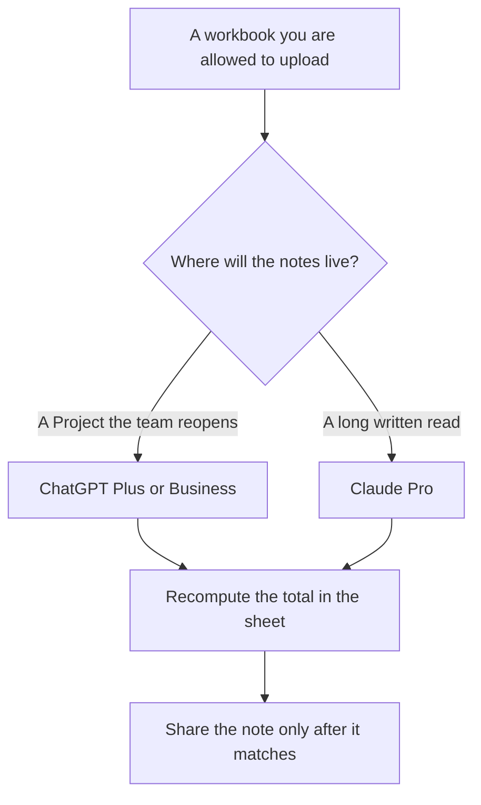

**Use ChatGPT Plus at $20 a month or Claude Pro at $20 a month ($17 billed annually) to ask questions of a workbook you upload, then recompute any total in the sheet before you share it.** Pick ChatGPT if the file already lives in a Project your team reuses. Pick Claude if you want the long written read of the same file and you will paste the columns you care about. If the formula has to stay inside Excel, the Microsoft seat is the other product, and it is not a winner of this pair.

The coding pair is [ChatGPT vs Claude for coding](/blog/chatgpt-vs-claude-for-coding-2026/). The writing pair is [ChatGPT vs Claude for writing](/blog/chatgpt-vs-claude-for-writing-2026/). A number the model stated without the cell is [what an AI hallucination is](/blog/what-is-ai-hallucination-2026/). The analyst shelf is [best AI tools for data analysts](/blog/best-ai-tools-for-data-analysts-2026/).

Prices are US list prices excluding tax from directory pages checked October 16, 2026. Published October 24, 2026. We did not score spreadsheet accuracy.

## Two chats, and the workbook that stays the record

| | [ChatGPT](/tools/chatgpt/) | [Claude](/tools/claude/) |
|---|---|---|
| Free | Limited tools. Fine for a public sample sheet | Files and code on the free plan, with free limits |
| The seat for a real workbook | Plus, $20 a month. Projects and higher upload limits on the card | Pro, $20 a month or $17 billed annually ($200 up front) |
| Heavier personal use | Pro at $100, $200, or $500 | Max at $100 or $200 |
| A company seat | Business, $20 a user a month billed annually for two or more users, or $25 monthly. No training on business data by default | Team is per seat for 2 to 150 people. No public seat dollar on the directory card |
| What you still do | Open the workbook and check the figure | Open the workbook and check the figure |
| A poor use | Letting the chat replace the formula | Letting the chat replace the formula |

Five people on ChatGPT Plus are 5 × $20 = $100 a month, with no shared admin. The same five on Business annual are also 5 × $20, with a two-user minimum and admin controls. Claude Pro annual for one analyst is $200 a year. A second analyst is another seat. Claude Team's dollar is not on the card, so a team budget should come from checkout.

## When the chat is the wrong surface

**The number has to be a formula in the file.** [Microsoft Copilot](/tools/microsoft-copilot/) is free with a signed-in Microsoft account, with limits. Microsoft 365 Personal is $9.99 a month. Premium is $19.99 a month. Copilot Business is listed from $18 a user a month paid yearly, and the directory marks that as promotional, originally $21. Those are the recorded lines for working inside Microsoft 365. Confirm the promo before you standardize. This pair of chats does not edit the cell for you.

**The sheet should become a notebook the team reruns.** [Hex](/tools/hex/) Professional is $36 an editor a month. Community is free, with a Hex agent trial and small compute. Use Hex when the analysis has to run again next month on a query, not when you have one workbook and one question.

**The sentence around a number you already checked.** [Grammarly](/tools/grammarly/) Pro is $12 a member a month billed annually. It will not audit a SUM.

**A confidential file.** Prefer ChatGPT Business, or a Claude plan your admin has already approved, over a personal free account. Remove columns the question does not need before you upload. The record habit is [what a system of record for AI is](/blog/what-is-a-system-of-record-for-ai-2026/).

A prompt that holds the line:

"Using only the attached workbook, list the columns you used. Compute the total I asked for and show the filter. If a column or a date range is missing, say Missing. Do not invent rows, percentages, or a cause."

The person who signs the note is [what human-in-the-loop AI is](/blog/what-is-human-in-the-loop-ai-2026/). The check is [how to fact-check AI writing](/blog/how-to-fact-check-ai-writing-2026/).

## FAQ

### Which one is more accurate in Excel?

We did not measure that. Accuracy here is whether the chat's figure matches a formula you can see. Run the same sheet through the free or trial path once, then keep the seat whose notes your team will actually recheck.

### Can I paste a CSV instead of uploading?

Yes, if the extract is the question. Name the filter you applied. A pasted fragment that drops rows will be analyzed as if it were complete.

### Is Plus required?

Free tiers can try a small file. A recurring finance workbook with customer data belongs on a plan with the admin and training defaults you need. Plus and Pro are the individual paid steps. Business is the ChatGPT admin step.

### Should the model write the formula?

It can propose one. You paste it into the sheet and confirm the result. A formula you did not run is a rumor with an equals sign.

## Last verified

October 16, 2026 for ChatGPT, Claude, Microsoft Copilot, Hex, and Grammarly. The Copilot Business yearly figure is the promotional price recorded on that card. Published October 24, 2026.

**Sources:** [ChatGPT pricing](https://chatgpt.com/pricing/), [Claude pricing](https://claude.com/pricing), [Microsoft Copilot for individuals](https://www.microsoft.com/en-us/microsoft-copilot/for-individuals).

*Published by Andrew for [AI Tools Optimizer](https://aitoolsoptimizer.com).*

[ChatGPT](/tools/chatgpt/) is in the [chatbots and assistants directory](/tools/category/chatbots-assistants/). Directory pages may use affiliate links. A purchase through them may earn us a commission at no extra cost to you.
