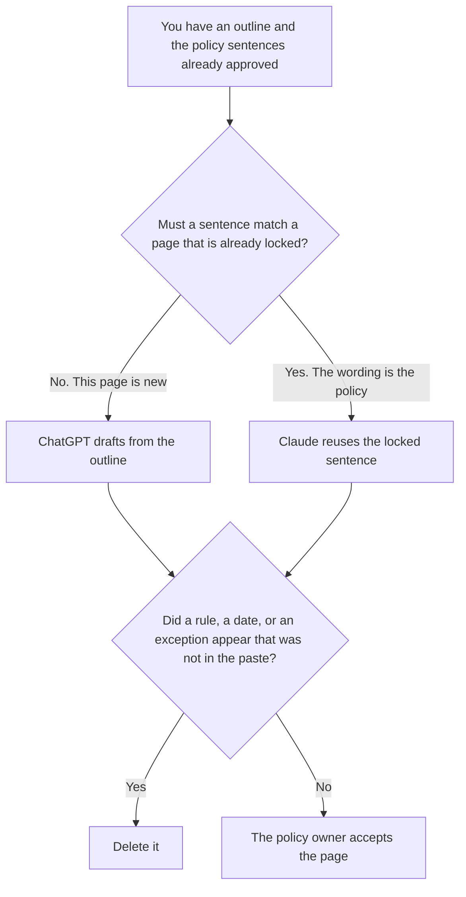

**Use ChatGPT when you are drafting one new handbook page from an outline and a policy sentence a person already approved. Use Claude when that page must reuse sentences already locked on other handbook pages, and a drift in wording would be a policy change.** The model may order the sections. It may not invent a rule, a deadline, or an exception.

A one-sentence update across Slack, email, and the intranet is [Claude vs ChatGPT for internal announcements](/blog/claude-vs-chatgpt-for-internal-announcements-2026/). The rule that a claim ships only with a source you can open is [what AI grounding citation-required is](/blog/what-is-ai-grounding-citation-required-2026/). The page that holds the handbook is a Notion question, covered below.

ChatGPT's Plus price is the October 24, 2026 plan-page figure recorded in [ChatGPT pricing explained](/blog/chatgpt-pricing-explained-2026/). Claude's prices are the October 24 read of claude.com/pricing recorded in [Claude pricing explained](/blog/claude-pricing-explained-2026/). Notion and Grammarly prices are from directory pages checked October 16, 2026. A live fetch of Grammarly's plans URL returned HTTP 401 on October 24. Published October 24, 2026. We did not score handbooks.

## Which page you are writing

| The job | Start here | First paid step | The limit |
|---|---|---|---|
| One new page from an outline you already wrote | [ChatGPT](/tools/chatgpt/) | Plus is $20 a month | No rule that was not in the outline |
| A page that must match sentences locked elsewhere | [Claude](/tools/claude/) | Pro is $17 a month billed annually, or $20 monthly | A paraphrase of a locked sentence is a new policy |
| The page employees will open | [Notion AI](/tools/notion-ai/) | Business is $20 a seat a month | Plus at $10 is not the full AI tier |
| The sentence that leaves the company, if any | [Grammarly](/tools/grammarly/) | Pro is $12 a member a month billed annually, or $30 monthly | Tone is not a rule change |

ChatGPT Plus is the right seat when the outline is the whole source and you will read one page. Claude Pro is the right seat when the handbook already has a sentence for vacation, expenses, or access, and this page is only allowed to point at it. A cleaner paraphrase is a different rule. If the locked sentence is missing from the paste, the line says Sentence not pasted. It does not get rewritten from memory.

The announcement post is for a fact that must stay identical in three channels this week. A handbook page is the durable version. Do not paste the announcement into the handbook and call it the policy. The policy owner accepts the page. The announcement, if you send one, comes after that.

## What the page is allowed to say

The outline's headings, the policy sentences you pasted, and the owner you named. An exception the model thinks is "reasonable" stays out. A deadline that was not in the outline stays out. If a section has no approved sentence, the section says Not yet approved.

**ChatGPT Plus** is the single-page draft. The review path for the bill is [ChatGPT pricing explained](/blog/chatgpt-pricing-explained-2026/).

**Claude Pro** holds the locked sentences in a Project so the next page cannot drift. The review is [Claude review](/blog/claude-review-2026/).

**Notion Business** is where the accepted page lives, with the owner and the date. The invoice is [Notion AI pricing explained](/blog/notion-ai-pricing-explained-2026/).

**Grammarly Pro** is the external sentence, after the rule is stable. The October 16 card is the price above. The invoice is [Grammarly pricing explained](/blog/grammarly-pricing-explained-2026/).

A prompt that holds the line:

"Draft the handbook page from the outline and the locked sentences I pasted. If a section has no approved sentence, write Not yet approved. Do not add a rule. Do not paraphrase a locked sentence."

## What not to delegate

Do not ask which policy a company "usually" has. Do not merge two locked sentences into a friendlier one. Do not publish because the headings look complete. The policy owner accepts the page.

## FAQ

### How is this different from an internal announcement?

The announcement is one fact, sent in several channels, often the same week. The handbook page is the durable rule employees open later. A sentence can appear in both only after the owner accepts it as policy. The announcement does not become the handbook by being formatted with headings.

### How is this different from an OKR page?

An OKR page is a target for a quarter. A handbook page is a rule that outlives the quarter. The OKR comparison is [ChatGPT vs Claude for OKRs](/blog/chatgpt-vs-claude-for-okrs-2026/). Do not put a quarterly target into the handbook unless the policy owner pasted it as a rule.

### When is Notion the place to draft?

When the page already lives there and the work is linking the owner and the locked sentence. The draft of a brand-new page can start in ChatGPT or Claude. The accepted text still lands on the page employees open.

### Who may publish the page?

The policy owner named on the page. Not yet approved stays unpublished. A formatted handbook is not acceptance.

## Last verified

October 24, 2026 for ChatGPT's plan page and for Claude, via the posts cited above. October 16, 2026 for Notion and Grammarly. Published October 24, 2026. Grammarly's plans URL returned HTTP 401 on October 24.

**Sources:** [ChatGPT and Codex pricing](https://learn.chatgpt.com/docs/pricing), [Claude pricing](https://claude.com/pricing), [Notion pricing](https://www.notion.com/pricing), [Grammarly pricing](https://www.grammarly.com/plans).

*Published by Andrew for [AI Tools Optimizer](https://aitoolsoptimizer.com).*

[ChatGPT](/tools/chatgpt/) is in the [chatbots and assistants directory](/tools/category/chatbots-assistants/). Directory pages may use affiliate links. A purchase through them may earn us a commission at no extra cost to you.
