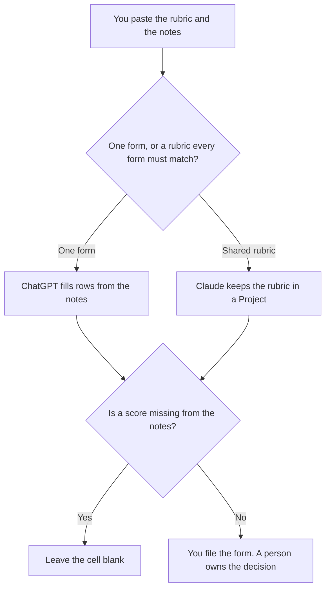

**Use Claude when the scorecard has to follow a rubric that already lives in a Project. Use ChatGPT when you are filling one candidate's form from notes you paste.** The model may format the rows. It may not invent a score, a competency, or a reason the notes do not contain. A blank cell stays blank. This page is not hiring advice, and it does not rank candidates.

The short bullets on a resume, which are a different document, are [ChatGPT vs Gemini for resume bullets](/blog/chatgpt-vs-gemini-for-resume-bullets-2026/). The place the accepted form lives is [what a system of record for AI is](/blog/what-is-a-system-of-record-for-ai-2026/).

Claude's prices are from claude.com/pricing on October 24, 2026. ChatGPT, Notion, and Grammarly prices are from directory pages checked October 16, 2026. chatgpt.com/pricing returned HTTP 403 on October 24. Published October 24, 2026. We did not score interview writeups.

## Which seat matches the form

| The form in front of you | Start here | First paid step | The limit |
|---|---|---|---|
| Every interviewer uses the same rubric | [Claude](/tools/claude/) | Pro is $17 a month billed annually, $200 up front, or $20 monthly | The Project holds your rubric. It does not score the candidate |
| One form, from notes you paste | [ChatGPT](/tools/chatgpt/) | Plus is $20 a month | No score that was not in the notes |
| The page the hiring packet will cite | [Notion AI](/tools/notion-ai/) | Business is $20 a seat a month | Plus at $10 is not the full AI tier |
| A last pass on the words | [Grammarly](/tools/grammarly/) | Pro is $12 a member a month billed annually, or $30 monthly | It may not add a judgment while it fixes grammar |

Claude Free can read a short paste. Pro is the seat with Projects, on the October 24 page. Max starts at $100 a month on that page if you already live in Claude all day. A scorecard does not require Max. The review is [Claude review](/blog/claude-review-2026/).

ChatGPT Go is $8 a month and may include ads, on the October 16 card. Plus is the seat for a saved outline of the rubric. The review is [ChatGPT review](/blog/chatgpt-review-2026/).

## What the scorecard is allowed to say

The competency names from the rubric, the evidence sentence from the notes, and the score only if the interviewer already chose it. If the notes say "strong on debugging" and the rubric wants a 1 to 4, the draft says Score not in notes. A model that picks 4 because the adjective was "strong" has written a score the interviewer did not.

**Claude Pro** is the shared-rubric path. Put the scale at the top. Ask for one row per competency. When the rubric changes, change it once, then read the forms that cited the old scale.

**ChatGPT Plus** is the one-form path. Paste the notes and the blank rows. A second version that adds "culture fit" you did not define is the version you delete.

**Notion Business** is where the accepted form lives if that is the packet. The chat is not the system of record.

**Grammarly Pro** is the last pass. If a rewrite upgrades "partial example" to "demonstrated expertise," put the original phrase back. The invoice is [Grammarly pricing explained](/blog/grammarly-pricing-explained-2026/).

A prompt that holds the line:

"Fill this scorecard from the rubric and the notes I pasted. If a score is not in the notes, write Score not in notes. Do not add a competency. Do not recommend a hire."

## What not to delegate

Do not ask which candidate is better. Do not paste a private assessment from a different process so the example "sounds real." Do not let a grammar pass change the score. The same restraint on an OKR number is [Gemini vs ChatGPT for OKR drafts](/blog/gemini-vs-chatgpt-for-okr-drafts-2026/).

## FAQ

### Which one writes a fairer scorecard?

We did not measure that. Claude fits a rubric that many forms must share. ChatGPT fits one form from notes you paste. The form is usable when every score traces to a note a person wrote.

### Do I need both?

You need the seat that matches the job. Running both and merging the rows is how a competency appears on one form and not the other. File one accepted form.

### Can the model suggest interview questions?

Only from the rubric you pasted, and only as questions, not as answers. A question that introduces a new competency does not belong on this form. Leave it out.

### Who may submit the score?

The interviewer named on the form. A finished paragraph is not a signature. A blank score is an incomplete form, which is better than a score nobody chose.

## Last verified

October 24, 2026 for Claude. October 16, 2026 for ChatGPT, Notion, and Grammarly. Published October 24, 2026.

**Sources:** [Claude pricing](https://claude.com/pricing), [ChatGPT pricing](https://chatgpt.com/pricing/), [Notion pricing](https://www.notion.com/pricing), [Grammarly pricing](https://www.grammarly.com/plans).

*Published by Andrew for [AI Tools Optimizer](https://aitoolsoptimizer.com).*

[Claude](/tools/claude/) is in the [chatbots and assistants directory](/tools/category/chatbots-assistants/). Directory pages may use affiliate links. A purchase through them may earn us a commission at no extra cost to you.
