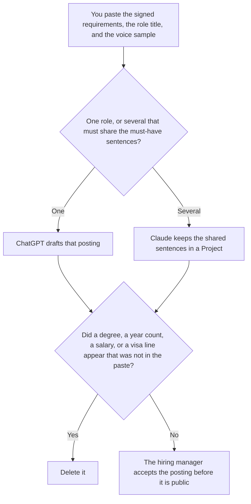

**Use ChatGPT when you are drafting one job description from a requirements list a hiring manager already signed. Use Claude when several roles must share the same must-have sentences and differ only in the lines you wrote for each role.** The model may order the list and match a voice you pasted. It may not add a degree, a year count, a salary, or a visa line. The writing workflow is [how to write a job description with AI](/blog/how-to-write-a-job-description-with-ai-2026/). The recruiter's shelf is [best AI tools for recruiters](/blog/best-ai-tools-for-recruiters-2026/).

A stakeholder note about the hire, after the role is real, is [ChatGPT vs Claude for stakeholder updates](/blog/chatgpt-vs-claude-for-stakeholder-updates-2026/). That note is not the posting.

ChatGPT's Plus price is the October 24, 2026 plan-page figure recorded in that stakeholder article. Claude's prices are the same-day read of claude.com/pricing recorded in [Claude pricing explained](/blog/claude-pricing-explained-2026/). Notion and Grammarly prices are from directory pages checked October 16, 2026. Published October 24, 2026. We did not score postings or predict who will apply.

## Which posting is in front of you

| The page | Start here | First paid step | The limit |
|---|---|---|---|
| One role, from a signed list | [ChatGPT](/tools/chatgpt/) | Plus is $20 a month | No requirement that was not on the list |
| Several roles that must share must-have sentences | [Claude](/tools/claude/) | Pro is $17 a month billed annually, $200 up front, or $20 monthly | The Project holds the shared lines. It does not retell them |
| The file the next recruiter will copy | [Notion AI](/tools/notion-ai/) | Business is $20 a seat a month | Plus at $10 is not the full AI tier |
| A clarity pass that must not touch the requirements | [Grammarly](/tools/grammarly/) | Pro is $12 a member a month billed annually, or $30 monthly | Compare the must-have lines before and after |

A posting that says "preferred" on a line the manager marked required has changed the job. If the salary band is missing, the draft says Salary not set. It does not propose a number. Put proposals in a note labeled Not in the posting.

ChatGPT Go is $8 a month on the October 24 plan page. Plus is the seat for a saved posting. The review is [ChatGPT review](/blog/chatgpt-review-2026/).

Claude Free can format a short list. Pro is the seat with Projects. Team standard seats are $20 a seat a month billed annually, or $25 monthly, when the posting is a company record, as recorded in [Claude Team pricing explained](/blog/claude-team-pricing-explained-2026/). The review is [Claude review](/blog/claude-review-2026/).

## What the posting is allowed to contain

The title you wrote, the must-haves you listed, the nice-to-haves you listed, and the voice sample you pasted. A benefit that was not in the paste stays out. A location that was not in the paste says Location not in the source. The recruiter can link the posting later. They should not be the person who invents the level.

**ChatGPT Plus** is the one-role path. Paste the requirements in the words you want repeated. A version that adds "5+ years" is the version you delete.

**Claude Pro** is the family. The shared must-have sentences are written once. Each role file changes only the lines you supplied for that role. If two files disagree on a shared sentence, stop and fix the Project. Do not publish either.

**Notion Business** stores the accepted text, the manager, and the date. The invoice is [Notion AI pricing explained](/blog/notion-ai-pricing-explained-2026/).

**Grammarly Pro** is the pass after the requirements are stable. Reject a suggestion that softens a must-have into a preference. The invoice is [Grammarly pricing explained](/blog/grammarly-pricing-explained-2026/).

A prompt that holds the line:

"Draft the job description from the title, the requirements, and the voice sample I pasted. If salary is missing, write Salary not set. Do not add a degree. Do not add a year count. Do not add a visa line."

## What not to delegate

Do not ask which requirements will "attract better candidates." Do not paste resumes so the posting matches the last person who held the job. Do not publish it because the intro sounds friendly. The hiring manager accepts it. A formatted page is not a signed list.

## FAQ

### How is this different from the job-description how-to?

That page is the workflow: requirements first, then a draft. This page is which seat to use when the draft is one role or a family of roles. Both pages refuse an invented salary. Use the how-to for the fields. Use this page for the tool.

### How is this different from a stakeholder update?

The update tells a named audience about a decision that already happened. The job description is a public list of requirements. An update can say the role is open. It does not replace the posting, and it does not add a requirement the posting does not have.

### Which one writes a fairer posting?

We did not measure that. ChatGPT fits one signed list. Claude fits several roles that must share sentences. The posting is safer when every requirement matches the manager's list, and a missing salary says so.

### Who may publish it?

The hiring manager, or the person that manager names. A recruiter can paste it into the applicant system after that. Two roles do not get two different versions of a sentence you marked shared.

## Last verified

October 24, 2026 for ChatGPT's plan page and for Claude, via the posts cited above. October 16, 2026 for Notion and Grammarly. Published October 24, 2026.

**Sources:** [ChatGPT and Codex pricing](https://learn.chatgpt.com/docs/pricing), [Claude pricing](https://claude.com/pricing), [Notion pricing](https://www.notion.com/pricing), [Grammarly pricing](https://www.grammarly.com/plans).

*Published by Andrew for [AI Tools Optimizer](https://aitoolsoptimizer.com).*

[ChatGPT](/tools/chatgpt/) is in the [chatbots and assistants directory](/tools/category/chatbots-assistants/). Directory pages may use affiliate links. A purchase through them may earn us a commission at no extra cost to you.
