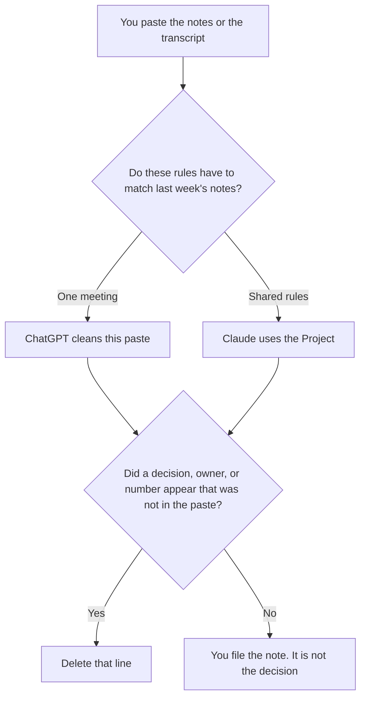

**Use ChatGPT when you are cleaning one transcript or one rough note from a paste. Use Claude when the cleanup rules, what counts as a decision, what stays a question, have to match every meeting in a Project.** The model may fix order, names you already spelled, and headings. It may not add a decision, an owner, or a number nobody said. The action rows after the note is clean are [Notion AI vs ChatGPT for meeting actions](/blog/notion-ai-vs-chatgpt-for-meeting-actions-2026/). The raw notes, before this cleanup, are [Notion AI vs ChatGPT for meeting notes](/blog/notion-ai-vs-chatgpt-for-meeting-notes-2026/).

Claude's prices are from claude.com/pricing on October 24, 2026. ChatGPT Plus is $20 a month on the October 24 Codex plan page. Notion and Otter prices are from directory pages checked October 16, 2026. Published October 24, 2026. We did not score transcripts.

## Which cleanup you are doing

| The notes in front of you | Start here | First paid step | The limit |
|---|---|---|---|
| One meeting, one paste | [ChatGPT](/tools/chatgpt/) | Plus is $20 a month | No decision that was not in the paste |
| The same rules on every meeting | [Claude](/tools/claude/) | Pro is $17 a month billed annually, $200 up front, or $20 monthly | The Project holds the rules. It does not attend the meeting |
| The page people will reread | [Notion AI](/tools/notion-ai/) | Business is $20 a seat a month | Plus at $10 is not the full AI tier |
| The recording, if you still need the words | [Otter](/tools/otter-ai/) | Pro is $8.33 a user a month billed annually, or $16.99 monthly | Cleanup does not replace the recording policy |

A cleanup that "makes the meeting sound decisive" has edited the meeting. If the notes say "we might revisit pricing," the clean note says that. It does not say the team decided to change the price.

## What each seat keeps

**ChatGPT Plus** is the one-paste path. Go is $8 a month on the October 24 plan page and may include ads, on the October 16 directory card. Plus is the seat when the notes are the work. The review is [ChatGPT review](/blog/chatgpt-review-2026/).

**Claude Pro** is the shared-rules path. Put the definitions at the top: a decision is a sentence someone committed to, a question stays a question, an owner appears only if a name was said. The review is [Claude review](/blog/claude-review-2026/).

**Notion Business** is where the accepted note lives if that is the wiki. The chat is not the system of record. The invoice is [Notion AI pricing explained](/blog/notion-ai-pricing-explained-2026/).

**Otter Pro** is a recorder, not a cleanup engine. Business is $19.99 a user a month billed annually on that card, with a 4-hour conversation limit, if the meeting was long. The invoice is [Otter AI pricing explained](/blog/otter-ai-pricing-explained-2026/). The long-meeting choice against another recorder is [Otter vs Fireflies for all-hands](/blog/otter-vs-fireflies-for-all-hands-2026/).

A prompt that holds the line:

"Clean these notes. Keep only statements from the paste. If a line is vague, label it Not a decision. Do not add an owner, a date, or a number. Do not recommend what the team should do next."

## What not to delegate

Do not paste a meeting the attendees were not told would be processed in a tool your company has not approved. Do not merge two meetings so the note "has more context." Do not let a grammar pass upgrade "we discussed" into "we committed."

## FAQ

### Which one writes better notes?

We did not measure that. ChatGPT fits one paste. Claude fits rules that have to survive more than one meeting. The note is usable when every decision traces to a line someone said.

### Do I need a recorder and a chat tool?

You need the source, which might be your own rough notes. A recorder is for when you want the words. The cleanup still may not invent a decision the words did not contain.

### What about action items?

List one only when the paste already has the task and the owner. Otherwise write Owner missing. The action page is a second document, on the meeting-actions article. This cleanup does not assign work.

### Who may share the clean note?

The meeting owner, under the policy you already have. A tidy paragraph is easier to forward than a transcript, which is why the tidy paragraph has to stay faithful.

## Last verified

October 24, 2026 for Claude and for ChatGPT Plus and Go. October 16, 2026 for Notion and Otter, including the Go ads note on the directory card. Published October 24, 2026.

**Sources:** [ChatGPT and Codex pricing](https://learn.chatgpt.com/docs/pricing), [Claude pricing](https://claude.com/pricing), [Notion pricing](https://www.notion.com/pricing), [Otter pricing](https://otter.ai/pricing).

*Published by Andrew for [AI Tools Optimizer](https://aitoolsoptimizer.com).*

[Claude](/tools/claude/) is in the [chatbots and assistants directory](/tools/category/chatbots-assistants/). Directory pages may use affiliate links. A purchase through them may earn us a commission at no extra cost to you.
