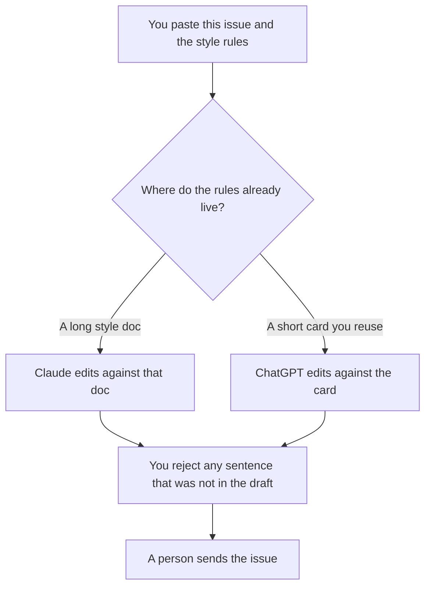

**Use Claude when the house style is a long document the edit must not contradict. Use ChatGPT when you keep a project that turns each issue's draft into the same edit pass.** A newsletter edit is a pass over copy a person already wrote: cuts, tone, and a check that every claim was in the draft. It is not a new issue. The workflow that builds an issue from a brief is [how to create a newsletter with AI](/blog/how-to-create-a-newsletter-with-ai-2026/). The card the edit should obey is [how to create a style guide with AI](/blog/how-to-create-a-style-guide-with-ai-2026/).

A sentence the draft did not contain is [what an AI hallucination is](/blog/what-is-ai-hallucination-2026/). The line-level checker that sits in the browser is a different bill from either chat.

Prices are US list prices excluding tax from directory pages checked October 16, 2026. Published October 24, 2026. We did not measure open rates, click rates, or which model "writes better."

## Which seat matches the draft

| The draft you actually have | Start here | What you still do |
|---|---|---|
| One paste, one issue | [ChatGPT](/tools/chatgpt/) Free or [Claude](/tools/claude/) Free | You accept or reject each change |
| The same edit rules every week | ChatGPT Plus at $20 a month | Swap the draft. Keep the rules |
| A long style doc the edit must quote | Claude Pro at $20 a month, or $17 billed annually | The Project holds the style doc. The edit adds no rule it does not contain |
| A line pass inside the inbox and the doc | [Grammarly](/tools/grammarly/) Pro at $12 a member a month billed annually, or $30 monthly | Grammarly does not own the issue. It flags the sentence |
| The archive lives in the workspace | [Notion AI](/tools/notion-ai/) Business at $20 a seat a month | The page is the record. The chat is not |

ChatGPT Pro starts at $100. Claude Max starts at $100. A weekly edit of a draft you already have does not need either. ChatGPT Business, at $20 a user a month billed annually with a two-user minimum, or $25 monthly, is the row when the list is the company's and a personal account is against policy. Go at $8 may include ads, on the card. A customer newsletter is a poor place for an ad you did not buy.

## What the edit may change

Cuts, order, and wording that preserve the claims in the draft. It may not add a statistic, a customer quote, a product promise, or a subject line that states a result you did not write. If a paragraph has no source in the draft, the edit marks it Missing or deletes it. Subject lines are claims. Treat them as claims.

**Claude Pro** is the paid path when the style guide is long enough to live in a Project and you do not want to paste it every week. The review is [Claude review](/blog/claude-review-2026/).

**ChatGPT Plus** is the paid path when the habit is a saved project and a paste of this week's draft. The review is [ChatGPT review](/blog/chatgpt-review-2026/).

**Grammarly Pro** is the paid path when the issue is already in the tool where you type and you want the sentence flagged in place. The annual price is the one to compare. Monthly at $30 is a different bill for the same Pro label. The invoice is [Grammarly pricing explained](/blog/grammarly-pricing-explained-2026/).

A prompt that holds the line:

"Edit this newsletter draft against the style rules I pasted. You may cut and reorder. You may not add a fact, a number, a quote, or a promise that is not in the draft. If a sentence breaks a rule, show the rule. Leave my claims intact."

## What not to delegate

Do not ask which subject line will win. Do not ask the model to fill a thin issue with "industry context." Do not ship an edit no person read. The send button is a person who owns the list. A cleaner paragraph that invents a feature is a worse issue than the draft you started with.

## FAQ

### Which one edits a newsletter better?

We did not measure that. Pick Claude when the style doc is long and should stay attached. Pick ChatGPT when the habit is a project and a weekly paste. The edit is only as good as the check against the draft.

### Can the model write the issue and then edit it?

That is two jobs. The creation workflow is the newsletter article. This page starts from a draft a person is willing to sign. An edit of the model's own draft is the model agreeing with itself.

### Where does Grammarly fit?

After the structural edit, on the sentences, in the app where the issue lives. It is not a substitute for the style doc. A grammar pass can still leave a false claim untouched, because the claim was spelled correctly.

### What if the draft has a number I cannot source?

The edit marks the number Missing. It does not replace it with a rounder number. A sourced number you computed stays, with the source line you already had. The fact-check pass, when the issue cites the outside world, is [how to fact-check AI writing](/blog/how-to-fact-check-ai-writing-2026/).

## Last verified

October 16, 2026 for ChatGPT, Claude, Grammarly, and Notion AI. Published October 24, 2026.

**Sources:** [ChatGPT pricing](https://chatgpt.com/pricing/), [Claude pricing](https://claude.com/pricing), [Grammarly pricing](https://www.grammarly.com/plans), [Notion pricing](https://www.notion.com/pricing).

*Published by Andrew for [AI Tools Optimizer](https://aitoolsoptimizer.com).*

[Claude](/tools/claude/) is in the [writing directory](/tools/category/writing/). Directory pages may use affiliate links. A purchase through them may earn us a commission at no extra cost to you.
