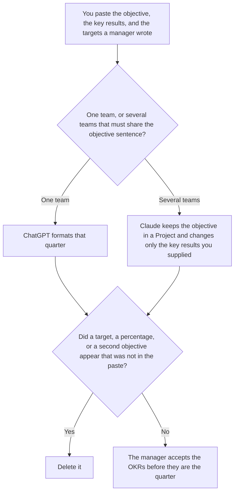

**Use ChatGPT when you are formatting one team's OKRs for a single quarter from targets a manager already wrote. Use Claude when the same objective sentence must appear, unchanged, in several team files and only the key results differ.** The model may order the lines. It may not invent a target, a percentage, or a second objective. The workflow is [how to write OKRs with AI](/blog/how-to-write-okrs-with-ai-2026/). The check-in, after the targets exist, is [Gemini vs ChatGPT for OKRs](/blog/gemini-vs-chatgpt-for-okrs-2026/).

The page that picks Claude for a long strategy memo and ChatGPT for a short reusable template is [Claude vs ChatGPT for OKRs](/blog/claude-vs-chatgpt-for-okrs-2026/). This page is a different cut: one team, or a sentence that must not drift across teams.

ChatGPT's Plus price is the October 24, 2026 plan-page figure recorded in [ChatGPT pricing explained](/blog/chatgpt-pricing-explained-2026/). Claude's prices are the same-day read of claude.com/pricing recorded in [Claude pricing explained](/blog/claude-pricing-explained-2026/). Notion and Grammarly prices are from directory pages checked October 16, 2026. Published October 24, 2026. We did not score which draft a leadership team prefers.

## Which quarter is in front of you

| The file | Start here | First paid step | The limit |
|---|---|---|---|
| One team, one quarter, targets already written | [ChatGPT](/tools/chatgpt/) | Plus is $20 a month | No target that was not in the paste |
| One objective sentence copied across teams | [Claude](/tools/claude/) | Pro is $17 a month billed annually, $200 up front, or $20 monthly | The Project holds the sentence. A team file may not reword it |
| The file the next quarter will copy | [Notion AI](/tools/notion-ai/) | Business is $20 a seat a month | Plus at $10 is not the full AI tier |
| A clarity pass that must not touch a number | [Grammarly](/tools/grammarly/) | Pro is $12 a member a month billed annually, or $30 monthly | Compare every key result before and after |

A key result that says "improve" without the number you pasted has dropped the target. If the target is missing, the line says Target not set. It does not propose one. Put proposals in a note labeled Not in the OKRs.

ChatGPT Go is $8 a month on the October 24 plan page. Plus is the seat for a saved quarter. The review is [ChatGPT review](/blog/chatgpt-review-2026/).

Claude Free can format a short list. Pro is the seat with Projects. Team standard seats are $20 a seat a month billed annually, or $25 monthly, when the OKRs are a company record, as recorded in [Claude Team pricing explained](/blog/claude-team-pricing-explained-2026/). The review is [Claude review](/blog/claude-review-2026/).

## What the OKR is allowed to contain

The objective you wrote, the key results you listed, and the targets you listed. A metric that was not in the paste stays out. A team that was not in the paste does not get a file. The manager can link the quarter later. They should not be the person who discovers a new goal in the draft.

**ChatGPT Plus** is the one-team path. Paste the targets in the words you want repeated. A version that adds "10%" is the version you delete.

**Claude Pro** is the shared sentence. The objective is written once. Each team file changes only the key results you supplied for that team. If two files disagree on the objective, stop and fix the Project. Do not publish either.

**Notion Business** stores the accepted text, the manager, and the quarter. The invoice is [Notion AI pricing explained](/blog/notion-ai-pricing-explained-2026/).

**Grammarly Pro** is the pass after the targets are stable. Reject a suggestion that softens a number into a direction. The invoice is [Grammarly pricing explained](/blog/grammarly-pricing-explained-2026/).

A prompt that holds the line:

"Draft the OKRs from the objective, the key results, and the targets I pasted. If a target is missing, write Target not set. Do not add a percentage. Do not add an objective. Do not reword a sentence I marked shared."

## What not to delegate

Do not ask which goals will "land better with leadership." Do not paste last quarter's results so the new targets match a trend. Do not publish the set because the objectives sound ambitious. The manager accepts it. A formatted page is not a target.

## FAQ

### How is this different from Claude vs ChatGPT for OKRs?

That page chooses Claude when the OKR has to follow a long strategy memo in a Project, and ChatGPT when the file is a short template you will reuse. This page chooses ChatGPT for one team's quarter and Claude when several teams must keep one objective sentence identical. Both pages refuse an invented number. Use that page for memo length. Use this page for shared wording across teams.

### How is this different from the OKR how-to?

That page is the workflow: you set the target, then the format. This page is which seat to use when the draft is one team or a shared objective. Both pages leave a missing target as Target not set. Use the how-to for the fields. Use this page for the tool.

### How is this different from an OKR review?

The Gemini-versus-ChatGPT review page is a check-in on targets that already exist. This page is the file you are still willing to edit before the quarter starts. A review may not change a target. A draft on this page may not invent one. Do not use a review prompt to write the first set.

### Who may accept the OKRs?

The manager who owns the quarter. A team file that rewords a shared objective is not accepted, even if the key results match. Two teams do not get two versions of a sentence you marked shared.

## Last verified

October 24, 2026 for ChatGPT's plan page and for Claude, via the posts cited above. October 16, 2026 for Notion and Grammarly. Published October 24, 2026.

**Sources:** [ChatGPT and Codex pricing](https://learn.chatgpt.com/docs/pricing), [Claude pricing](https://claude.com/pricing), [Notion pricing](https://www.notion.com/pricing), [Grammarly pricing](https://www.grammarly.com/plans).

*Published by Andrew for [AI Tools Optimizer](https://aitoolsoptimizer.com).*

[ChatGPT](/tools/chatgpt/) is in the [chatbots and assistants directory](/tools/category/chatbots-assistants/). Directory pages may use affiliate links. A purchase through them may earn us a commission at no extra cost to you.
