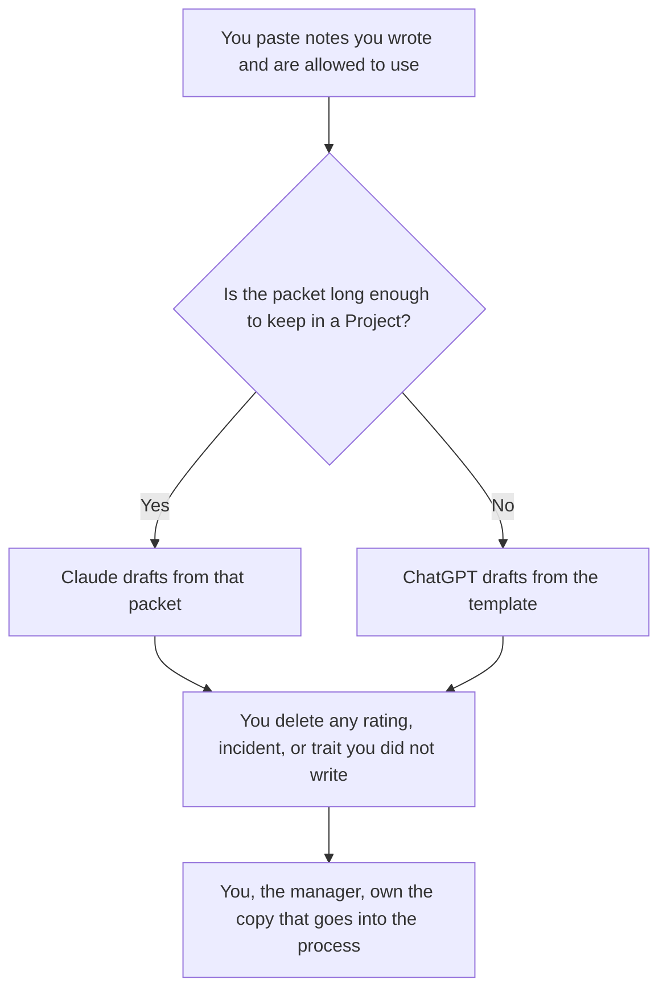

**Use Claude when the review has to follow a long packet of notes you keep in a Project. Use ChatGPT when the review is a short template you paste into each cycle.** This page is manager drafting only. It is not HR advice, legal advice, or a rating. The model may tighten sentences you already believe. It may not invent a rating, an incident, a motive, or a trait.

A meeting you are turning into notes is [how to summarize meetings with AI](/blog/how-to-summarize-meetings-with-ai-2026/). A number you cannot point at is [what an AI hallucination is](/blog/what-is-ai-hallucination-2026/). The person who accepts the draft is [what human-in-the-loop AI is](/blog/what-is-human-in-the-loop-ai-2026/).

Prices are US list prices excluding tax from directory pages checked October 16, 2026. Published October 24, 2026. We did not score which draft reads better. Nothing here tells you whom to promote, pay, or dismiss.

## Which seat matches the packet

| What you actually have | Start here | What you still do |
|---|---|---|
| A few bullets you wrote this week | [ChatGPT](/tools/chatgpt/) Free or [Claude](/tools/claude/) Free | You keep every fact. The model only formats |
| The same review template every cycle | ChatGPT Plus at $20 a month | Swap the notes. Do not reuse last cycle's examples |
| A long packet: goals, peer notes you are allowed to use, your own log | Claude Pro at $20 a month, or $17 billed annually | The Project holds the packet. The draft adds nothing that is not in it |
| The signed review lives in the wiki | [Notion AI](/tools/notion-ai/) Business at $20 a seat a month | The page is the record. The chat is the draft |
| The 1:1 notes, captured without a bot on the call | [Granola](/tools/granola/) Business at $14 a user a month | Free history is 30 days. You still decide what enters the review |

Claude Max starts at $100 a month. ChatGPT Pro starts at $100. A review draft does not need either. ChatGPT Go at $8 may include ads. Do not take an ad, or a model suggestion, as feedback. Business, at $20 a user a month billed annually with a two-user minimum, matters when the notes are confidential and a personal account is against policy. The card says Business does not train on business data by default.

## What the draft is allowed to contain

It may contain the goals you named, the examples you wrote, and the wording you asked for. It may say Missing where you left a blank. It may not add a score, a percentile, a personality label, or a sentence about health, family, age, or any other matter that does not belong in the notes you pasted.

**Claude Pro** is the right paid seat when the packet is long and you refuse to re-paste it. Projects are on Pro. The review of the product is [Claude review](/blog/claude-review-2026/).

**ChatGPT Plus** is the right paid seat when the company template is short and you already keep it in ChatGPT. The product review is [ChatGPT review](/blog/chatgpt-review-2026/). The people-team shelf next to this draft is [best AI tools for people ops](/blog/best-ai-tools-for-people-ops-2026/). This page does not replace that team's process.

A prompt that holds the line:

"Draft a performance review from the manager notes I pasted. Use only those notes. Do not add a rating, a ranking, or an incident. Do not infer motive or personality. If a section has no note, write Missing. This is a draft for me to edit. It is not an HR decision."

## What not to delegate

Do not ask which rating to assign. Do not ask the model to build a case for or against someone. Do not paste peer feedback you were told not to quote. Do not send the draft to the employee, to HR, or into the system of record until you have read it against your notes. The company's form and your manager are the process. The model is a text editor with opinions you must delete.

If the cycle also needs a written goal for the next period, that goal is a different page. The format, when it is an OKR, is [how to write OKRs with AI](/blog/how-to-write-okrs-with-ai-2026/). The number is still one you type.

## FAQ

### Which model writes a fairer review?

We did not measure fairness, and a model cannot supply it. Fairness is your notes, the same criteria you used for other people, and the process your company already runs. Pick Claude for a long packet. Pick ChatGPT for a short template. Read every sentence before it leaves your draft.

### Can it suggest strengths and weaknesses?

Only by restating themes that are already in your notes. A theme it invented is not feedback. Delete it. If your notes do not support a section, leave Missing.

### Is this legal or HR advice?

No. It is a drafting workflow for a manager who already has notes. Questions about what you may document, what you must not ask, and how a decision is made belong to your HR partner or counsel. Do not use the draft as that advice.

### What if we only have Free?

Use Free for one short review. Pay when the packet or the template has to persist, or when policy forbids a personal account for employee notes. Do not put confidential reviews in a free consumer account if your company forbids it. The tool price is not the policy.

## Last verified

October 16, 2026 for ChatGPT, Claude, Notion AI, and Granola. Published October 24, 2026.

**Sources:** [ChatGPT pricing](https://chatgpt.com/pricing/), [Claude pricing](https://claude.com/pricing), [Notion pricing](https://www.notion.com/pricing), [Granola](https://www.granola.ai).

*Published by Andrew for [AI Tools Optimizer](https://aitoolsoptimizer.com).*

[Notion AI](/tools/notion-ai/) is in the [productivity and notes directory](/tools/category/productivity-notes/). Directory pages may use affiliate links. A purchase through them may earn us a commission at no extra cost to you.
