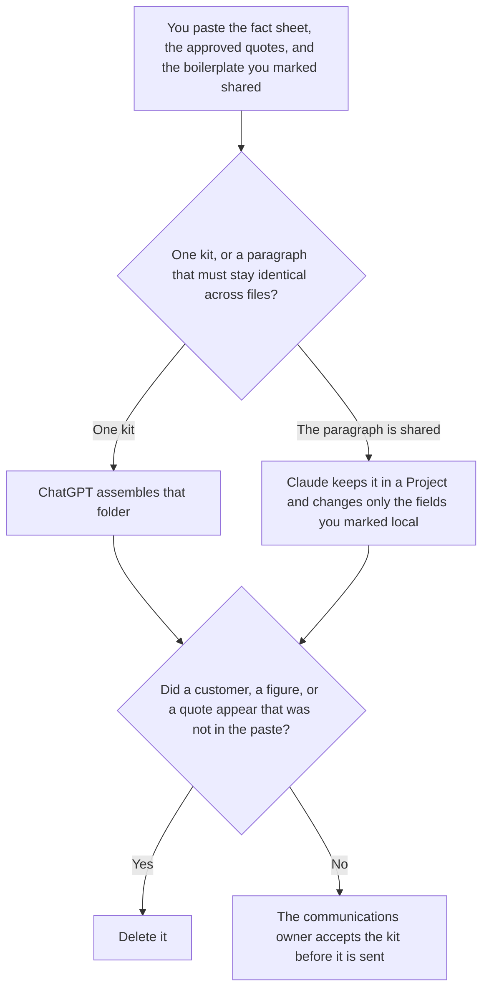

**Use ChatGPT when you are assembling one press kit from a fact sheet for a single announcement. Use Claude when the same boilerplate paragraph must appear, unchanged, in the kit, the short bio, and the about line.** The model may order the files. It may not invent a founding year, a customer, a funding figure, or a quote. A single external news page, with a peg and approved quotes, is [Claude vs ChatGPT for press releases](/blog/claude-vs-chatgpt-for-press-releases-2026/). This page is the folder around that page: boilerplate, bios, the product line, and the fact sheet those sentences must match.

The internal page the claims should already match is [how to write a product one-pager with AI](/blog/how-to-write-a-product-one-pager-with-ai-2026/). A sentence the fact sheet does not contain is [what an AI hallucination is](/blog/what-is-ai-hallucination-2026/).

ChatGPT's Plus price is the October 24, 2026 plan-page figure recorded in [ChatGPT pricing explained](/blog/chatgpt-pricing-explained-2026/). Claude's prices are the same-day read of claude.com/pricing recorded in [Claude pricing explained](/blog/claude-pricing-explained-2026/). Grammarly and Notion prices are from directory pages checked October 16, 2026. A live fetch of Grammarly's plans URL returned HTTP 401 on October 24, as the Business pricing article records, so the Grammarly figure stays on the October 16 card. Published October 24, 2026. We did not measure pickup. We did not send a kit.

## Which file is in front of you

| The file | Start here | First paid step | The limit |
|---|---|---|---|
| One kit, from one fact sheet | [ChatGPT](/tools/chatgpt/) | Plus is $20 a month | No fact that was not on the sheet |
| One boilerplate paragraph copied across the kit, the bio, and the about line | [Claude](/tools/claude/) | Pro is $17 a month billed annually, $200 up front, or $20 monthly | The Project holds the paragraph. A file may not reword it |
| The folder the next announcement will copy | [Notion AI](/tools/notion-ai/) | Business is $20 a seat a month | Plus at $10 is not the full AI tier |
| A clarity pass that must not touch a number | [Grammarly](/tools/grammarly/) | Pro is $12 a member a month billed annually, or $30 monthly | Compare every figure before and after |

A bio that adds "industry-leading" has added a claim. If the fact sheet does not say it, the line stays out. A funding figure that was not on the sheet stays as Figure not on the sheet. Put proposals in a note labeled Not in the kit.

The press-release page chooses Claude when a long fact sheet and a style doc should not be pasted every time, and ChatGPT when a project turns each sheet into the same release shape. This page is the folder, not the release. A kit can exist with no news peg. A release can exist with no logo folder. Do not merge the drafts.

## What the kit is allowed to contain

The facts on the sheet, the quotes that name an approver, and the boilerplate you marked shared. A logo usage note is a sentence you already wrote. The model may repeat it. It may not invent a clearance rule. The style rules, if you have them, are [how to create a style guide with AI](/blog/how-to-create-a-style-guide-with-ai-2026/).

**ChatGPT Plus** is the one-folder path. Go is $8 a month on the October 24 plan page. Plus is the seat for a saved kit. The review is [ChatGPT review](/blog/chatgpt-review-2026/).

**Claude Pro** is the shared paragraph. Team standard seats are $20 a seat a month billed annually, or $25 monthly, when the kit is a company record, as recorded in [Claude Team pricing explained](/blog/claude-team-pricing-explained-2026/). The review is [Claude review](/blog/claude-review-2026/).

**Notion Business** stores the accepted kit, the owner, and the date. The invoice is [Notion AI pricing explained](/blog/notion-ai-pricing-explained-2026/).

**Grammarly Pro** is the pass after the figures are stable. Reject a suggestion that rounds a number or softens a quote. The invoice is [Grammarly pricing explained](/blog/grammarly-pricing-explained-2026/).

A prompt that holds the line:

"Draft the press kit from the fact sheet and the quotes I pasted. If a figure is missing, write Figure not on the sheet. Do not add a customer. Do not add a quote. Do not reword a paragraph I marked shared."

## What not to delegate

Do not ask which facts will "land with reporters." Do not paste a competitor's kit so yours matches the tone. Do not send the folder because the bios sound complete. The communications owner accepts it. A formatted folder is not a fact.

## FAQ

### How is this different from Claude vs ChatGPT for press releases?

That page is one external news page: a peg, facts you can stand behind, and quotes people approved. This page is the kit around it: boilerplate that must match across files, bios, and the fact sheet. A release can ship without a kit. A kit can sit on a site with no release this week. Use that page for the news page. Use this page for the folder.

### How is this different from a product one-pager?

The one-pager is the internal positioning sheet: who it is for, the difference, the proof. The kit is what you are willing to hand outside. If they disagree, a person decides which page wins. The model does not reconcile them by inventing a third sentence.

### How is this different from a style guide?

The style guide is the wording rules. The kit is the facts and the files. A style pass may not change a founding year. A kit draft may not invent a style rule. Link the guide. Do not paste it as if it were a source of new facts.

### Who may send the kit?

The communications owner. A file that rewords a shared boilerplate paragraph is not accepted, even if the local fields match. Two files do not get two versions of a paragraph you marked shared.

## Last verified

October 24, 2026 for ChatGPT's plan page and for Claude, via the posts cited above. October 16, 2026 for Grammarly and Notion. Published October 24, 2026. Grammarly's plans URL returned HTTP 401 on October 24.

**Sources:** [ChatGPT and Codex pricing](https://learn.chatgpt.com/docs/pricing), [Claude pricing](https://claude.com/pricing), [Grammarly pricing](https://www.grammarly.com/plans), [Notion pricing](https://www.notion.com/pricing).

*Published by Andrew for [AI Tools Optimizer](https://aitoolsoptimizer.com).*

[ChatGPT](/tools/chatgpt/) is in the [chatbots and assistants directory](/tools/category/chatbots-assistants/). Directory pages may use affiliate links. A purchase through them may earn us a commission at no extra cost to you.
