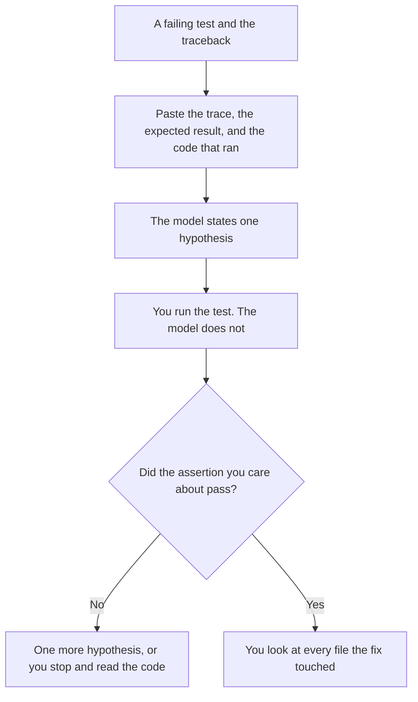

**Use either ChatGPT Plus or Claude Pro to read a Python traceback you paste. Then run the test yourself.** Plus is $20 a month. Claude Pro is $20 a month, or $17 billed annually. The debugging difference on this page is not a leaderboard. It is whether the failing test stays in a chat, or whether you hand the repo to an agent. An agent that "fixes" five files you did not mean to open is a second bug.

The agent choice, when you do want the repo edited, is [ChatGPT vs Claude for coding](/blog/chatgpt-vs-claude-for-coding-2026/). The editor comparison is [Cursor vs Claude Code vs Codex](/blog/cursor-vs-claude-code-vs-codex-2026/). This page stops at the failure in front of you: a stack trace, a wrong assert, a version you can name.

Prices are US list prices excluding tax from directory pages checked October 16, 2026. Published October 24, 2026. We did not score which model finds the bug faster.

## Where the failure is

| The situation | Start here | What you still do |
|---|---|---|
| One traceback and a short function, pasted | [ChatGPT](/tools/chatgpt/) Plus or [Claude](/tools/claude/) Pro | Read the hypothesis. Run the test. Reject a fix that touches files you did not paste |
| The same failure, and you want Claude Code in the project | Claude Pro, which includes Claude Code on the card | Review the diff. The coding page covers the agent. This page covers the test |
| The same failure, and Codex should live in the ChatGPT seat | ChatGPT Plus, which includes expanded Codex on the card | Same review. Do not start there for a one-function bug |
| The edit should happen in the editor you already use | [Cursor](/tools/cursor/) Plus at $8 a month, or $80 a year | The model proposes. You accept a hunk |
| Completions beside GitHub | [GitHub Copilot](/tools/github-copilot/) Pro at $10 a user a month | A completion is not a diagnosis. Paste the trace somewhere you can read a paragraph |

A green test you did not run is not a fix. A green test on a different Python version than production is a hint. Say the version in the paste. If you do not know it, write "version missing" and look it up before you merge.

## What $20 buys, and what it does not

**ChatGPT Plus at $20 a month** adds projects, higher upload limits, and expanded Codex, on the directory card. Free includes limited tools. Go at $8 a month is more room than Free, and the card says Go may include ads. Business is $20 a user a month billed annually, for two or more users, with no training on business data by default. A private repo's traceback belongs on a plan your company allows. The ladder is [ChatGPT Go vs Plus vs Pro](/blog/chatgpt-go-vs-plus-vs-pro-2026/).

**Claude Pro is $20 a month, or $17 billed annually ($200 a year).** The annual figure is the directory's. Pro includes Claude Code and Projects. Free can already take files and code, with usage limits. Max at $100 or $200 is 5× or 20× Pro usage. A single traceback does not require Max. Buy Max when the cap is the constraint, which is [Claude Pro vs Max](/blog/claude-pro-vs-max-2026/).

**Cursor Plus at $8 a month** is the smaller seat if you are already in that editor and the bug is a few lines. Teams seats on that card are $30, $100, or $200. The invoice is [Cursor pricing explained](/blog/cursor-pricing-explained-2026/).

**Copilot Pro at $10** includes a credit pool the directory lists as $15 monthly credits on that row. Business is $19. Use Copilot if the team standard is already GitHub. Do not add it only to paste a traceback you could paste in a chat. The invoice is [GitHub Copilot pricing explained](/blog/github-copilot-pricing-explained-2026/).

A prompt that holds the line:

"Here is the traceback, the Python version, the test, and the function. State one likely cause. Propose the smallest change. Do not invent a library version. Do not rewrite files I did not paste. If the cause depends on a line I did not include, say which line you need."

The person who runs the test is [what human-in-the-loop AI is](/blog/what-is-human-in-the-loop-ai-2026/). A confident cause that was not in the trace is [what an AI hallucination is](/blog/what-is-ai-hallucination-2026/).

## What not to paste

Do not paste production secrets, customer rows, or a `.env` file to "give it context." A stack trace rarely needs them. Do not ask for a new architecture because a test failed. The failure is the scope. If the fix is a product change, that document is [how to draft a product spec with AI](/blog/how-to-draft-a-product-spec-with-ai-2026/), after you know the bug.

If the same prompt template is how your team debugs, and it keeps shipping with an unfilled variable, the file check is [what a prompt linter is](/blog/what-is-prompt-linter-2026/). That is separate from finding the Python bug.

## FAQ

### Which model is better at Python?

We did not measure that. Use the seat you will re-read. If you will not run the test, neither product has debugged anything.

### Should I let Codex or Claude Code apply the patch?

For a one-function failure, paste and run the test first. Hand over the repo when the failure crosses files and you are ready to read the whole diff. The coding comparison linked above is that decision. This page is the smaller one.

### What if the model suggests a dependency upgrade?

Treat it as a hypothesis that names a version. Confirm that version exists and that your lockfile allows it. Do not upgrade a production service because a chat said the bug is "probably the old release."

### Is Free enough?

Free on both products can take a short paste, with limits the directory describes only as limits. If the session dies before you finish one bug, Plus or Pro is the recorded next step. Do not buy Max or ChatGPT Pro at $100 to read one traceback.

## Last verified

October 16, 2026 for ChatGPT, Claude, Cursor, and GitHub Copilot. Published October 24, 2026.

**Sources:** [ChatGPT pricing](https://chatgpt.com/pricing/), [Claude pricing](https://claude.com/pricing), [Cursor pricing](https://cursor.com/help/account-and-billing/pricing).

*Published by Andrew for [AI Tools Optimizer](https://aitoolsoptimizer.com).*

[Claude](/tools/claude/) is in the [chatbots and assistants directory](/tools/category/chatbots-assistants/). Directory pages may use affiliate links. A purchase through them may earn us a commission at no extra cost to you.
