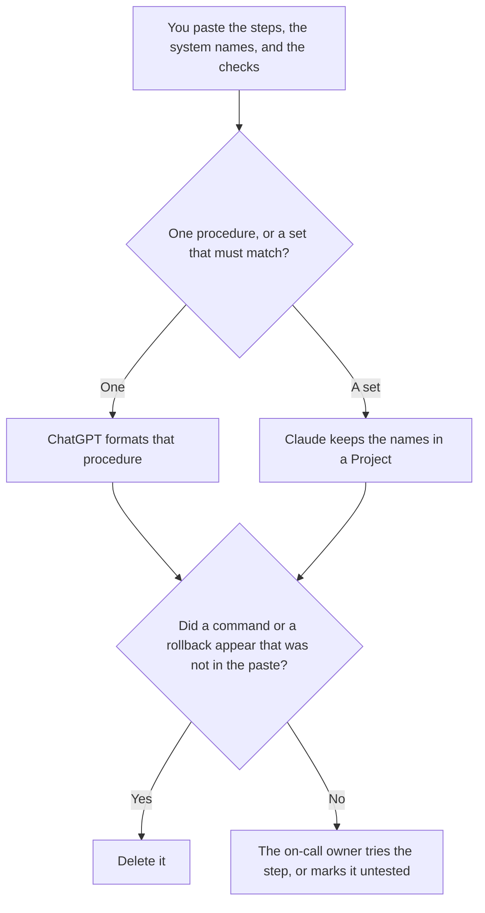

**Use ChatGPT when you are formatting one procedure from steps a person already wrote. Use Claude when several runbooks must use the same names for the same systems, and those names live in a Project.** The model may order steps and name a check you already listed. It may not invent a command, a dashboard, or a rollback. The checklist form of one runbook is [how to write a runbook checklist with AI](/blog/how-to-write-a-runbook-checklist-with-ai-2026/). The timeline after something has already broken is [Claude vs ChatGPT for incident timelines](/blog/claude-vs-chatgpt-for-incident-timelines-2026/).

ChatGPT, Notion, and Cursor prices are from directory pages checked October 16, 2026. chatgpt.com/pricing returned HTTP 403 on October 24. Claude's prices are from claude.com/pricing that day. Published October 24, 2026. We did not score procedures.

## Which runbook you are editing

| The page in front of you | Start here | First paid step | The limit |
|---|---|---|---|
| One procedure, from steps you paste | [ChatGPT](/tools/chatgpt/) | Plus is $20 a month | No command that was not in the paste |
| A set of runbooks that must share names | [Claude](/tools/claude/) | Pro is $17 a month billed annually, $200 up front, or $20 monthly | The Project holds your names. It does not prove the step works |
| The page on-call will open | [Notion AI](/tools/notion-ai/) | Business is $20 a seat a month | Plus at $10 is not the full AI tier |
| A command you want checked against the repo | [Cursor](/tools/cursor/) | Plus is $8 a month, or $80 a year | You review the diff. The runbook does not merge it |

A runbook the model "completed" with a plausible command is a risk, not a draft. If the paste says the command is unknown, the runbook says Command not recorded. The person who last ran the step is the source. The chat is not.

ChatGPT Go is $8 a month and may include ads, on the October 16 card. Plus is the seat for a saved procedure. The review is [ChatGPT review](/blog/chatgpt-review-2026/).

Claude Free can format a short paste. Pro is the seat with Projects. Max starts at $100 a month if you already live in Claude all day. A runbook set does not require Max. The review is [Claude review](/blog/claude-review-2026/).

## What the runbook is allowed to contain

The trigger you named, the steps you pasted, the check you listed, and the rollback you already wrote. If the rollback is blank, the page says Rollback not recorded. It does not propose one. The message you send if you do roll back is [how to write a rollback comms note with AI](/blog/how-to-write-a-rollback-comms-note-with-ai-2026/).

**ChatGPT Plus** is the one-procedure path. Paste the steps in order. A version that adds a "common fix" you did not paste is the version you delete.

**Claude Pro** is the set. Put the system names and the words you use for severity at the top. When a name changes, change it once, then read every runbook that cited it.

**Notion Business** is where the accepted page lives if that is the wiki. Link the date the owner last ran it.

**Cursor Plus** is how you check a command the runbook quotes, against the repo, as a diff you read. Do not let a chat invent a flag.

A prompt that holds the line:

"Format this runbook from the steps, the checks, and the rollback I pasted. If a command is missing, write Command not recorded. Do not add a step. Do not mark a step as tested."

## What not to delegate

Do not ask for the fastest way to recover. Do not paste production credentials so the example "looks real." Do not publish the page because the headings look complete. The on-call owner accepts it. Untested steps stay labeled untested.

## FAQ

### Which one writes a safer runbook?

We did not measure that. ChatGPT fits one procedure from a paste. Claude fits a set that must share names. The runbook is safer when every command traces to a step a person recorded, and untested steps say so.

### Do I need both?

You need the seat that matches the size of the set. Running both and merging the steps is how a command survives in one runbook and changes in its neighbor. File one accepted version.

### How is this different from an incident timeline?

The timeline is what happened, with times. The runbook is what to do next time, with steps. A timeline can show that a runbook step was wrong. It does not rewrite the runbook by itself. The timeline article is the one to use on the morning after.

### Who may mark a step tested?

The person who ran it, with the date. A formatted page is not a test. A model that says the step "should work" has not run it.

## Last verified

October 16, 2026 for ChatGPT, Notion, and Cursor. October 24, 2026 for Claude. Published October 24, 2026.

**Sources:** [ChatGPT pricing](https://chatgpt.com/pricing/), [Claude pricing](https://claude.com/pricing), [Notion pricing](https://www.notion.com/pricing), [Cursor pricing](https://cursor.com/help/account-and-billing/pricing).

*Published by Andrew for [AI Tools Optimizer](https://aitoolsoptimizer.com).*

[ChatGPT](/tools/chatgpt/) is in the [chatbots and assistants directory](/tools/category/chatbots-assistants/). Directory pages may use affiliate links. A purchase through them may earn us a commission at no extra cost to you.
