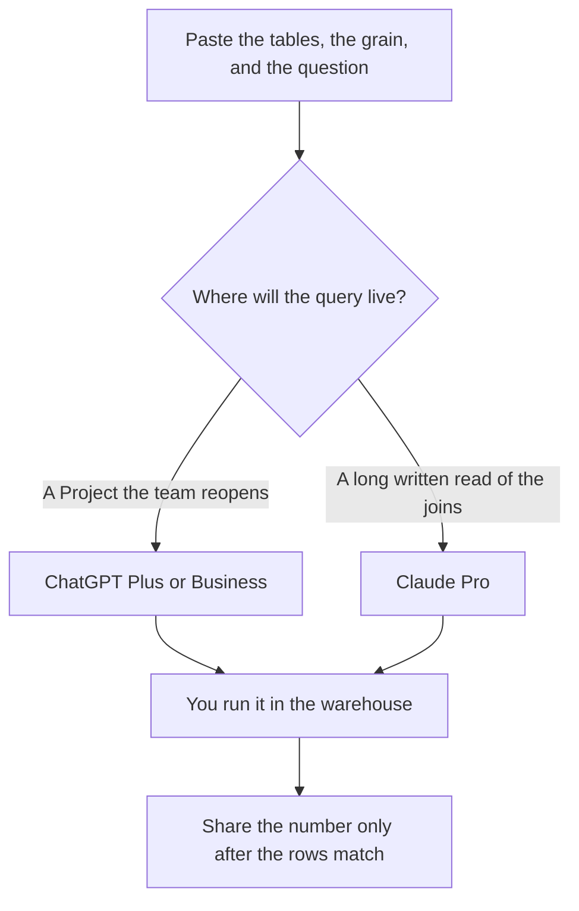

**Use ChatGPT Plus at $20 a month or Claude Pro at $20 a month ($17 billed annually) to draft a SQL query from a schema and a question you paste, then run that query yourself and read the rows before you share a number.** Pick ChatGPT if the query should live in a Project your team reopens next week. Pick Claude if the schema is long and you want a written explanation of each join beside the query. If the query has to be scheduled, reviewed, and rerun, the notebook is the other product. This pair of chats does not hold your warehouse password.

The spreadsheet pair is [ChatGPT vs Claude for Excel analysis](/blog/chatgpt-vs-claude-for-excel-analysis-2026/). The coding pair is [ChatGPT vs Claude for coding](/blog/chatgpt-vs-claude-for-coding-2026/). A figure that was not in the result set is [what an AI hallucination is](/blog/what-is-ai-hallucination-2026/). The analyst shelf is [best AI tools for data analysts](/blog/best-ai-tools-for-data-analysts-2026/).

Prices are US list prices excluding tax from directory pages checked October 16, 2026. Published October 24, 2026. We did not score SQL accuracy. We did not connect either chat to a database.

## Two chats, and the query you still execute

| | [ChatGPT](/tools/chatgpt/) | [Claude](/tools/claude/) |
|---|---|---|
| Free | Limited tools. Fine for a textbook schema | Files and code on the free plan, with free limits |
| The seat for a real schema | Plus, $20 a month. Projects and higher upload limits on the card | Pro, $20 a month or $17 billed annually ($200 up front). The card lists a context window up to 1 million tokens depending on the model |
| Heavier personal use | Pro at $100, $200, or $500 | Max at $100 or $200 |
| A company seat | Business, $20 a user a month billed annually for two or more users, or $25 monthly. No training on business data by default | Team is per seat for 2 to 150 people. No public seat dollar on the directory card |
| What you still do | Run the query and read the rows | Run the query and read the rows |
| A poor use | Pasting production secrets into a personal chat | Letting the explanation replace the result set |

Five people on ChatGPT Plus are 5 × $20 = $100 a month with no shared admin. The same five on Business annual are also 5 × $20, with a two-user minimum. Claude Pro annual for one analyst is $200 a year. A second analyst is another seat. Claude Team's dollar is not on the card, so a team budget should come from checkout.

## When the chat is the wrong surface

**The query must run again next Monday.** [Hex](/tools/hex/) Professional is $36 an editor a month, with the Hex agent and up to 5 published apps. Team is $75 an editor a month when you need scheduled runs and alerts. Community is free, with a Hex agent trial and small compute. Use Hex when the warehouse is the system of record. The invoice is [Hex pricing explained](/blog/hex-pricing-explained-2026/). The operational shelf around that rerun is [best AI tools for data ops](/blog/best-ai-tools-for-data-ops-2026/).

**The file is a spreadsheet, not a warehouse.** [Julius AI](/tools/julius-ai/) Plus is $20 a month, or $16 billed annually, with 2,000 monthly credits. That is a different job from SQL against Postgres. The invoice is [Julius AI pricing explained](/blog/julius-ai-pricing-explained-2026/).

**The sentence around a number you already checked.** [Grammarly](/tools/grammarly/) Pro is $12 a member a month billed annually. It will not validate a JOIN.

**A confidential schema.** Prefer ChatGPT Business, or a Claude plan your admin has already approved, over a personal free account. Paste column names and grain. Do not paste credentials, row-level customer extracts, or a production connection string. The record habit is [what a system of record for AI is](/blog/what-is-a-system-of-record-for-ai-2026/).

A prompt that holds the line:

"Using only the tables I paste, draft one SQL query for this question. Name every column you use. If a column or a date grain is missing, write Missing and stop. Do not invent tables. Add a one-line comment on each join. I will run it myself."

The person who runs it is [what human-in-the-loop AI is](/blog/what-is-human-in-the-loop-ai-2026/). The check on the words around the number is [how to fact-check AI writing](/blog/how-to-fact-check-ai-writing-2026/).

## FAQ

### Which model writes correct SQL?

We did not measure that. Correct here means the query runs in your warehouse and the rows match the question. Run the same schema through the seat you will keep, once, on a question you already know the answer to.

### Can I paste a CSV instead?

Yes, if the question is about that file. That is closer to the Excel workflow than to warehouse SQL. Say which filter you already applied so dropped rows are not treated as the full population.

### Should the model connect to the database?

Only through a path your admin has approved, with a read-only role and a logged query. A chat box is not that path. Hex is the directory tool aimed at that rerun. This comparison stops at the draft.

### Is Plus required?

Free tiers can try a small public schema. A recurring query about customers belongs on a plan with the admin and training defaults you need. Plus and Pro are the individual paid steps. Business is the ChatGPT admin step.

## Last verified

October 16, 2026 for ChatGPT, Claude, Hex, Julius, and Grammarly. Claude Team has no public per-seat dollar on the directory card. Published October 24, 2026.

**Sources:** [ChatGPT pricing](https://chatgpt.com/pricing/), [Claude pricing](https://claude.com/pricing), [Hex pricing](https://hex.tech/pricing/).

*Published by Andrew for [AI Tools Optimizer](https://aitoolsoptimizer.com).*

[Hex](/tools/hex/) is in the [data and analytics directory](/tools/category/data-analytics/). Directory pages may use affiliate links. A purchase through them may earn us a commission at no extra cost to you.
