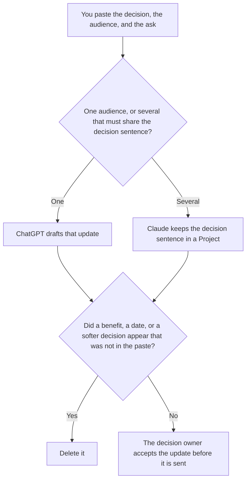

**Use ChatGPT when you are writing one stakeholder update from a decision, an audience, and an ask a person already wrote. Use Claude when several audiences must share that decision sentence and differ only in the ask.** The model may order what changed, what it means for that audience, and what you need from them. It may not soften a decision, add a benefit, or invent a date. The decision itself is [ChatGPT vs Claude for decision memos](/blog/chatgpt-vs-claude-for-decision-memos-2026/). The standing Friday recap of notes already filed is [ChatGPT vs Gemini for weekly updates](/blog/chatgpt-vs-gemini-for-weekly-updates-2026/).

The email after a change, when the change is the whole message, is [how to write a change management email with AI](/blog/how-to-write-a-change-management-email-with-ai-2026/).

ChatGPT's Plus price is from learn.chatgpt.com/docs/pricing on October 24, 2026. Claude's prices are from claude.com/pricing that day. Notion and Grammarly prices are from directory pages checked October 16, 2026. Published October 24, 2026. We did not score updates.

## Which audience is in front of you

| The page | Start here | First paid step | The limit |
|---|---|---|---|
| One audience, from a paste | [ChatGPT](/tools/chatgpt/) | Plus is $20 a month | No benefit that was not in the paste |
| Several audiences, one decision sentence | [Claude](/tools/claude/) | Pro is $17 a month billed annually, $200 up front, or $20 monthly | The Project holds the decision. It does not retell it differently |
| The page the next sender will copy | [Notion AI](/tools/notion-ai/) | Business is $20 a seat a month | Plus at $10 is not the full AI tier |
| A clarity pass that must not touch the ask | [Grammarly](/tools/grammarly/) | Pro is $12 a member a month billed annually, or $30 monthly | Compare the ask before and after |

An update that says the change is "minor" when the decision did not say minor has amended the decision. If the ask is missing, the update says Ask not set. It does not propose one in the message. Put proposals in a separate note labeled Not in the update.

ChatGPT Go is $8 a month on the October 24 plan page. Plus is the seat for a saved update. The review is [ChatGPT review](/blog/chatgpt-review-2026/).

Claude Free can format a short paste. Pro is the seat with Projects. Team standard seats are $20 a seat a month billed annually, or $25 monthly, when the update is a company record, as recorded the same day in [Claude Team pricing explained](/blog/claude-team-pricing-explained-2026/). The review is [Claude review](/blog/claude-review-2026/).

## What the update is allowed to contain

The decision you wrote, the audience you named, the meaning you already listed for that audience, and the ask you wrote. A risk that was not in the paste stays out. A date that was not in the paste says Date not in the source. The weekly recap can mention the same decision later. It does not replace this note.

**ChatGPT Plus** is the one-audience path. Paste the decision in the words you want repeated. A version that adds "what this means for you" beyond the lines you pasted is the version you delete.

**Claude Pro** is the set. The decision sentence is written once. Each audience file changes only the ask and the meaning you supplied for that audience. If two files disagree on the decision, stop and fix the Project. Do not send either.

**Notion Business** stores the accepted text and the date the owner accepted it. The invoice is [Notion AI pricing explained](/blog/notion-ai-pricing-explained-2026/).

**Grammarly Pro** is the pass after the words are stable. Reject a suggestion that softens the decision or the ask. The invoice is [Grammarly pricing explained](/blog/grammarly-pricing-explained-2026/).

A prompt that holds the line:

"Draft the stakeholder update from the decision, the audience, and the ask I pasted. If the ask is missing, write Ask not set. Do not add a benefit. Do not soften the decision. Do not invent a date."

## What not to delegate

Do not ask how to make the audience comfortable with a decision they have not heard. Do not paste a private objection so the note "sounds human." Do not send it because the subject line is short. The decision owner accepts it. A friendly paragraph is not a decision.

## FAQ

### How is this different from a decision memo?

The memo records what was decided, for the record. The stakeholder update tells a named audience what they need to do about that decision. The update may quote the decision. It may not change it. If the decision is not accepted yet, you do not have this page. You have a draft memo.

### How is this different from a weekly update?

A weekly update combines the week's notes for a standing reader. A stakeholder update is about one change, sent when that audience must hear it. A Friday recap can link the update. It should not be the first time a named audience sees the ask.

### Which one writes a safer update?

We did not measure that. ChatGPT fits one audience. Claude fits several audiences that must share a sentence. The update is safer when the decision line matches the memo, and a missing ask says so.

### Who may send it?

The decision owner, or the person that owner names for that audience. A formatted draft is not a send. Two audiences do not get two decisions.

## Last verified

October 24, 2026 for ChatGPT's plan page and for Claude. The Team seat dollars are from the same-day Team article. October 16, 2026 for Notion and Grammarly. Published October 24, 2026.

**Sources:** [ChatGPT and Codex pricing](https://learn.chatgpt.com/docs/pricing), [Claude pricing](https://claude.com/pricing), [Notion pricing](https://www.notion.com/pricing), [Grammarly pricing](https://www.grammarly.com/plans).

*Published by Andrew for [AI Tools Optimizer](https://aitoolsoptimizer.com).*

[ChatGPT](/tools/chatgpt/) is in the [chatbots and assistants directory](/tools/category/chatbots-assistants/). Directory pages may use affiliate links. A purchase through them may earn us a commission at no extra cost to you.
