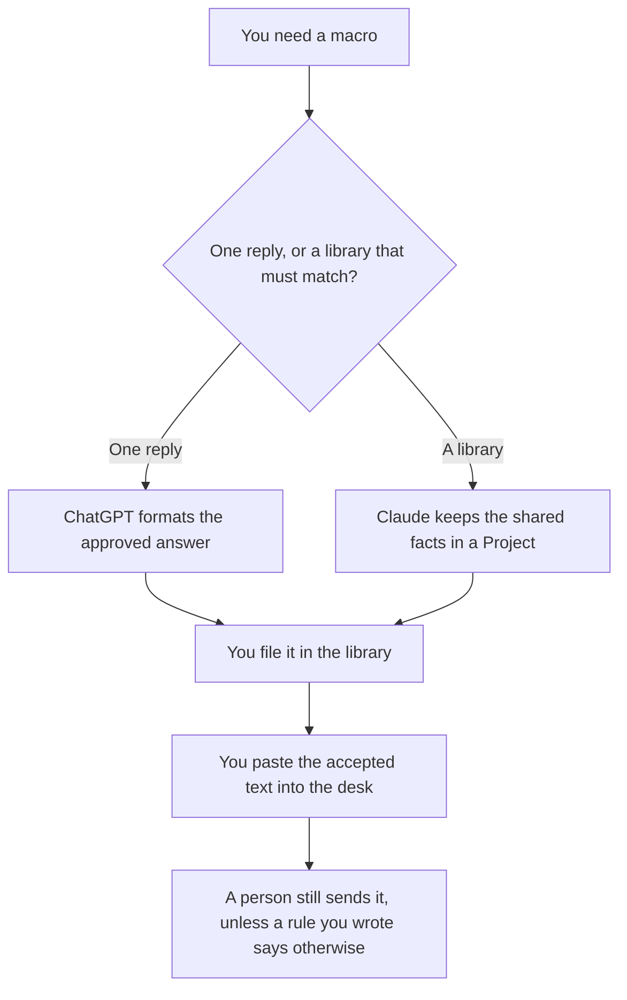

**Use ChatGPT when you are editing one macro from a short approved answer you paste. Use Claude when many macros must stay consistent and the library is long enough to live in a Project.** The model may format a reply you already approved. It may not invent a refund, a credit, or a policy exception. The page that files those replies is [how to write a support macro library with AI](/blog/how-to-write-a-support-macro-library-with-ai-2026/). The person who changes the queue is [best AI tools for support ops leads](/blog/best-ai-tools-for-support-ops-leads-2026/).

Prices are US list prices excluding tax from directory pages checked October 16, 2026. A live fetch of vendor pricing pages on October 24, 2026 returned HTTP 401, so this page stays on the directory record. Published October 24, 2026. We did not score handle time or deflection.

## Which seat matches the macro

| The work in front of you | Start here | First paid step | The limit |
|---|---|---|---|
| One reply, from a paste of the approved answer | [ChatGPT](/tools/chatgpt/) | Plus is $20 a month | No policy sentence that was not in the paste |
| A set of macros that must use the same facts | [Claude](/tools/claude/) | Pro is $20 a month, or $17 billed annually | The Project holds your text. It does not approve a macro |
| The page the team will open next month | [Notion AI](/tools/notion-ai/) | Business is $20 a seat a month | Plus at $10 is not the full AI tier |
| The desk that actually sends the reply | [Zendesk AI](/tools/zendesk-ai/) | Suite Team is $55 per agent per month paid yearly | A draft macro is off until a person turns it on |

ChatGPT Go is $8 a month and may include ads, on the directory card. A macro is a poor place to discover an ad or a tight limit. Plus is the seat for a saved project of approved answers. The review is [ChatGPT review](/blog/chatgpt-review-2026/).

Claude Pro includes Projects on the directory card. That is the point of this comparison: several macros that must not contradict the refund cap, the hours, and the escalation line. Free can format one paste. The review is [Claude review](/blog/claude-review-2026/).

## What the macro is allowed to say

The approved answer, the conditions you pasted, and the next step you named. If the paste does not mention a credit, the macro does not offer one. If the owner of the macro is missing, the draft says Owner missing and you do not publish it.

**ChatGPT Plus** is the one-reply path. Paste the answer a lead already accepted. Ask for the macro fields your desk uses: title, when to use it, the body. A second version that "sounds warmer" and adds a promise is the version you delete.

**Claude Pro** is the library path. Put the shared facts at the top of the Project: the cap, the hours, the article URL. Ask for a macro that only uses those facts. When you change the cap, you change it once, then you regenerate the macros that cited it. You still diff them.

**Notion Business** is where the accepted text lives if that is the wiki. The chat is not the macro the agent will insert.

**Zendesk Suite Team** is the desk if you already run it. Support Team at $19 per agent per month paid yearly does not include the AI agents, on the directory card. Price the seat you have. Do not buy Suite so a macro draft has a panel.

A prompt that holds the line:

"Format one macro from the approved answer and the conditions I pasted. Do not add a credit, a deadline, or a policy. If a condition is missing, write Condition missing and stop."

## What not to delegate

Do not ask which refund policy is "fair." That is the policy owner. Do not publish a macro in the desk and leave a different wording in the library. Do not paste a live ticket, with a customer's name and address, into a personal chat. The strip step is [what AI PII redaction is](/blog/what-is-ai-pii-redaction-2026/). The moment the bot should stop and a person should take the case is [what an AI conversation handoff is](/blog/what-is-ai-conversation-handoff-2026/).

## FAQ

### Which one writes a better macro?

We did not measure that. ChatGPT fits one approved answer. Claude fits a set of macros that share facts in a Project. The macro is better when every sentence traces to text a person already accepted.

### Do I need both?

You need the seat that matches the job in front of you. Running both and merging the prose is how a credit appears in one draft and not the other. File one accepted version.

### Where does Notion fit?

Notion is the system of record for the library if the team already works there. Business is the seat with the agent, on the directory card checked October 16, 2026. The drafting comparison on this page is still ChatGPT versus Claude.

### Can the model decide when the macro should fire?

Only by copying conditions you pasted. A condition it invented will fire on the wrong tickets. Leave the cell missing and write the condition yourself.

## Last verified

October 16, 2026 for ChatGPT, Claude, Notion, and Zendesk. Published October 24, 2026.

**Sources:** [ChatGPT pricing](https://chatgpt.com/pricing/), [Claude pricing](https://claude.com/pricing), [Notion pricing](https://www.notion.com/pricing), [Zendesk](https://www.zendesk.com).

*Published by Andrew for [AI Tools Optimizer](https://aitoolsoptimizer.com).*

[ChatGPT](/tools/chatgpt/) is in the [chatbots and assistants directory](/tools/category/chatbots-assistants/). Directory pages may use affiliate links. A purchase through them may earn us a commission at no extra cost to you.
