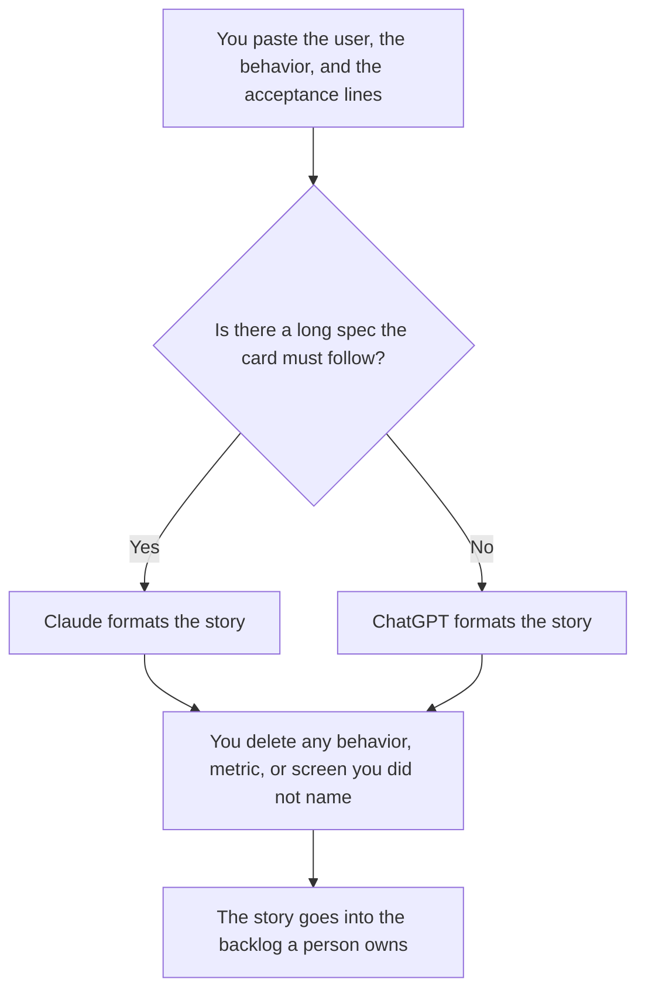

**Use ChatGPT when the user story is a short card you reuse: who, what, and why, plus acceptance lines you already wrote. Use Claude when the story has to follow a long spec that lives in a Project.** The model formats the card. It does not decide the scope. A story that adds a feature you did not name is a draft to cut.

The longer page those stories should match is [how to draft a product spec with AI](/blog/how-to-draft-a-product-spec-with-ai-2026/). The internal positioning sheet is [how to write a product one-pager with AI](/blog/how-to-write-a-product-one-pager-with-ai-2026/). A policy page, which is a different document, is [Claude vs ChatGPT for policy drafts](/blog/claude-vs-chatgpt-for-policy-drafts-2026/).

Prices are US list prices excluding tax from directory pages checked October 16, 2026. Published October 24, 2026. We did not score stories, and we did not sit in a planning meeting.

## Which seat matches the card

| The story you actually have | Start here | What you still do |
|---|---|---|
| One card, a few lines | [ChatGPT](/tools/chatgpt/) Free or [Claude](/tools/claude/) Free | You accept or reject each acceptance line |
| The same template every sprint | ChatGPT Plus at $20 a month | Swap the user and the rule. Keep the template |
| A long spec the card must not contradict | Claude Pro at $20 a month, or $17 billed annually | The Project holds the spec. The card adds no behavior the spec does not contain |
| The card lives in the backlog | [Notion AI](/tools/notion-ai/) Business at $20 a seat a month | The database is the record. The chat is the draft |
| The story quotes code that must match the repo | [Cursor](/tools/cursor/) Plus at $8 a month, or $80 a year | You read the file. The story does not invent an endpoint |

ChatGPT Go is $8 a month and may include ads, on the directory card. A story you will paste into a backlog is a poor place for an ad you did not choose. Plus at $20 is the seat when this is every sprint. ChatGPT Pro starts at $100. A story card does not need it. Claude Max starts at $100. The same rule applies. ChatGPT Business, at $20 a user a month billed annually with a two-user minimum, is the row when the spec is confidential and a personal account is against policy.

## What the card may contain

The user you named, the behavior you described, and the acceptance lines you wrote. It may include a note that a line is missing. It may not add a persona, a success metric, or an edge case you did not supply. If the acceptance line is blank, the card says Acceptance missing.

**ChatGPT Plus** is the paid path when the habit is a saved project and a paste of this sprint's rule. The review is [ChatGPT review](/blog/chatgpt-review-2026/).

**Claude Pro** is the paid path when the spec is long and the story should be checked against it in the same Project. The review is [Claude review](/blog/claude-review-2026/).

**Notion Business** is the paid path when the backlog is already the system of record. Do not upgrade a whole workspace only to format one card. The invoice is [Notion AI pricing explained](/blog/notion-ai-pricing-explained-2026/).

A prompt that holds the line:

"Format one user story from the user, the behavior, and the acceptance lines I pasted. Do not add an edge case, a metric, or a screen. If an acceptance line is missing, write Acceptance missing and stop."

## What not to delegate

Do not ask which story to build next. Do not turn a story into a promise of a date. The rollout that decides who sees the change is [how to create a feature flag rollout plan with AI](/blog/how-to-create-a-feature-flag-rollout-plan-with-ai-2026/). Priority stays with the person who owns the backlog.

## FAQ

### How is this different from a product spec?

The spec is the longer document: problem, behavior, and what is out of scope. The user story is one card that should not contradict it. Write the spec first when the behavior is new. Format the card from the spec. Do not let a pile of cards become the spec.

### Can the model write the acceptance tests?

It can format a check you already described. A new test it composed is a proposal until someone who can run it has read it. A story does not become testable because the lines sound specific.

### What if the spec and the story disagree?

The spec wins until a person changes the spec. Delete the extra behavior. Do not "merge" them in a second prompt and hope the conflict disappears.

### Do I need both seats?

No. Plus is enough for a template. Pro is enough for a long spec. Buy the second seat when the work actually lives in the other product, not because a comparison listed both.

## Last verified

October 16, 2026 for ChatGPT, Claude, Notion AI, and Cursor. Published October 24, 2026.

**Sources:** [ChatGPT pricing](https://chatgpt.com/pricing/), [Claude pricing](https://claude.com/pricing), [Notion pricing](https://www.notion.com/pricing), [Cursor pricing](https://cursor.com/help/account-and-billing/pricing).

*Published by Andrew for [AI Tools Optimizer](https://aitoolsoptimizer.com).*

[ChatGPT](/tools/chatgpt/) is in the [chatbots and assistants directory](/tools/category/chatbots-assistants/). Directory pages may use affiliate links. A purchase through them may earn us a commission at no extra cost to you.
