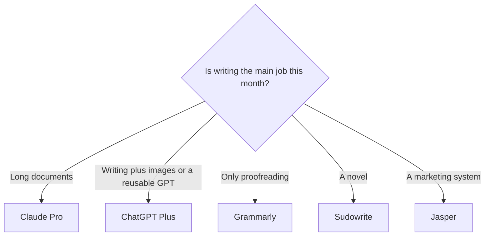

**Use Claude when the writing is a long document you will revise in projects. Use ChatGPT when writing shares the month with images, voice, or custom GPTs.** Both free plans are enough to find out which one you edit less. Most writers need one paid plan at $20, not both.

This is a writing comparison. The general three-way with Gemini is [ChatGPT vs Gemini vs Claude](/blog/chatgpt-vs-gemini-vs-claude-2026/). The wider writing shelf, including Grammarly and fiction tools, is [best AI writing assistants](/blog/best-ai-writing-assistants/). Prices are US list prices from OpenAI and Anthropic pricing pages, last verified October 16, 2026. We did not score prose in a blind test. The fit table describes documented features.

## The writing decision

| The page you are writing | Prefer | Why the feature set matches |
|---|---|---|
| A memo, report, or chapter from notes and files | [Claude](/tools/claude/) | Projects, Artifacts, and file creation are on the product, including Free, with usage limits |
| A newsletter plus images, or a custom writing assistant you reuse | [ChatGPT](/tools/chatgpt/) | Image generation and custom GPTs sit in the same subscription |
| Grammar in the box where you already type | [Grammarly](/tools/grammarly/) | It edits in place. A chatbot makes you paste |
| On-brand marketing for a team | [Jasper](/tools/jasper/) | Brand voice is a plan feature, not a paragraph in a prompt. See the [Jasper review](/blog/jasper-ai-review-2026/) |
| Fiction | [Sudowrite](/tools/sudowrite/) | Built for story. Hobby and Student is $10/month billed annually |
| The draft has to stay in a team wiki | [Notion AI](/tools/notion-ai/) | Business at $20/seat/month is where Agent and meeting notes live |

## What each free plan already gives a writer

**Claude Free** includes chat on the web, desktop, and mobile, web search, file creation, code execution, memory, connectors, and Artifacts. Anthropic lists up to 5 Projects on Free. Usage limits are the constraint. Model training is opt-out on Free, Pro, and Max. For a writer, that means you can keep a project per client or per book and turn training off in settings. Confirm the toggle before you paste a manuscript you do not want used.

**ChatGPT Free** includes unlimited text chats with GPT-6, subject to abuse guardrails, plus limited uploads, image creation, voice, deep research, and memory. Custom GPTs, projects, and higher tool limits are why people move to Plus. OpenAI's consumer lineup is the GPT-6 family, as documented on the pricing material we checked.

Neither free plan is a bibliography. If a paragraph needs sources, use [Perplexity](/tools/perplexity/) or paste the sources yourself. The assistant comparison covers that gap. This page assumes you are drafting, not citing.

## The $20 plans, for writers

| | Claude Pro | ChatGPT Plus | ChatGPT Go |
|---|---|---|---|
| Price | $20/month, or $17/month billed annually ($200 up front) | $20/month | $8/month. OpenAI says Go may include ads |
| What changes for writing | More usage, more Projects, Claude Code, Chrome, and Microsoft 365 | Projects, custom GPTs, higher uploads, advanced reasoning | More messages, uploads, images, and memory than Free |
| Images in the same plan | Limited. Not the reason to buy Pro | Yes | More than Free, less than Plus |
| Heavy-use step up | Max 5x is $100/month. Max 20x is $200/month | Pro is $100, $200, or $500/month | Not a heavy-use plan |

Claude's annual price is $200 up front, which is $17 a month across the year. ChatGPT Plus at $20 has no annual figure on the page we used. Go at $8 is the cheap step when you want more room and you can tolerate ads. A writer who lives in long files should not pick Go to save $12 if the actual pain is project space and usage. The tier guide is [ChatGPT Go vs Plus vs Pro](/blog/chatgpt-go-vs-plus-vs-pro-2026/). Claude's own step from Pro to Max is [Claude Pro vs Max](/blog/claude-pro-vs-max-2026/).

**Claude Team** covers 2 to 150 people with central billing. We did not record a current USD price per seat, so it is not in the table. **ChatGPT Business** is $20/user/month billed annually for 2 or more users, or $25 monthly, and OpenAI says business data is not used for training by default. A solo writer does not need Business. A company that wants an admin and a training default does.

## How to use each one without a style mess

**Claude, for a document that already exists.** Create one Project per piece of work. Put the style notes, the outline, and the source files in the project. Ask for a section, not the whole piece. Use an Artifact when you want a draft you can iterate beside the chat. When the usage limit hits mid-chapter, that is the signal to look at Pro, and at Max only if Pro hits the same wall every week.

**ChatGPT, for a repeating format.** Build a custom GPT on Plus with the style sheet and two examples of your own writing. Use it for the newsletter, the product blurb, or the lesson plan. Keep images in that same account if the piece needs a figure. Do not also pay for Claude unless the long-document work is a separate weekly job.

**Both, for editing.** Paste a section you wrote and ask for the three sentences that are vague, then rewrite those yourself. A full rewrite in the model's voice is how drafts start to sound like every other draft. [Grammarly](/tools/grammarly/) Pro at $12/member/month annual is the better second subscription if the problem is tone in the browser, not a blank page. See [is Grammarly Pro worth it](/blog/is-grammarly-pro-worth-it-2026/).

[QuillBot](/tools/quillbot/) Premium showed $8.33/month billed annually and is a paraphrase tool. It is not a second opinion on structure.

## When neither chatbot is the writing product

- **Fiction.** [Sudowrite](/tools/sudowrite/) Hobby and Student is $10/month billed annually ($19 monthly) for 225,000 credits. Professional is $22/month annual. The features are aimed at story, outline, and the next stretch of prose.
- **Marketing teams.** [Jasper](/tools/jasper/) Pro is $69/seat/month or $59 billed yearly, with Brand Voices and a 7-day trial. There is no free plan. Copy.ai's Chat plan is the cheaper shared chat, at $24/month billed annually for 5 seats, and it is a go-to-market product rather than a manuscript tool.
- **Google Docs as the home of the draft.** [Gemini](/tools/gemini/) on Google AI Pro at $19.99/month puts the assistant in Docs and Gmail. If the file never leaves Drive, start there instead of pasting into Claude. The three-way comparison covers that case.
- **A wiki.** [Notion AI](/tools/notion-ai/) on Business at $20/seat/month. The review is [Notion AI](/blog/notion-ai-review-2026/).

Paying for ChatGPT Plus and Claude Pro in the same month is $40, or $37 if Claude is annual. Do that only after each one has a job the other failed. The wider rule is [which AI subscription is worth paying for](/blog/which-ai-subscription-is-worth-paying-for/).

## A one-evening trial

1. Take a real piece: 800 to 1,200 words you still have to finish.
2. Put the same outline and the same style notes into Claude Free and ChatGPT Free.
3. Ask each for the next section only.
4. Edit for ten minutes. Keep the draft you changed less.
5. Subscribe to that product for one month. Cancel if you go back to the other tab.

## FAQ

### Is Claude better than ChatGPT for writing?

Claude is the stronger default for long documents, projects, and file-based revision. ChatGPT is the stronger default when the writing job also needs images or a custom GPT you will run every week. We did not measure which model writes "better" prose.

### Can I write a book with the free plan?

You can draft on either free plan until the usage limit stops the session. Claude Pro at $17/month annual or ChatGPT Plus at $20 is the usual fix. Fiction-specific tools such as Sudowrite are a separate purchase.

### Which plan lets me opt out of training?

Anthropic lists model training as opt-out on Claude Free, Pro, and Max. ChatGPT Business is the plan OpenAI describes as not training on business data by default. Check the toggle in your account before you upload client work. This is not legal advice.

## Last verified

October 16, 2026. Recheck [Claude pricing](https://claude.com/pricing) and [ChatGPT pricing](https://chatgpt.com/pricing/) before you buy an annual plan.

**Sources:** [Claude pricing](https://claude.com/pricing), [ChatGPT pricing](https://chatgpt.com/pricing/), [Grammarly plans](https://www.grammarly.com/plans), [Jasper pricing](https://www.jasper.ai/pricing), [Sudowrite pricing](https://sudowrite.com/pricing), [Notion pricing](https://www.notion.com/pricing).

Directory pages for [ChatGPT](/tools/chatgpt/) and [Claude](/tools/claude/) may include affiliate links. A purchase through them may earn us a commission at no extra cost to you.
