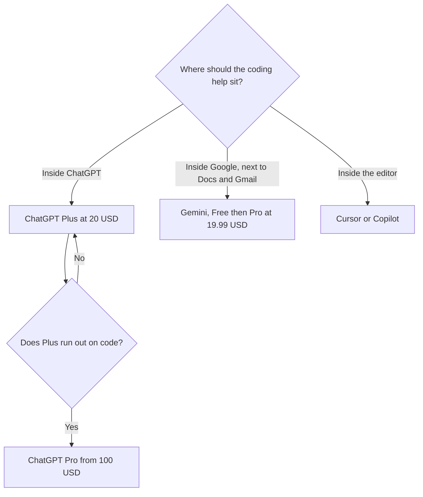

**Use ChatGPT when the coding agent should live in the ChatGPT seat, which is Codex on Plus. Use Gemini when you already live in Google's plans and the coding task is explanation, a snippet, or work next to Docs and Gmail.** They are not two IDEs. If the code lives in a repository you edit all day, the editor seat is Cursor or GitHub Copilot, and this page says so.

The Claude version of the same seat question is [ChatGPT vs Claude for coding](/blog/chatgpt-vs-claude-for-coding-2026/). The three-assistant overview is [ChatGPT vs Gemini vs Claude](/blog/chatgpt-vs-gemini-vs-claude-2026/). The editor map is [Cursor vs Claude Code vs Codex](/blog/cursor-vs-claude-code-vs-codex-2026/).

Prices are US list prices excluding tax from directory pages checked October 16, 2026. Published October 24, 2026. We did not score code.

## Where the code work actually sits

| Your week | Start here | First paid step | Not this |
|---|---|---|---|
| You want a coding agent in the same seat as the rest of ChatGPT | [ChatGPT](/tools/chatgpt/) Plus, which includes [Codex](/tools/openai-codex/) | Plus is $20 a month. Go is $8 and is not the Codex-heavy seat | A Google storage plan, if the repo is the point |
| You want a snippet, an explanation, or help beside Gmail and Docs | [Gemini](/tools/gemini/) | Free with a Google account. Google AI Pro is $19.99 a month | Plus, if you will not use anything outside Google |
| You edit in an IDE all day | [Cursor](/tools/cursor/) or [GitHub Copilot](/tools/github-copilot/) | Cursor Plus is $8. Copilot Pro is $10. Copilot Free is 2,000 completions a month | Either chat, as the only place the diff lives |
| You want a terminal agent on a Claude seat | [Claude](/tools/claude/) Pro, which includes Claude Code | $20 a month, or $17 billed annually. No Claude Code on Free | Gemini, as a stand-in for that agent |
| Plus limits already stop the day | ChatGPT Pro | From $100 a month | Gemini Ultra, unless you already needed that Google plan |

## What each plan is for

**ChatGPT.** Free includes text chat and limited Codex access, on the directory card. Go is $8 and adds usage. It may include ads. Plus is $20 and adds advanced reasoning, projects, scheduled tasks, custom GPTs, and expanded Codex usage. Pro is $100, $200, or $500. Business is $20 a user a month billed annually, or $25 monthly, for two or more users, and does not train on business data by default. The coding comparison that treats Codex as the product is the Claude article linked above. The ladder is [ChatGPT Go vs Plus vs Pro](/blog/chatgpt-go-vs-plus-vs-pro-2026/).

Codex on Plus is still a diff you have to read. A copilot suggests. An agent edits. The definition is [what an AI copilot is](/blog/what-is-an-ai-copilot-2026/). The person who accepts the change is [what human-in-the-loop AI is](/blog/what-is-human-in-the-loop-ai-2026/).

**Gemini.** Free, with a Google account, includes the Flash-Lite model and limited access to other features, plus 15 GB of storage. Google AI Plus is $4.99 a month for higher usage, video generation, and 400 GB. Google AI Pro is $19.99 a month and adds higher usage, Gemini 4 Argon access on that card, Gemini in Gmail and Docs, and 5 TB. Ultra is $99.99 or $199.99 a month. The directory does not list a separate "Gemini Code Assist" price. Do not invent one. If your coding help is "explain this function" or "draft this script I will paste into a repo," Pro is a Google bundle, not an IDE. The Workspace angle, which is mail and docs more than a compiler, is [Gemini vs ChatGPT for Google Workspace](/blog/gemini-vs-chatgpt-for-google-workspace-2026/).

**The editor, if that is the real job.** [GitHub Copilot](/tools/github-copilot/) Free is 2,000 completions a month. Pro is $10, with $15 in monthly credits. Business is $19 and adds IP indemnity and admin controls. [Cursor](/tools/cursor/) Plus is $8 a month, or $80 a year, on The X Subscription. Those are the tools to open when the refactor spans files. A chat window is where the explanation can live. The comparison is [Cursor vs GitHub Copilot](/blog/cursor-vs-github-copilot-2026/). The shelf is [best AI coding assistants](/blog/best-ai-coding-assistants-2026/).

## How to choose

If you want one agent that opens the repo from the ChatGPT side, start on Plus and use Codex. If Plus never runs out, do not buy Pro. If you are a student or a hobbyist who mostly asks what a line does, Gemini Free is enough to learn whether you like the assistant. Buy Google AI Pro when you also want the Gmail and Docs integration and the higher cap, not because a forum said it codes better.

Do not pay for Plus and Pro in the same month to answer the same question twice. Run one task you already understand in the free tier of each. Keep the tool whose mistakes you can see.

A refactor with tests is a narrower job than "coding." That head-to-head, between a terminal agent and an editor, is [Claude vs Cursor for refactors](/blog/claude-vs-cursor-for-refactors-2026/).

## FAQ

### Is Google AI Pro the same kind of product as ChatGPT Plus?

Both are monthly assistant seats, at $19.99 and $20. Plus includes expanded Codex usage. Pro includes Gemini inside Gmail and Docs and a storage upgrade. The overlap is "help me with this code in chat." The non-overlap is the agent and the Google bundle. Buy the non-overlap you will use.

### Does Gemini Free include a coding agent?

The directory describes a free assistant with a Google account. It does not describe a Codex-style coding agent on that free plan. Treat free Gemini as chat help. If you need an agent in the editor, look at Copilot Free or Cursor Free.

### Can I use Gemini for code and ChatGPT for everything else?

Yes. That split fails when you pay for both and only use one. If the code help is occasional, keep the one you already pay for and use its free counterpart for a second opinion you did not need a subscription to get.

### Which one writes better code?

This page did not measure that. The model, the tests, and whether you read the diff matter more than the logo.

## Last verified

October 16, 2026 for ChatGPT, Gemini, GitHub Copilot, Cursor, and Claude prices named above. Published October 24, 2026.

**Sources:** [ChatGPT pricing](https://chatgpt.com/pricing), [Google AI plans](https://one.google.com/about/google-ai-plans/), [GitHub Copilot](https://github.com/features/copilot).

*Published by Andrew for [AI Tools Optimizer](https://aitoolsoptimizer.com).*

[ChatGPT](/tools/chatgpt/) is in the [chatbots and assistants directory](/tools/category/chatbots-assistants/). Directory pages may use affiliate links. A purchase through them may earn us a commission at no extra cost to you.
