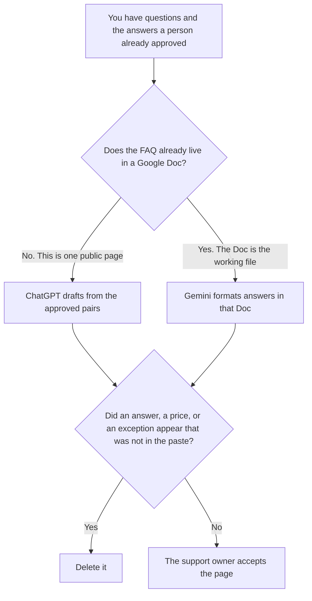

**Use ChatGPT when you are drafting one public FAQ page from question-and-answer pairs a person already approved. Use Gemini when that FAQ already lives in a Google Doc the support team edits, and the work is formatting answers next to those questions.** The model may order the questions. It may not invent an answer, a price, or an exception.

The workflow that starts from real questions is [how to create FAQ pages with AI](/blog/how-to-create-faq-pages-with-ai-2026/). An internal page, which is not this public FAQ, is [ChatGPT vs Gemini for wiki pages](/blog/chatgpt-vs-gemini-for-wiki-pages-2026/). The rule that a claim ships only with a source you can open is [what AI grounding citation-required is](/blog/what-is-ai-grounding-citation-required-2026/).

ChatGPT's Plus price is the October 24, 2026 plan-page figure recorded in [ChatGPT pricing explained](/blog/chatgpt-pricing-explained-2026/). Gemini's prices are the October 16 directory figures recorded in [Gemini pricing explained](/blog/gemini-pricing-explained-2026/): Plus is $4.99 a month, Pro is $19.99. Notion is the October 16 directory card. Claude's prices are the October 24 read of claude.com/pricing recorded in [Claude pricing explained](/blog/claude-pricing-explained-2026/). Published October 24, 2026. We did not score FAQs.

## Which page you are writing

| The job | Start here | First paid step | The limit |
|---|---|---|---|
| One public page from approved pairs | [ChatGPT](/tools/chatgpt/) | Plus is $20 a month | No answer that was not in the paste |
| The FAQ already lives in a Google Doc | [Gemini](/tools/gemini/) | Google AI Plus is $4.99 a month. Pro is $19.99 | The Doc's questions stay. A new question needs a person |
| The accepted page, if it does not live in Google | [Notion AI](/tools/notion-ai/) | Business is $20 a seat a month | Plus at $10 is not the full AI tier |
| A long answer that must match a locked help sentence | [Claude](/tools/claude/) | Pro is $17 a month billed annually, or $20 monthly | A paraphrase of a locked sentence is a new policy |

ChatGPT Plus is the right seat when the approved pairs are the whole source and you will read one page. Gemini Plus at $4.99 is the right first paid step when the file is already a Google Doc and you need more room than Free. Pro at $19.99 is the card's higher individual row, with Gemini in Docs on the October 16 record. Buying Pro to get an answer the paste does not contain does not put that answer in the Doc. If a question has no approved answer, the line says Answer not approved.

The wiki comparison is for an internal page. A public FAQ is what a customer will read. Do not paste the wiki into the FAQ and call it support policy. The support owner accepts the page.

## What the page is allowed to say

The questions you pasted, the answers you pasted, and the owner you named. A refund rule the model thinks is "standard" stays out. A price that was not in the paste stays out. If a question has no approved answer, the question stays unpublished.

**ChatGPT Plus** is the single-page draft. The bill is [ChatGPT pricing explained](/blog/chatgpt-pricing-explained-2026/).

**Gemini Plus** is the Doc you already have. The ladder, including Pro at $19.99 and the two Ultra prices, is [Gemini pricing explained](/blog/gemini-pricing-explained-2026/).

**Notion Business** is where the accepted page lives when Google is not the system of record. The invoice is [Notion AI pricing explained](/blog/notion-ai-pricing-explained-2026/).

**Claude Pro** holds a locked help sentence so the FAQ cannot drift from it. The review is [Claude review](/blog/claude-review-2026/).

A prompt that holds the line:

"Draft the FAQ from the approved question-and-answer pairs I pasted. If a question has no approved answer, write Answer not approved. Do not add a question. Do not add a price."

## What not to delegate

Do not ask what a company "usually" tells customers. Do not merge two approved answers into a friendlier one. Do not publish because the headings look complete. The support owner accepts the page.

## FAQ

### How is this different from the FAQ how-to?

That page is the workflow: real questions first, then the answer. This page is which seat drafts the page, ChatGPT or Gemini, after those answers exist. A workflow is not a price, and a price is not an answer.

### How is this different from a wiki page?

The wiki comparison is an internal page. This FAQ is the public page. A sentence can appear in both only after the owner accepts it for customers. The wiki does not become the FAQ by being shortened.

### When is Gemini Pro the seat?

When you already need the Pro row the pricing article describes, including Gemini in Docs, and the FAQ lives in that Doc. Plus at $4.99 is the first paid step. Pro does not supply an answer you did not paste.

### Who may publish the page?

The support owner named on the page. Answer not approved stays unpublished. A formatted FAQ is not acceptance.

## Last verified

October 24, 2026 for ChatGPT's plan page and for Claude, via the posts cited above. October 16, 2026 for Gemini and Notion. Published October 24, 2026. We did not score FAQs.

**Sources:** [ChatGPT and Codex pricing](https://learn.chatgpt.com/docs/pricing), [Google AI subscriptions](https://gemini.google/subscriptions/), [Notion pricing](https://www.notion.com/pricing), [Claude pricing](https://claude.com/pricing).

*Published by Andrew for [AI Tools Optimizer](https://aitoolsoptimizer.com).*

[ChatGPT](/tools/chatgpt/) is in the [chatbots and assistants directory](/tools/category/chatbots-assistants/). Directory pages may use affiliate links. A purchase through them may earn us a commission at no extra cost to you.
