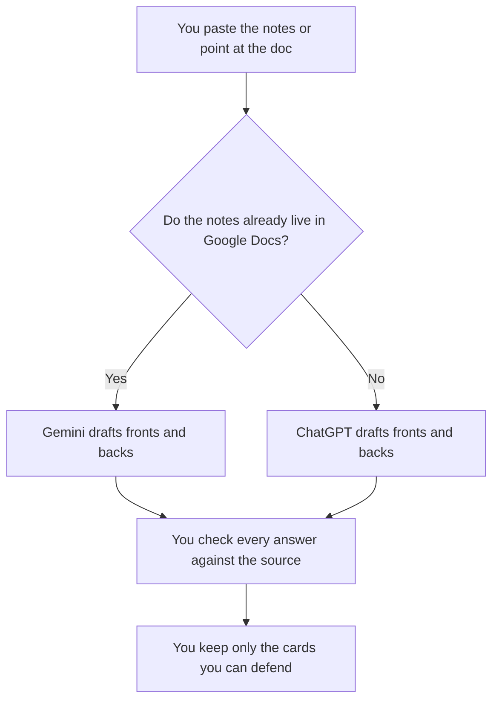

**Use Gemini when the source notes already live in a Google Doc. Use ChatGPT when you want a reusable project that turns a paste into a deck you will export.** Both can write a front and a back. Neither knows which fact is true. A card with an answer you did not check is a confident error you will memorize.

The wider student stack is [ChatGPT vs Gemini for students](/blog/chatgpt-vs-gemini-for-students-2026/). A quiz with an answer key you wrote is [how to create training quizzes with AI](/blog/how-to-create-training-quizzes-with-ai-2026/). A wrong back of the card is [what an AI hallucination is](/blog/what-is-ai-hallucination-2026/).

Prices are US list prices excluding tax from directory pages checked October 16, 2026. Quizlet's upgrade page did not load on that check, so this article prints no Quizlet dollar. Published October 24, 2026. We did not measure recall.

## Which seat matches the deck

| The notes you actually have | Start here | What you still do |
|---|---|---|
| A short paste and a definition list | [ChatGPT](/tools/chatgpt/) Free or [Gemini](/tools/gemini/) Free | You check every back against the source |
| The same course, week after week, in a saved prompt | ChatGPT Plus at $20 a month | Swap this week's notes. Do not reuse last week's answers |
| The chapter sits in Google Docs or Drive | Gemini on Google AI Pro at $19.99 a month, which includes Gemini in Docs | The doc is the source. The cards quote it |
| A lighter Google plan for more usage | Google AI Plus at $4.99 a month | 2x usage versus free, on the directory card. Still check the backs |
| A dedicated flashcard app | [Quizlet](/tools/quizlet/) has a free tier with flashcards | Price for Plus was not confirmed. Import a deck you already checked |
| The deck should live next to the class notes | [Notion AI](/tools/notion-ai/) Business at $20 a seat a month | The page is the record. The chat is the draft |

ChatGPT Go is $8 a month and may include ads. Do not treat an ad as a fact on a card. ChatGPT Pro starts at $100. Google AI Ultra starts at $99.99. A deck does not need either. Free is enough for one chapter.

## What each card should contain

A card has a prompt, an answer that appears in your notes, and a source line you can reopen. It does not have a mnemonic the model invented from a fact you did not supply. If the notes do not state it, the back says Missing.

**Gemini** is the right paid seat when you refuse to re-paste a Doc you already wrote. Pro is the plan that lists Gemini in Gmail and Docs. Free can draft from a paste. The review is [Gemini review](/blog/gemini-review-2026/).

**ChatGPT Plus** is the right paid seat when the deck template lives in a project and the notes are a file you drop in each week. Projects are on Plus. The review is [ChatGPT review](/blog/chatgpt-review-2026/).

A prompt that holds the line:

"Write flashcards only from the notes I pasted. One fact per card. The back must be a phrase that appears in the notes. If the notes do not answer the front, write Missing. Do not add facts, dates, or formulas I did not include."

## What not to delegate

Do not ask the model to fill gaps in a lecture you missed. Do not generate a deck from a topic name alone. Do not upload another student's unpublished work into a personal account if the course forbids it. The check is [how to fact-check AI writing](/blog/how-to-fact-check-ai-writing-2026/).

Quizlet is useful after the cards are true. This page does not pick a winner on "which app helps you remember." Memory is your review schedule. The tool only stores the cards.

## FAQ

### Which one makes better flashcards?

We did not measure studying. The better deck is the one whose backs match your notes. Pick Gemini when the source is a Google Doc. Pick ChatGPT when you want a project you reuse. Read the backs before you study them.

### Can the model write the clues too?

Only clues that restate your notes. A hint that adds a fact is a second, unchecked card. Leave it out.

### Is a quiz the same as a deck?

A deck is recall. A quiz can be multiple choice with a key you approve. Use the quiz article when you need choices. Use this page when you need fronts and backs.

### What if Quizlet is where the class already studies?

Build and check the cards here, then import them. We could not confirm Quizlet Plus pricing on October 16, 2026. Use the free flashcard tools, or read the upgrade page yourself before you budget a seat.

## Last verified

October 16, 2026 for ChatGPT, Gemini, Quizlet's missing price, and Notion AI. Published October 24, 2026.

**Sources:** [ChatGPT pricing](https://chatgpt.com/pricing/), [Google AI subscriptions](https://gemini.google/subscriptions/), [Notion pricing](https://www.notion.com/pricing).

*Published by Andrew for [AI Tools Optimizer](https://aitoolsoptimizer.com).*

[Quizlet](/tools/quizlet/) is in the [education directory](/tools/category/education/). Directory pages may use affiliate links. A purchase through them may earn us a commission at no extra cost to you.
