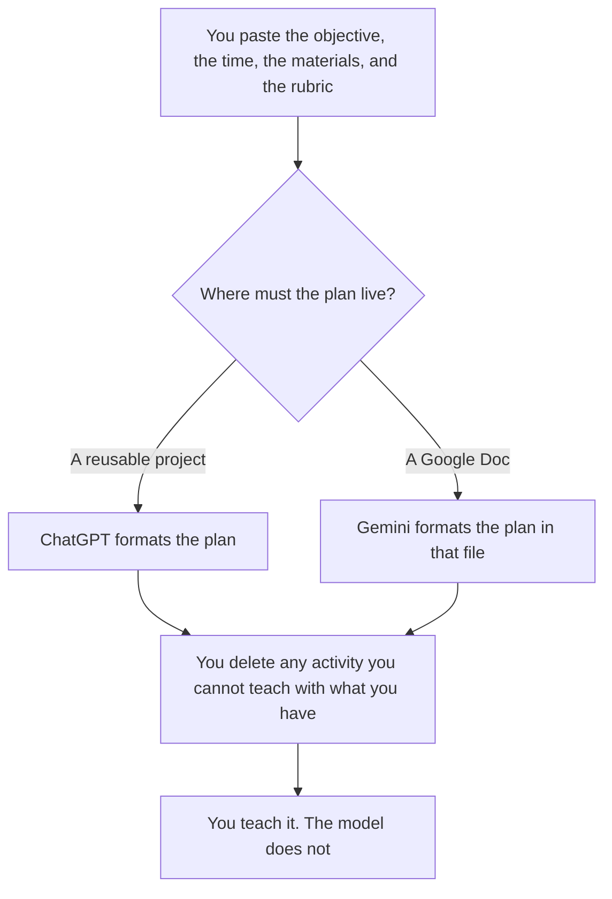

**Use ChatGPT when the lesson plan is a project you reuse and the standards live in a short card you paste each time. Use Gemini when the plan has to land in a Google Doc or Drive folder the school already uses.** A lesson plan here is a sequence a teacher will teach: objective, materials you have, steps, and a check against a rubric you wrote. It is not a grade, and it is not a tutor sitting with a student.

The classroom shelf is [best AI tools for teachers](/blog/best-ai-tools-for-teachers-2026/). The teacher product built for this job is [MagicSchool pricing explained](/blog/magicschool-pricing-explained-2026/). The tutor that is free for teachers and priced for families is [Khanmigo pricing explained](/blog/khanmigo-pricing-explained-2026/).

Prices are US list prices excluding tax from directory pages checked October 16, 2026. A live fetch of vendor pricing pages returned HTTP 401 on October 24, 2026, so this page stays on the directory record. Published October 24, 2026. We did not score lesson plans, and we did not sit in a classroom.

## Which seat matches the plan

| The plan you actually have | Start here | What you still do |
|---|---|---|
| One paste, one lesson | [ChatGPT](/tools/chatgpt/) Free or [Gemini](/tools/gemini/) Free | You accept or reject each step |
| The same planning card every week | ChatGPT Plus at $20 a month | Swap the objective. Keep the card |
| The file must live in Google Docs | Gemini, free, or Google AI Pro at $19.99 a month | Pro is the card's row for Gemini in Docs |
| A teacher-specific planner with a published seat | [MagicSchool](/tools/magicschool/) Plus at $8.33 a user a month billed annually, or $12.99 monthly | You still teach the lesson |
| A student tutor, not a plan | [Khanmigo](/tools/khanmigo/) free for teachers | Learners and families are $4 a month or $44 a year |

ChatGPT Go is $8 a month and may include ads, on the directory card. A plan you will hand a student is a poor place for an ad you did not choose. Plus at $20 is the seat when this is weekly work. ChatGPT Pro starts at $100. A weekly plan does not need it. Google AI Plus is $4.99 a month. Buy Plus when you need that card's video generation and storage, not because a lesson plan requires it. Pro at $19.99 is the row the directory ties to Gemini in Gmail and Docs and 5 TB. The ladder is [Gemini pricing explained](/blog/gemini-pricing-explained-2026/).

ChatGPT for Teachers is recorded on the teacher roundup as free for verified U.S. K–12 educators through June 2027. That window is a U.S. educator program. A teacher outside it prices the consumer seats on this page. This article is not a country guide.

## What the plan may contain

The objective you wrote, the minutes you have, the materials you listed, and a check that uses your rubric. It may not add a standard you did not name, a website you have not opened, or a differentiation move that requires a file you did not paste. If a step needs a printout you do not have, the step says Materials missing.

**ChatGPT Plus** is the paid path when the habit is a saved project and a paste of this week's objective. The review is [ChatGPT review](/blog/chatgpt-review-2026/).

**Gemini** is the paid path when the plan is a Doc and you already pay for Google, or when Pro's Docs access is the reason for the seat. Free Gemini can draft one plan. The review is [Gemini review](/blog/gemini-review-2026/).

**MagicSchool Plus** is the paid path when you want a planner built for teachers rather than a general chat. The free plan is described as forever free for an individual teacher. Brisk's paid plans are school and district sales, so this page does not invent a Brisk dollar. The note is [Brisk Teaching pricing explained](/blog/brisk-teaching-pricing-explained-2026/).

A prompt that holds the line:

"Write a lesson plan from the objective, minutes, materials, and rubric I pasted. Do not add a standard, a link, or a material. If a step needs something I did not list, write Materials missing. Do not write a grade."

## What not to delegate

Do not paste identifiable student work into a consumer account the school has not approved. Do not ask which plan will "engage them more." Do not ask the model to assign the grade. The check at the end of the lesson is yours. A fluent activity you cannot run with the materials in the room is a worse plan than the outline you started with.

## FAQ

### Which one writes better lesson plans?

We did not measure that. Pick ChatGPT when the card is short and the project is the habit. Pick Gemini when the file has to be a Google Doc. Pick MagicSchool when you want the teacher product and its published seat. The plan is only as good as the materials you can actually use.

### Can the model align the plan to standards?

It can place a standard code you pasted next to the objective. It cannot look up your state's list and assert a match. If the code is not in your paste, the line says Standard not provided.

### Where does Khanmigo fit?

Khanmigo is the tutor. It is free for teachers on the directory card, and $4 a month or $44 a year for learners and families. Use it when a student needs guided practice. Use this page when you are writing the plan you will teach.

### What if the school bans consumer chat?

Then neither Plus nor a personal Gemini account is the tool. Use the system the school named. A better prompt does not override that rule.

## Last verified

October 16, 2026 for ChatGPT, Gemini, MagicSchool, Khanmigo, and Brisk. The ChatGPT for Teachers window is the date recorded on the teacher roundup, October 24, 2026. Published October 24, 2026.

**Sources:** [ChatGPT pricing](https://chatgpt.com/pricing/), [Gemini subscriptions](https://gemini.google/subscriptions/), [MagicSchool pricing](https://www.magicschool.ai/pricing), [Khanmigo pricing](https://www.khanmigo.ai/pricing).

*Published by Andrew for [AI Tools Optimizer](https://aitoolsoptimizer.com).*

[MagicSchool](/tools/magicschool/) is in the [education directory](/tools/category/education/). Directory pages may use affiliate links. A purchase through them may earn us a commission at no extra cost to you.
