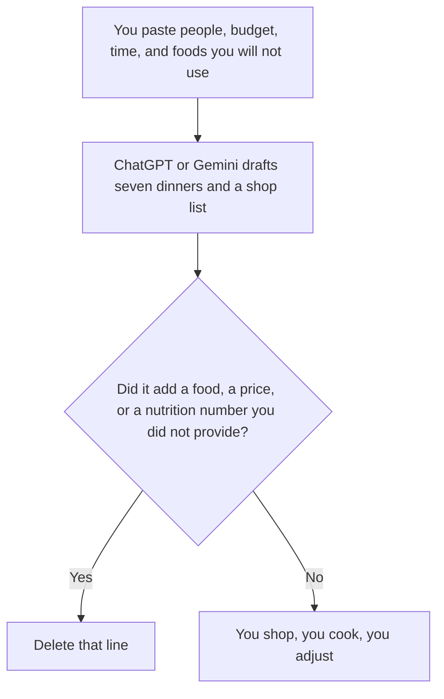

**Use ChatGPT or Gemini to draft a week of meals from the constraints you paste: who is eating, the budget, the minutes you have, and the foods you will not use. Then you buy the groceries and you taste the food.** A plan that invents a pantry you do not own is a different week. We did not score which model writes a better recipe.

The seat ladder on the OpenAI side is [ChatGPT Go vs Plus vs Pro](/blog/chatgpt-go-vs-plus-vs-pro-2026/). A number the model adds, including a calorie total you did not ask it to compute from a label, needs the same habit as any other claim: [how to fact-check AI writing](/blog/how-to-fact-check-ai-writing-2026/). An invented ingredient amount is [what an AI hallucination is](/blog/what-is-ai-hallucination-2026/).

Prices are US list prices excluding tax from directory pages checked October 16, 2026. Published October 24, 2026. This page is not medical, allergy, or diet advice. A restriction you care about has to be in the paste, and you still read the label in the store.

## Which seat matches the week

| The week you actually have | Start here | What you still do |
|---|---|---|
| One list, on your phone, from foods you typed | [ChatGPT](/tools/chatgpt/) Free, or [Gemini](/tools/gemini/) Free | Check every ingredient against the store and the people eating |
| You want the plan saved as a project you will reuse | ChatGPT Plus at $20 a month | Replace last week's prices. Do not keep a stale grocery total |
| You want the list in a Google Doc you already share | Gemini, on the Google account that holds the doc. Google AI Plus is $4.99 a month. Pro is $19.99 | The doc is the plan of record. The chat is the draft |
| The "source" is a cookbook PDF or a family doc | [Gemini Notebook](/tools/gemini-notebook/), free with a Google account | Ask only from that file. Open the page before you trust a quantity |
| You hit the free limit mid-list | ChatGPT Go at $8 a month, or Google AI Plus at $4.99 | Finish the week. Do not buy a top tier to plan seven dinners |

Go may include ads, on the ChatGPT card. A meal plan is not a reason to accept an ad as a recipe. Business, at $20 a user a month billed annually with a two-user minimum, matters when the paste includes someone else's health information and your policy forbids a personal account. A household week usually stays on Free, Go, Plus, or a Google AI plan.

## What $0 already does

**ChatGPT Free** can hold a text plan. Plus at $20 adds projects, which is the right row if you reuse the same household constraints every Sunday. Pro at $100 and above is a capacity tier. Seven dinners do not require it. The tool page is [ChatGPT](/tools/chatgpt/).

**Gemini Free** is enough for a list. Google AI Plus at $4.99 a month is the small step if you want more usage and Gemini in Google apps, on the directory card. Google AI Pro at $19.99 adds the higher usage tier the card calls out, including Gemini in Gmail and Docs. Use Pro when the plan lives in a shared Doc and you are already paying for the storage and the apps. Use Free when you will copy a list into a note.

**Gemini Notebook** is the better Gemini path when the constraint is a document: a scanned cookbook, a meal-service export, a sheet of family rules. It is free with a Google account. It does not know your fridge unless the fridge is in the file.

A prompt that holds the line:

"Plan seven dinners for the people and the minutes I pasted. Use only foods I allowed. If a meal needs something I did not list, write Missing. Do not invent prices, calories, or medical claims. Give a shop list grouped by store section. Keep each recipe short enough that I can cook it on a weeknight."

The person who cooks is [what human-in-the-loop AI is](/blog/what-is-human-in-the-loop-ai-2026/).

## What not to delegate

Do not ask the model to diagnose a diet. Do not paste a child's medical record into a personal chat your policy would not allow for a work document. Do not accept a grocery total the model computed from prices it remembered. Prices belong in the paste, with the store and the date, or they stay off the list.

If you want a second model to edit the wording of a recipe you already trust, [Claude](/tools/claude/) Pro is $20 a month, or $17 billed annually. That is an edit. It is not a second opinion on nutrition. The capacity split is [Claude Pro vs Max](/blog/claude-pro-vs-max-2026/).

## FAQ

### Which one cooks better?

We did not measure that. Use the account you will re-read on Sunday. If you will not check the shop list against the pantry, neither product has planned your week.

### Can I include calories?

Only from numbers you paste, from a label you read. A model-estimated calorie line is a claim without a source. Delete it, or replace it with the label. Grounding that claim is [what AI grounding is](/blog/what-is-ai-grounding-2026/).

### Is Plus or Pro required?

No. Free on both products can draft a week. Pay when the limit stops the list, or when you need projects or the Google apps you already use. The top tiers are for heavier work than seven dinners.

### What if someone in the house has an allergy?

Put the allergy in the paste as a hard exclusion. Then read every ingredient you buy. The model can miss a sauce, a stock, or a "may contain" line. The label in your hand is the check.

## Last verified

October 16, 2026 for ChatGPT, Gemini, Gemini Notebook, and Claude. Published October 24, 2026.

**Sources:** [ChatGPT pricing](https://chatgpt.com/pricing/), [Google AI subscriptions](https://gemini.google/subscriptions/), [Claude pricing](https://claude.com/pricing).

*Published by Andrew for [AI Tools Optimizer](https://aitoolsoptimizer.com).*

[Gemini](/tools/gemini/) is in the [chatbots and assistants directory](/tools/category/chatbots-assistants/). Directory pages may use affiliate links. A purchase through them may earn us a commission at no extra cost to you.
