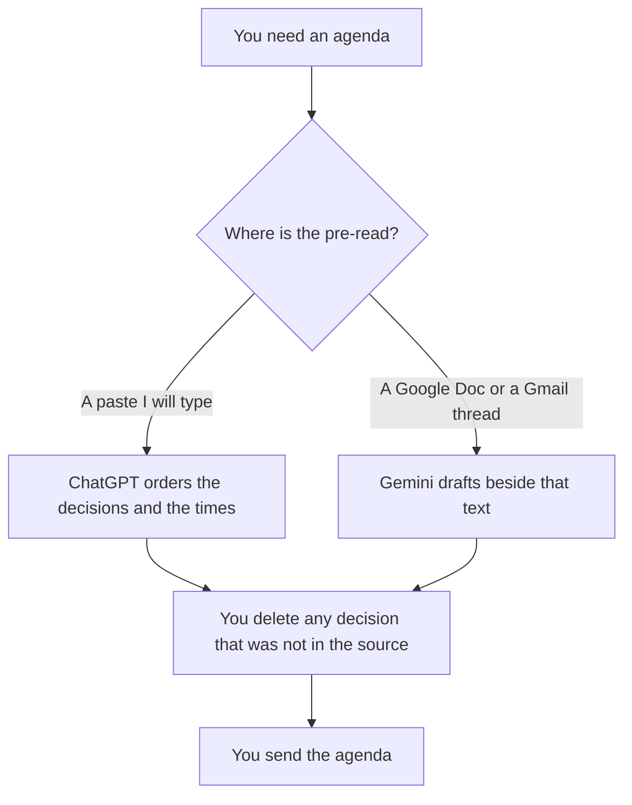

**Use ChatGPT when the agenda is a short list built from decisions and times you paste. Use Gemini when the pre-read already lives in a Google Doc or a Gmail thread and the agenda should be drafted beside that text.** The model may order the items. It may not invent a decision, an owner, or a duration. The Claude-versus-ChatGPT version of this task is [Claude vs ChatGPT for meeting agendas](/blog/claude-vs-chatgpt-for-meeting-agendas-2026/). The workflow that starts from the decisions is [how to create meeting agendas with AI](/blog/how-to-create-meeting-agendas-with-ai-2026/).

Prices are US list prices excluding tax from directory pages checked October 16, 2026. Published October 24, 2026. We did not score meetings.

## Where the pre-read already lives

| The material you have | Start here | First paid step | The limit |
|---|---|---|---|
| A paste of decisions, owners, and a clock | [ChatGPT](/tools/chatgpt/) | Plus is $20 a month | No decision that was not in the paste |
| A Google Doc or a Gmail thread | [Gemini](/tools/gemini/) | Google AI Pro is $19.99 a month for Gemini in Gmail and Docs | The Doc is the source. The chat does not add a topic |
| A long agenda you will reuse in a Project | [Claude](/tools/claude/) | Pro is $20 a month, or $17 billed annually | The other article |
| The agenda page the team already opens | [Notion AI](/tools/notion-ai/) | Business is $20 a seat a month | Publish the page. The chat is not the invite |

Google AI Plus is $4.99 a month on the directory card and lists higher usage than Free. The Gmail and Docs line is on Pro, on that card. If the agenda must sit inside the Doc, Plus is the wrong quote. Free Gemini can still draft from a paste. The invoice is [Gemini pricing explained](/blog/gemini-pricing-explained-2026/).

ChatGPT Go is $8 a month. Plus is the seat when the agenda lives in a Project with last week's decisions. The review is [ChatGPT review](/blog/chatgpt-review-2026/).

## What the agenda is allowed to contain

A purpose line you wrote, the decisions you already named, the owner of each decision, and the minutes you assigned. A topic called "other" is how a meeting doubles. If the source does not name an owner, the line says Owner missing. The model does not volunteer one.

**ChatGPT Plus** is the paste path. Put the decisions in the prompt. Ask for an ordered list that sums to the meeting length you gave. A 25-minute meeting cannot hold six 15-minute items. The arithmetic is yours to check.

**Gemini on Pro** is the Doc path. The directory card says Pro includes Gemini in Gmail and Docs. Use the Doc you already shared. Do not paste a private thread into a personal chat the attendees cannot see, then wonder why the agenda drifted.

**Claude** is the right seat when the agenda is long and should sit next to a decision log in a Project. That choice is the other comparison. Do not run all three and merge them.

**Notion** is the system of record if that is the wiki. Generate into the page the calendar invite already links.

A prompt that holds the line:

"Order an agenda from the decisions, owners, and total minutes I pasted. Do not add a topic. If an owner is missing, write Owner missing. The minutes must sum to the total I gave."

## What not to delegate

Do not ask the model what the meeting should decide. Do not let it pull a topic from a different Doc because the titles looked related. Do not send an agenda you have not read. The factual check, if a number snuck in, is [how to fact-check AI writing](/blog/how-to-fact-check-ai-writing-2026/).

## FAQ

### Which one writes a better agenda?

We did not measure that. ChatGPT fits a paste. Gemini fits a Doc or a Gmail thread you already have on Pro. The agenda is better when every line traces to a decision you named.

### Do I need Google AI Pro?

You need Pro if the point is Gemini inside Gmail and Docs, on the directory card checked October 16, 2026. You can draft from a paste on Free. The $4.99 Plus card is a usage step, and the directory does not put the Gmail line on it.

### How is this different from the Claude comparison?

That page chooses between Claude and ChatGPT for the same kind of list. This page chooses between ChatGPT and Gemini based on where the pre-read lives. Read both if Claude is also on the table.

### Can the model assign owners?

Only by copying owners you pasted. An invented owner is a commitment that person did not make. Leave the cell missing.

## Last verified

October 16, 2026 for ChatGPT, Gemini, Claude, and Notion. Published October 24, 2026.

**Sources:** [ChatGPT pricing](https://chatgpt.com/pricing/), [Google AI subscriptions](https://gemini.google/subscriptions/), [Claude pricing](https://claude.com/pricing), [Notion pricing](https://www.notion.com/pricing).

*Published by Andrew for [AI Tools Optimizer](https://aitoolsoptimizer.com).*

[ChatGPT](/tools/chatgpt/) is in the [chatbots and assistants directory](/tools/category/chatbots-assistants/). Directory pages may use affiliate links. A purchase through them may earn us a commission at no extra cost to you.
