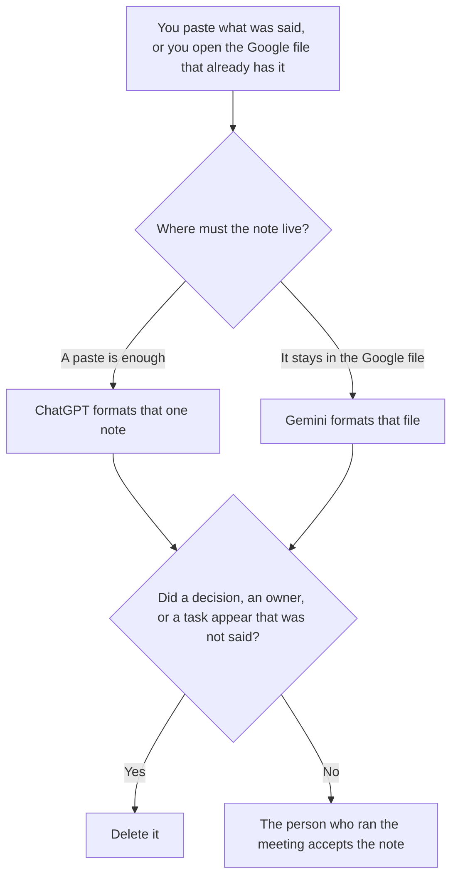

**Use ChatGPT when you are formatting one transcript or one rough note from a paste. Use Gemini when the notes must stay in a Google Doc or a Drive file the meeting already produced.** The model may group decisions, owners, and open questions that were said. It may not invent a decision, assign an owner who was not named, or add a task from silence. A cleanup that has to follow the same rules in a Claude Project is [ChatGPT vs Claude for meeting notes cleanup](/blog/chatgpt-vs-claude-for-meeting-notes-cleanup-2026/). The page the team already opens in Notion is [Notion AI vs ChatGPT for meeting notes](/blog/notion-ai-vs-chatgpt-for-meeting-notes-2026/).

A recorder, which is a different product, is the shelf in [best AI meeting notetakers](/blog/best-ai-meeting-notetakers/). The agenda before anyone speaks is [Gemini vs Claude for meeting agendas](/blog/gemini-vs-claude-for-meeting-agendas-2026/).

ChatGPT's Plus price is the October 24, 2026 plan-page figure recorded in [ChatGPT pricing explained](/blog/chatgpt-pricing-explained-2026/). Gemini's prices are the October 16 directory card recorded in [Gemini pricing explained](/blog/gemini-pricing-explained-2026/). Notion and Otter prices are from directory pages checked October 16, 2026. Published October 24, 2026. We did not score transcription. We did not run either model on a live meeting.

## Where the note has to live

| The file | Start here | First paid step | The limit |
|---|---|---|---|
| One transcript, pasted | [ChatGPT](/tools/chatgpt/) | Plus is $20 a month | No decision the paste did not contain |
| A Google Doc or Drive file the meeting already has | [Gemini](/tools/gemini/) | Google AI Pro is $19.99 a month | The note stays in that file. No owner who was not named |
| The Notion page the team already opens | [Notion AI](/tools/notion-ai/) | Business is $20 a seat a month | Plus at $10 is not the full AI tier. AI Meeting Notes are on Business, on the October 16 card |
| A recording, if you do not already have a transcript | [Otter](/tools/otter-ai/) | Pro is $8.33 a user a month billed annually | 1,200 minutes and a 90-minute cap. This page does not turn a chat into a recorder |

A line that says "the team agreed" has added a decision when the paste only had a discussion. If the decision is missing, the line says Decision not stated. It does not propose one. Put proposals in a note labeled Not in the meeting notes.

ChatGPT Go is $8 a month on the October 24 plan page. Plus is the seat for a saved note. Free Gemini comes with a Google account, on the pricing article. AI Plus is $4.99 a month. Pro at $19.99 is the seat this page quotes when the Doc is the record. The review is [Gemini review](/blog/gemini-review-2026/).

## What the note is allowed to contain

The words that were said, the names that were said, and the open questions that were said. A metric that nobody spoke stays out. A task without an owner stays as Owner not named. The person who ran the meeting can add the owner later. They should not discover a new commitment in the draft.

**ChatGPT Plus** is the one-paste path. The review is [ChatGPT review](/blog/chatgpt-review-2026/).

**Gemini Pro** is the Google-file path. If the transcript is not already in Drive, do not pretend Gemini attended the meeting. Paste it, or use a recorder. The invoice is [Gemini pricing explained](/blog/gemini-pricing-explained-2026/).

**Notion Business** is the page after the note is accepted, when the team does not live in Google. The invoice is [Notion AI pricing explained](/blog/notion-ai-pricing-explained-2026/). The Claude cut of that same Notion choice is [Notion AI vs Claude for meeting notes](/blog/notion-ai-vs-claude-for-meeting-notes-2026/).

**Otter Pro** is the recorder when you do not have text yet. Business, at $19.99 a user a month billed annually, is a different cap. The invoice is [Otter.ai pricing explained](/blog/otter-ai-pricing-explained-2026/).

A prompt that holds the line:

"Draft the meeting note from the transcript I pasted. If a decision was not stated, write Decision not stated. If an owner was not named, write Owner not named. Do not add a task. Do not add a number nobody said."

## What not to delegate

Do not ask which decisions "must have been meant." Do not paste last week's notes so this week matches them. Do not send the note because the headings look complete. The person who ran the meeting accepts it. A formatted page is not a decision.

## FAQ

### How is this different from ChatGPT vs Claude for meeting notes cleanup?

That page chooses ChatGPT for one paste and Claude when the cleanup rules must match every meeting in a Project. This page chooses ChatGPT for one paste and Gemini when the note has to stay in a Google Doc or Drive file. Both pages refuse an invented decision. Use that page for a shared rule set. Use this page for the Google file.

### How is this different from Notion AI vs ChatGPT for meeting notes?

That page chooses Notion when the notes must live on the Notion page, and ChatGPT when you will paste the accepted text in afterward. This page chooses Gemini when the file is already in Google. Notion is a third home. Do not run all three and merge the drafts. Pick the file people will open.

### How is this different from a meeting agenda?

The agenda page is the list before anyone speaks. This page is the note after they spoke. An agenda item that was not discussed stays off the note, or the note says it was not discussed, if you wrote that. Do not let the agenda become a decision.

### Who may accept the note?

The person who ran the meeting. A formatted Doc is not acceptance. Decision not stated stays not stated. Owner not named stays unnamed until that person writes the name.

## Last verified

October 24, 2026 for ChatGPT's plan page, via the pricing article. October 16, 2026 for Gemini, Notion, and Otter. Published October 24, 2026.

**Sources:** [ChatGPT and Codex pricing](https://learn.chatgpt.com/docs/pricing), [Gemini subscriptions](https://gemini.google/subscriptions/), [Notion pricing](https://www.notion.com/pricing), [Otter pricing](https://otter.ai/pricing).

*Published by Andrew for [AI Tools Optimizer](https://aitoolsoptimizer.com).*

[ChatGPT](/tools/chatgpt/) is in the [chatbots and assistants directory](/tools/category/chatbots-assistants/). Directory pages may use affiliate links. A purchase through them may earn us a commission at no extra cost to you.
