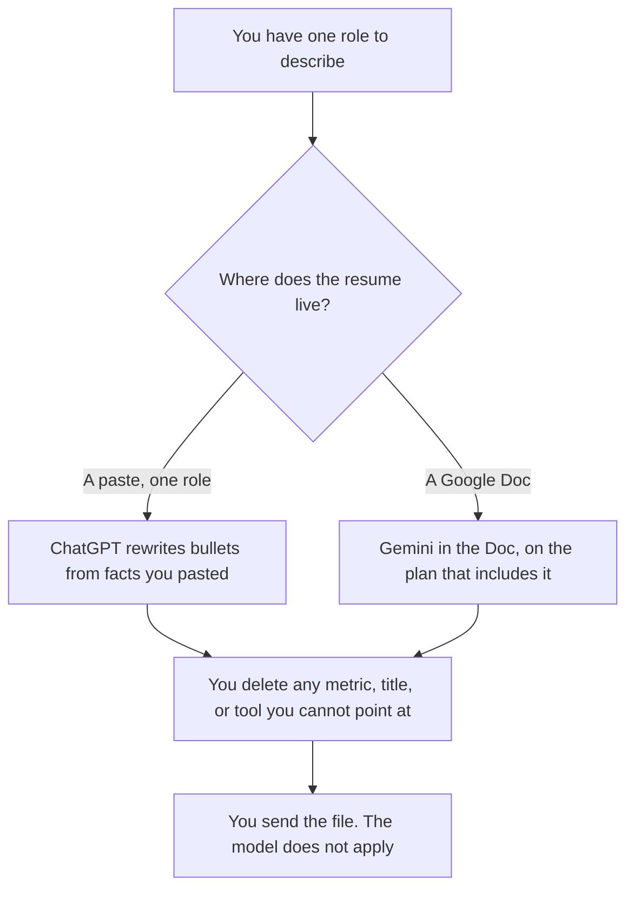

**Use ChatGPT when you are rewriting one role from a paste of the job post and the facts you already did. Use Gemini when the resume already lives in a Google Doc and you want the draft in that file.** The model may shorten a bullet you can defend. It may not invent a metric, a title, or a tool you did not use. The scorecard a hiring team uses later is [how to create interview scorecards with AI](/blog/how-to-create-interview-scorecards-with-ai-2026/). A different ChatGPT-versus-Gemini split, for agendas, is [ChatGPT vs Gemini for meeting agendas](/blog/chatgpt-vs-gemini-for-meeting-agendas-2026/).

ChatGPT prices are from the directory page checked October 16, 2026, because chatgpt.com/pricing returned HTTP 403 on October 24. Google AI prices are from gemini.google/subscriptions on October 24, 2026. Grammarly's price is from the October 16 directory card. Published October 24, 2026. We did not score callbacks or interviews.

## Which seat matches the bullet

| The draft in front of you | Start here | First paid step | The limit |
|---|---|---|---|
| One role, from a paste of the posting and your facts | [ChatGPT](/tools/chatgpt/) | Plus is $20 a month | No metric that was not in the paste |
| The resume is a Google Doc | [Gemini](/tools/gemini/) | Google AI Pro is $19.99 a month and includes Gemini in Docs on that page | The Doc is the source. The model does not add a job |
| A last pass on grammar | [Grammarly](/tools/grammarly/) | Pro is $12 a member a month billed annually, or $30 monthly | If the rewrite adds a result, put the old bullet back |
| A long career history that must stay consistent | [Claude](/tools/claude/) | Pro is $17 a month billed annually, or $20 monthly, on the October 24 Claude page | The comparison on this page is still ChatGPT versus Gemini |

ChatGPT Go is $8 a month and may include ads, on the October 16 card. A resume is a poor place to discover an ad or a tight limit. Plus is the seat for a saved set of roles. The review is [ChatGPT review](/blog/chatgpt-review-2026/).

Google AI Plus is $4.99 a month on the October 24 subscriptions page. The page lists Gemini in Gmail, Docs, and more on Plus and above in the benefits section we read, and it lists higher access on Pro. If your Doc editing requires Pro, Pro at $19.99 is the seat. Do not quote Plus as Docs access if checkout says otherwise. The invoice is [Gemini pricing explained](/blog/gemini-pricing-explained-2026/).

## What a bullet is allowed to say

A duty you performed, a scope you can name, and a result you already measured. If you do not have the number, the bullet does not grow one. "Improved onboarding" stays qualitative. "Cut onboarding time by 40%" appears only when you paste the 40%.

**ChatGPT Plus** is the one-role path. Paste the posting and three facts. Ask for bullets that use only those facts. A second set that "sounds more senior" and adds a team size is the set you delete.

**Gemini on the Doc** is the path when the file is already in Google. Ask for a rewrite of the bullets you highlighted. Do not ask it to "fill gaps" from the job posting by assuming you did every line in the posting.

**Grammarly Pro** is the last pass. The invoice is [Grammarly pricing explained](/blog/grammarly-pricing-explained-2026/). A cleaner verb is welcome. A new achievement is not.

A prompt that holds the line:

"Rewrite these bullets using only the facts I pasted. Do not add a metric, a tool, or a title. If a bullet has no result, leave it without a number. Do not match the job post by inventing experience."

## What not to delegate

Do not paste a colleague's review or a private performance document into a personal chat. Do not let the model choose which job title is "close enough." Do not send the model's file to an employer without reading every number. The interview scorecard is a different document, written by the hiring team, from criteria they set.

## FAQ

### Which one writes stronger bullets?

We did not measure that. ChatGPT fits a paste of one role. Gemini fits a Google Doc you already keep. The bullet is stronger when every claim is a fact you can say out loud in an interview.

### Do I need Google AI Pro?

The October 24 subscriptions page prices Pro at $19.99 and Plus at $4.99. Read the Docs line at checkout for the seat you will actually edit in. Free Gemini can help with a paste. A Doc workflow is the paid question.

### Can the model tailor bullets to a job post?

It may emphasize facts you already pasted that match lines in the post. It may not acquire the experience the post describes. A missing skill stays missing.

### Where does Claude fit?

Claude Pro is the long-history seat if several roles must not contradict each other. This page's choice is still ChatGPT versus Gemini. Use one drafter for the version you will send.

## Last verified

October 24, 2026 for Google AI subscriptions and Claude. October 16, 2026 for ChatGPT and Grammarly. Published October 24, 2026.

**Sources:** [ChatGPT pricing](https://chatgpt.com/pricing/), [Google AI subscriptions](https://gemini.google/subscriptions/), [Grammarly pricing](https://www.grammarly.com/plans), [Claude pricing](https://claude.com/pricing).

*Published by Andrew for [AI Tools Optimizer](https://aitoolsoptimizer.com).*

[ChatGPT](/tools/chatgpt/) is in the [chatbots and assistants directory](/tools/category/chatbots-assistants/). Directory pages may use affiliate links. A purchase through them may earn us a commission at no extra cost to you.
