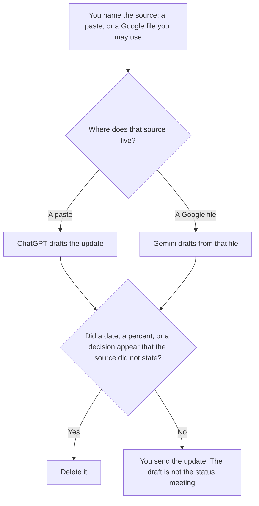

**Use ChatGPT when the status update is one paste of bullets a person already wrote. Use Gemini when those bullets already live in a Google Doc, Gmail thread, or Sheet you are allowed to use.** The update may group done, next, and blocked. It may not turn a blocker into a decision, add a date, or invent a percent complete. A resume line, which is a different paste, is [ChatGPT vs Gemini for resume bullets](/blog/chatgpt-vs-gemini-for-resume-bullets-2026/). A spreadsheet check with a different pair of models is [Gemini vs Claude for spreadsheet audits](/blog/gemini-vs-claude-for-spreadsheet-audits-2026/).

ChatGPT Plus and Business prices are from learn.chatgpt.com/docs/pricing on October 24, 2026. Gemini, Claude, and Notion prices below: Gemini and Notion are directory pages checked October 16, 2026. Claude is claude.com/pricing on October 24, 2026. Published October 24, 2026. We did not score prose.

## Which update you are writing

| The source in front of you | Start here | First paid step | The limit |
|---|---|---|---|
| Bullets in a paste | [ChatGPT](/tools/chatgpt/) | Plus is $20 a month | No status that was not in the paste |
| A Google Doc or thread you may use | [Gemini](/tools/gemini/) | Google AI Plus is $4.99 a month on the October 16 card | The Doc stays the source |
| Rules that must match last week's update | [Claude](/tools/claude/) | Pro is $17 a month billed annually, or $20 monthly | The Project holds the headings |
| The page the team will reread | [Notion AI](/tools/notion-ai/) | Business is $20 a seat a month | Plus at $10 is not the full AI tier |

A status update that "keeps leadership calm" has edited the week. If the source says the migration is blocked, the update says it is blocked. The name of the owner appears only if the source named them.

## What each seat keeps

**ChatGPT Plus** is the one-paste path. Go is $8 a month on the October 24 page. Business is $20 a user a month billed annually for two or more users, or $25 monthly, when a personal seat is the wrong place for the notes. The page says Business does not train on business data by default. The ladder is [ChatGPT pricing explained](/blog/chatgpt-pricing-explained-2026/). The review is [ChatGPT review](/blog/chatgpt-review-2026/).

**Gemini** Free exists with a Google account on the October 16 card. Google AI Plus is $4.99 a month. Google AI Pro is $19.99. Use Pro when you are already hitting the limits of the Google apps the update depends on. The invoice is [Gemini pricing explained](/blog/gemini-pricing-explained-2026/).

**Claude Pro** is the shared-headings path when every update must use the same three sections. That is a writing rule, not a Google file. The review is [Claude review](/blog/claude-review-2026/).

**Notion Business** is the home of the update if the team already tracks the work there. The model formats the page. It does not close the task. The invoice is [Notion AI pricing explained](/blog/notion-ai-pricing-explained-2026/).

A prompt that holds the line:

"Write a status update from the bullets I pasted. Use only done, next, and blocked items that are in the paste. If an owner or a date is missing, write Missing. Do not resolve a blocker. Do not add a percent complete."

## What not to delegate

Do not merge two weeks so the update "has more progress." Do not pull a Google file the sender was not allowed to open. Do not let a grammar pass change "blocked" into "nearly done."

## FAQ

### Which one writes a clearer update?

We did not measure that. ChatGPT fits a paste. Gemini fits a Google file you may already use. The update is usable when every line traces to that source.

### Is Gemini's free plan enough?

The October 16 card says Free exists with a Google account. It does not print a status-update quota. If the file is sensitive, the plan question is your company's rule, not the existence of a free tier.

### What about a number I almost know?

Leave it out, or write the source. An estimate belongs in the update only when you label it as your estimate and you typed it. The model does not get to supply the estimate.

### Who sends the update?

The person who owns the work. A finished paragraph is not a send. The meeting that follows is a different document.

## Last verified

October 24, 2026 for ChatGPT Plus, Go, and Business, and for Claude. October 16, 2026 for Gemini and Notion. Published October 24, 2026.

**Sources:** [ChatGPT and Codex pricing](https://learn.chatgpt.com/docs/pricing), [Gemini subscriptions](https://gemini.google/subscriptions), [Claude pricing](https://claude.com/pricing), [Notion pricing](https://www.notion.com/pricing).

*Published by Andrew for [AI Tools Optimizer](https://aitoolsoptimizer.com).*

[ChatGPT](/tools/chatgpt/) is in the [chatbots and assistants directory](/tools/category/chatbots-assistants/). Directory pages may use affiliate links. A purchase through them may earn us a commission at no extra cost to you.
