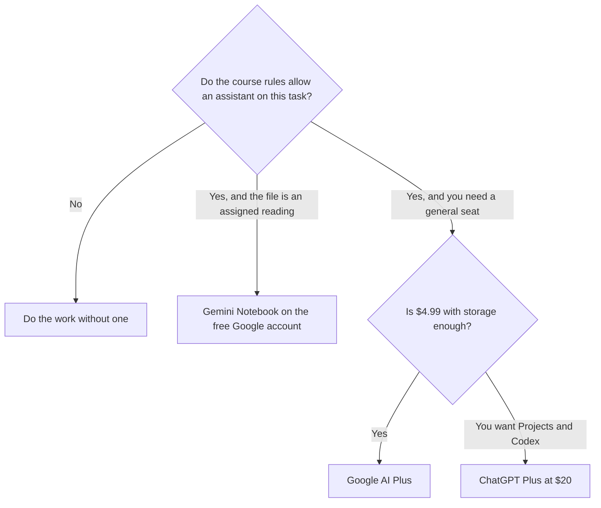

**Use ChatGPT when you want a general drafting and coding seat with a clear $20 Plus plan. Use Gemini when you want the Google account you already have, a $4.99 Plus step, and storage bundled with the same plan.** Your school's rules outrank either price. If the assignment forbids an assistant, neither product is a workaround. This page does not score which model writes a better essay.

The wider shelf, including a notebook for assigned readings, is [best AI tools for students](/blog/best-ai-tools-for-students-2026/). The reading workflow is [Gemini Notebook study workflows](/blog/gemini-notebook-study-workflows/). A cited web tool, which is a different job, is covered in [Perplexity alternatives for students](/blog/perplexity-alternatives-for-students-2026/).

Prices are US list prices excluding tax from directory pages checked October 16, 2026. The directory does not record a student discount for ChatGPT or for Gemini. Do not assume one at checkout. Published October 24, 2026.

## The plans a student actually hits

| | [ChatGPT](/tools/chatgpt/) | [Google Gemini](/tools/gemini/) |
|---|---|---|
| Free | Unlimited text chats with GPT-6, plus limited uploads, images, voice, and deep research | Flash-Lite, image generation and editing, limited Nano Banana Pro, 15 GB storage |
| First paid step | Go at $8 a month. OpenAI says Go may include ads | Google AI Plus at $4.99 a month: 2× Free usage, video generation, 200 Flow credits, 400 GB storage |
| The seat people mean | Plus at $20 a month: projects, scheduled tasks, custom GPTs, expanded Codex | Google AI Pro at $19.99 a month: 4× Free usage, Gemini 4 Argon, 1,000 Flow credits, Gemini in Gmail and Docs, 5 TB |
| Heavy tier | Pro at $100, $200, or $500 a month | Ultra at $99.99 a month (5× Pro limits) or $199.99 (20×), with 20 TB or more and YouTube Premium |
| A recorded student price | None on the directory card | None on the directory card |

Go at $8 is the cheap ChatGPT step, with the ads caveat the directory records. Plus at $20 is the step that adds projects. Five months of Plus is 5 × $20 = $100, the same sticker as one month of the lowest Pro tier. Pro is a usage band for heavy work, not a student default. The ladder is [ChatGPT Go vs Plus vs Pro](/blog/chatgpt-go-vs-plus-vs-pro-2026/).

Google AI Plus at $4.99 is 12 × $4.99 = $59.88 a year if you stay month to month. Google AI Pro at $19.99 is 12 × $19.99 = $239.88 a year. Buy Pro when you want Gemini inside Gmail and Docs and the larger storage, not because a forum ranked the model. The product page is [Gemini review](/blog/gemini-review-2026/). The coding angle, which is a different decision, is [ChatGPT vs Gemini for coding](/blog/chatgpt-vs-gemini-for-coding-2026/).

## What to use around the chatbot

**Assigned readings.** [Gemini Notebook](/tools/gemini-notebook/) is free with a Google account in supported countries. Google AI Plus at $4.99 adds more Audio Overviews and notebooks. Pro offers 5× more, on the directory card. Start on Free. The notebook cites your sources. A general chat does not replace the PDF you were given.

**A tutor that withholds the answer.** [Khanmigo](/tools/khanmigo/) is $4 a month or $44 a year for learners and families, sales tax excluded. Teachers are free. Parents can add up to 10 children. If hints are forbidden too, $4 does not help. If hints are allowed, it is a closer fit than a chatbot that will dump the solution when asked.

**A grammar pass on words you wrote.** [Grammarly](/tools/grammarly/) Free covers basics. Pro is $12 a member a month billed annually. Pro is optional. The card is [Grammarly pricing explained](/blog/grammarly-pricing-explained-2026/).

**Code practice, if the course allows it.** GitHub Copilot Free includes 2,000 completions a month. Verified students can get a Copilot Student plan. We did not record that plan's price or limits, so confirm them on the account. The explainer is [GitHub Copilot pricing explained](/blog/github-copilot-pricing-explained-2026/).

ChatGPT Business, at $20 a user a month billed annually for two or more users, is a team plan. A solo student does not need it to avoid training. Read the consumer plan's data settings before you paste a draft you care about.

## What this page will not tell you

It will not rank the models on homework. It will not invent an education discount. It will not suggest using either tool on a closed-book exam. Practice problems you are allowed to practice, and cite the assistant if the instructor asked you to. The claim check, when you do use a draft, is [how to fact-check AI writing](/blog/how-to-fact-check-ai-writing-2026/).

## FAQ

### Is Gemini cheaper than ChatGPT for a student?

The first paid Gemini step on the card is $4.99. The first paid ChatGPT step is Go at $8, and Plus is $20. Free exists on both. Cheaper is not the same as allowed, and it is not the same as enough storage or enough projects.

### Should I buy Ultra or Pro?

Ultra starts at $99.99 and the higher Ultra band is $199.99. ChatGPT Pro starts at $100. Those are heavy-usage prices. A course load that fits in Free or Plus does not need them. Revisit only when you are actually hitting the cap.

### Is there a student discount?

Not on the ChatGPT or Gemini directory cards checked October 16, 2026. Other products on this site do record student offers. Those offers are not transferable. Check the account. Do not budget a rumor.

### What about group projects and shared logins?

Buy a seat per person if the plan is per person. A shared password breaks the moment two people need the account, and it may violate the product terms. For a shared drive you already have, Gemini's storage bundle is the feature to read. It is not a reason to share a login.

## Last verified

October 16, 2026 for ChatGPT, Gemini, Gemini Notebook, Khanmigo, Grammarly, and the Copilot student note above. No ChatGPT or Gemini student price was on those cards. Published October 24, 2026.

**Sources:** [ChatGPT pricing](https://chatgpt.com/pricing), [Google Gemini](https://gemini.google.com), [Khanmigo](https://www.khanmigo.ai).

*Published by Andrew for [AI Tools Optimizer](https://aitoolsoptimizer.com).*

[Google Gemini](/tools/gemini/) is in the [chatbots and assistants directory](/tools/category/chatbots-assistants/). Directory pages may use affiliate links. A purchase through them may earn us a commission at no extra cost to you.
