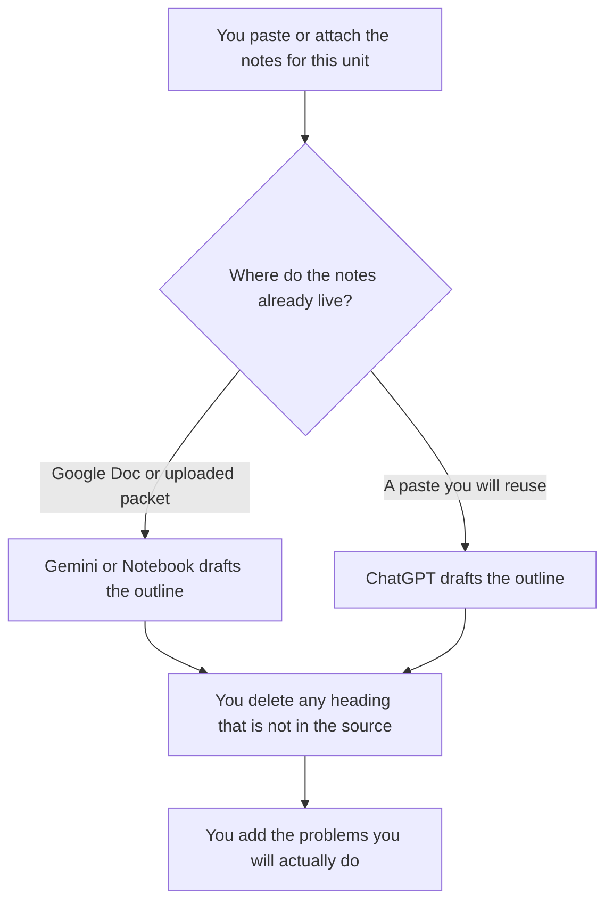

**Use Gemini when the chapter already lives in a Google Doc or in Notebook. Use ChatGPT when you want a reusable project that turns a paste into the same outline every week.** A study guide is a map of material you already have: headings, definitions, and the problems you will practice. It is not a textbook the model writes from memory. A section you did not check against the source is a fact you may memorize wrong.

The card format, which is a different artifact, is [ChatGPT vs Gemini for flashcards](/blog/chatgpt-vs-gemini-for-flashcards-2026/). The wider student decision is [ChatGPT vs Gemini for students](/blog/chatgpt-vs-gemini-for-students-2026/). A wrong sentence that was not in the notes is [what an AI hallucination is](/blog/what-is-ai-hallucination-2026/).

Prices are US list prices excluding tax from directory pages checked October 16, 2026. Published October 24, 2026. We did not measure exam scores. This page is not a school-policy review.

## Which seat matches the chapter

| The source you actually have | Start here | What you still do |
|---|---|---|
| A short paste of your own notes | [ChatGPT](/tools/chatgpt/) Free or [Gemini](/tools/gemini/) Free | You check every definition against the source |
| The same course outline, week after week | ChatGPT Plus at $20 a month | Swap this week's notes. Do not reuse last week's answers |
| The chapter sits in Google Docs | Gemini on Google AI Pro at $19.99 a month | The doc is the source. The guide quotes it |
| A lighter Google plan | Google AI Plus at $4.99 a month | The card lists 2x usage versus free. The source rule does not change |
| Several PDFs or a packet you upload | [Gemini Notebook](/tools/gemini-notebook/) on the free Google account, or AI Plus at $4.99 | The guide may use only what you uploaded |
| A long handbook the outline must not contradict | [Claude](/tools/claude/) Pro at $20 a month, or $17 billed annually | The Project holds the handbook. The guide adds no topic it does not contain |

ChatGPT Pro starts at $100. Gemini's Google AI Ultra starts at $99.99. A weekly study guide from notes you have does not need either. ChatGPT Business, at $20 a user a month billed annually with a two-user minimum, is the row when the notes are a company's and a personal account is against policy. A class syllabus is not that row unless the school says so.

## What the guide should contain

The unit's headings, the definitions copied from the source, the formulas or dates the source states, and a short list of practice items you chose. It should not contain a "helpful background" section the chapter never taught. If a heading has no source line, the heading says Missing, or it comes out.

**Gemini and Notebook** are the right paid path when the files are already in Google. Notebook's free tier comes with a personal Google account. AI Plus at $4.99 raises Audio Overviews, notebooks, and related limits on that card. AI Pro at $19.99 is the 5x row. The product page is [Gemini review](/blog/gemini-review-2026/).

**ChatGPT Plus** is the right paid path when you keep a project with the outline template and you paste each week's notes. The product page is [ChatGPT review](/blog/chatgpt-review-2026/).

A prompt that holds the line:

"Build a study guide from the notes I pasted. Use only headings and definitions that appear in those notes. If a topic is missing, write Missing. Do not add background, mnemonics that state a new fact, or practice answers I did not supply. Leave a blank line where I will add problems."

The cards you make after the outline is honest are the flashcards article. A quiz with an answer key you wrote is [how to create training quizzes with AI](/blog/how-to-create-training-quizzes-with-ai-2026/).

## What not to delegate

Do not ask the model what will be on the exam. Do not ask it to fill gaps in the reading. Do not ship a guide to a study group until someone has checked it against the assigned text. A cleaner outline that teaches the wrong date is worse than your messy notes.

## FAQ

### Which one writes a better study guide?

We did not measure that. Pick Gemini when the source is a Google file or an upload in Notebook. Pick ChatGPT when the habit is a saved project and a paste. The guide is only as good as the check against the source.

### Can the model add examples?

Only examples that are in the notes, or examples you write and label as yours. An example the model invents can smuggle in a rule the chapter does not use. Leave a blank and fill it yourself.

### Is Notebook the same product as the Gemini app?

On this site they are separate directory pages. The Gemini app is the chat. Notebook is the grounded notebook with uploads, Audio Overviews, and its own limits. Use Notebook when the packet is the source. Use the app when you are pasting a short note.

### What if the professor forbids AI?

Then this page does not apply. The school's rule wins. A study guide you were told not to build with a model is a conduct question, and the model cannot clear it.

## Last verified

October 16, 2026 for ChatGPT, Gemini, Gemini Notebook, and Claude. Published October 24, 2026.

**Sources:** [ChatGPT pricing](https://chatgpt.com/pricing/), [Gemini subscriptions](https://gemini.google/subscriptions/), [Gemini Notebook](https://workspace.google.com/products/gemini-notebook/), [Claude pricing](https://claude.com/pricing).

*Published by Andrew for [AI Tools Optimizer](https://aitoolsoptimizer.com).*

[Gemini](/tools/gemini/) is in the [chatbots and assistants directory](/tools/category/chatbots-assistants/). Directory pages may use affiliate links. A purchase through them may earn us a commission at no extra cost to you.
