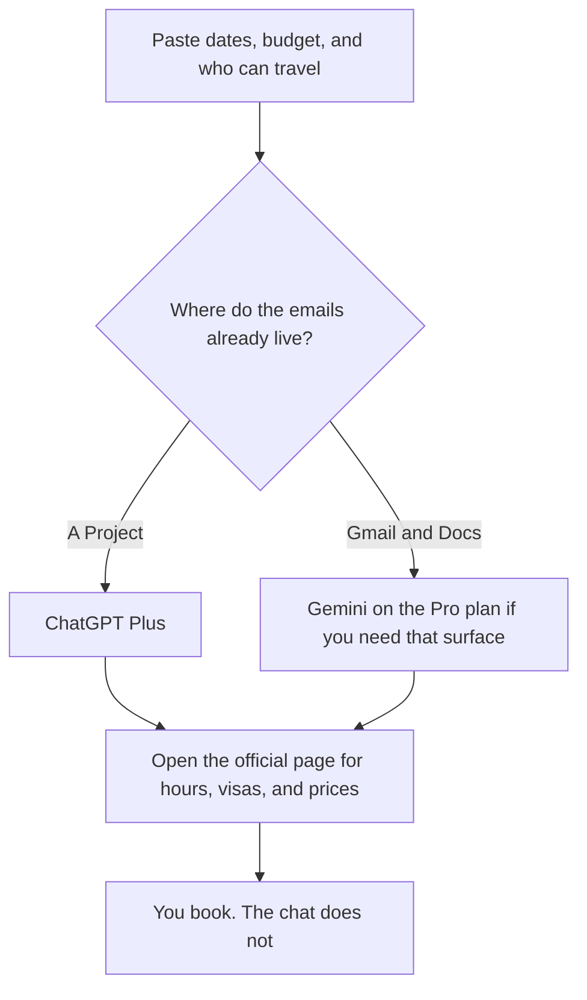

**Use ChatGPT or Gemini to draft a travel plan from constraints you paste: dates, city, budget, and who is going. Then open the official page for any hour, visa rule, or price before you book.** Pick ChatGPT Plus at $20 a month if the plan should live in a Project with the constraints and the reservation emails you pasted. Pick Gemini if the trip already lives in Gmail and Google Docs and you want the draft next to that mail. Neither chat is a booking engine on the facts this directory records. A confident museum hour is a rumor until the venue's page says it.

A cited lookup for the hour or the visa page is the neighbor, and the tool is [Perplexity](/tools/perplexity/). The shopping habit of opening the real page, in a different aisle, is [Perplexity vs ChatGPT for shopping research](/blog/perplexity-vs-chatgpt-for-shopping-research-2026/). A made-up fact has a name: [what an AI hallucination is](/blog/what-is-ai-hallucination-2026/).

Prices are US list prices excluding tax from directory pages checked October 16, 2026. Published October 24, 2026. We did not score itineraries. We did not book a trip. Prices and hours change. The page you will pay is the record.

## A draft, and the page that can contradict it

| | [ChatGPT](/tools/chatgpt/) | [Gemini](/tools/gemini/) |
|---|---|---|
| Free | Limited tools. Enough to try a weekend outline from a paste | Free with a Google account. The card does not put Gemini in Gmail and Docs on this line |
| The seat for a real trip | Plus, $20 a month, with Projects | Google AI Pro, $19.99 a month, lists Gemini in Gmail and Docs and 5 TB of storage |
| A cheaper step | Go, $8 a month. The card says it may include ads | Google AI Plus, $4.99 a month, lists 2x usage versus Free and 400 GB. The Gmail line is on Pro |
| Heavier use | Pro at $100, $200, or $500 | Ultra at $99.99 or $199.99 a month |
| What you still do | Open the official page for every time and rule | Open the official page for every time and rule |
| A poor use | Treating the chat as a confirmed booking | Treating a Maps-like suggestion as a ticket |

ChatGPT Plus is $240 a year at $20. Google AI Pro is $19.99 a month, or $239.88 if you keep it for twelve months. The stickers match. Buy Pro if you wanted Gmail and the storage anyway. Do not buy it because a travel draft felt more official. A free Gemini account can still outline a public-city weekend if you paste the constraints and you check the pages.

## The tools around the draft

**A cited page.** [Perplexity](/tools/perplexity/) Pro is $17 a month billed annually. Ask for the venue or the government page, then click it. Free is enough for a first pass inside the weekly limit on the card. A citation you do not open is decoration. The review is [Perplexity review](/blog/perplexity-review-2026/).

**The packing list and the day-by-day that the group can edit.** [Notion AI](/tools/notion-ai/) Business is $20 a seat a month for the full AI tier. Free includes a trial of Notion AI. A shared page beats a chat scroll when four people are adding trains. The invoice is [Notion AI pricing explained](/blog/notion-ai-pricing-explained-2026/).

**A careful rewrite of the note to the group.** [Claude](/tools/claude/) Pro is $20 a month, or $17 billed annually. Use it after the hours are confirmed, not before. The writing pair is [ChatGPT vs Claude for writing](/blog/chatgpt-vs-claude-for-writing-2026/).

**Mail you will actually send about the plan.** If that draft has to happen inside Gmail, the comparison is [Gemini vs ChatGPT for Gmail](/blog/gemini-vs-chatgpt-for-gmail-2026/).

A prompt that holds the line:

"Draft a three-day plan for these dates, this city, and this budget. For every place, write Needs check next to hours and price. Do not invent opening times, visa rules, or reservation availability. If I did not give a neighborhood or a pace, ask."

The person who books is [what human-in-the-loop AI is](/blog/what-is-human-in-the-loop-ai-2026/). The check is [how to fact-check AI writing](/blog/how-to-fact-check-ai-writing-2026/).

## What the draft must not decide

It must not decide a visa, a travel advisory, or an insurance exclusion. Those live on the official page for your passport and your policy. It must not spend the budget. A generated "about $40" is not a fare. Paste the fare from the carrier if you want it in the note, with the date you saw it.

It must not store passport numbers, full card numbers, or a household's live location history in a personal free account. Keep the paste to dates, cities, and constraints.

## FAQ

### Which one knows my city better?

We did not measure local knowledge. Both can be wrong about a Tuesday closure. The official page is the tie-breaker. Use the chat to hold the shape of the day, not the hours.

### Can it book the flight?

Not as a confirmed ticket in the workflow this page describes. If a product offers a booking link, you still complete payment on the carrier or the hotel. Read the total there.

### Is Google AI Pro required for a family trip?

No. Pro is the card that lists Gemini in Gmail and Docs. A free Gemini chat can draft from a paste. Use Pro when the trip mail already lives in Gmail and you want the assistant there. Use ChatGPT Plus when the Project is the record.

### How do we keep the group from editing a stale hour?

Put confirmed facts on the shared page with the source and the date. Leave model suggestions in a separate section labeled Unchecked. When the venue's site changes, the dated line is what you fix.

## Last verified

October 16, 2026 for ChatGPT, Gemini, Perplexity, Notion, and Claude. Published October 24, 2026.

**Sources:** [ChatGPT pricing](https://chatgpt.com/pricing/), [Google AI subscriptions](https://gemini.google/subscriptions/), [Perplexity pricing](https://www.perplexity.ai/hub/pricing).

*Published by Andrew for [AI Tools Optimizer](https://aitoolsoptimizer.com).*

[ChatGPT](/tools/chatgpt/) is in the [chatbots and assistants directory](/tools/category/chatbots-assistants/). Directory pages may use affiliate links. A purchase through them may earn us a commission at no extra cost to you.
