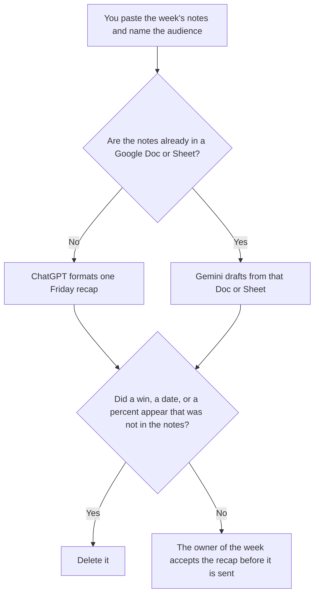

**Use ChatGPT when the weekly update is several status notes a person already filed, pasted into one recap for a named audience. Use Gemini when those notes already live in a Google Doc or Sheet you are allowed to use.** The recap may group what shipped, what slipped, and what the audience needs. It may not add a win, close a blocker, or invent a percent complete. One paste of done, next, and blocked is a different page: [ChatGPT vs Gemini for status updates](/blog/chatgpt-vs-gemini-for-status-updates-2026/). The habit of writing that shorter note is [how to write a status update with AI](/blog/how-to-write-a-status-update-with-ai-2026/).

A decision already made, which is not this recap, is [ChatGPT vs Claude for decision memos](/blog/chatgpt-vs-claude-for-decision-memos-2026/).

ChatGPT's Plus price is from learn.chatgpt.com/docs/pricing on October 24, 2026. Gemini, Notion, and Claude prices used below are from directory pages checked October 16, 2026, except Claude Pro, which is from claude.com/pricing on October 24. Published October 24, 2026. We did not score updates.

## Which Friday note is in front of you

| The page | Start here | First paid step | The limit |
|---|---|---|---|
| Several notes, one paste | [ChatGPT](/tools/chatgpt/) | Plus is $20 a month | No win that was not in a note |
| Notes that already live in a Doc or Sheet | [Gemini](/tools/gemini/) | Google AI Plus is $4.99 a month | The Doc is the source. A chat memory is not |
| The page the team will reopen next Friday | [Notion AI](/tools/notion-ai/) | Business is $20 a seat a month | Plus at $10 is not the full AI tier |
| A set of weekly notes that must share headings | [Claude](/tools/claude/) | Pro is $17 a month billed annually, or $20 monthly | The Project holds your headings. It does not invent the week |

A weekly update that "celebrates momentum" without a note that said so is a different document. If a note is missing for a workstream, the recap says Note not filed. It does not infer the workstream is fine.

ChatGPT Go is $8 a month on the October 24 plan page. Plus is the seat for a saved recap you will edit. The review is [ChatGPT review](/blog/chatgpt-review-2026/).

Gemini's October 16 card lists Google AI Pro at $19.99 a month. Buy Pro when Plus limits are the constraint you can show, not because a weekly note sounds important. The ladder is [Gemini pricing explained](/blog/gemini-pricing-explained-2026/).

## What the recap is allowed to contain

The audience you named, the notes you pasted, and the date of the week. If a ship date was not in a note, the line says Date not in the notes. It does not estimate one. The status update that fed this page stays the source. Do not edit the source to match a smoother recap.

**ChatGPT Plus** is the paste path. Paste each note with its date. A version that merges two slips into one "minor delay" is the version you delete.

**Gemini** is the Doc path. Point it at the file you are allowed to use. A version that pulls a number from a different tab you did not name is the version you delete.

**Notion Business** is where next Friday's owner finds this recap, if that is the wiki. Link the notes. The invoice is [Notion AI pricing explained](/blog/notion-ai-pricing-explained-2026/).

**Claude Pro** is the set of weekly recaps that must share headings. Put the headings in the Project: shipped, slipped, needs a decision. When a heading changes, change it once.

A prompt that holds the line:

"Write the weekly update for the audience I named, using only the notes I pasted. If a workstream has no note, write Note not filed. Do not add a win. Do not close a blocker. Do not invent a percent."

## What not to delegate

Do not ask which workstream is "on track." Do not paste a private personnel note so the recap has color. Do not send the recap because the bullets look even. The owner of the week sends it. A formatted page is not the week.

## FAQ

### How is this different from a status update?

A status update is one team's done, next, and blocked. A weekly update combines several of those notes for one audience on a cadence. If you only have one paste, use the status-update page. This page starts when there are several notes and one Friday reader.

### Which one writes a safer recap?

We did not measure that. ChatGPT fits a paste. Gemini fits notes that already live in a Doc or Sheet. The recap is safer when every line traces to a note, and a missing note says so.

### Do I need both?

You need the seat that matches where the notes already are. Running both and merging the paragraphs is how a slip changes in one recap and stays in the other. File one accepted version.

### Who may call the week done?

The owner of the week, after the recap matches the notes they are willing to send. A shared link is not acceptance. A confident closing line is not a note that was filed.

## Last verified

October 24, 2026 for ChatGPT's plan page and for Claude. October 16, 2026 for Gemini and Notion. Published October 24, 2026.

**Sources:** [ChatGPT and Codex pricing](https://learn.chatgpt.com/docs/pricing), [Gemini](https://gemini.google.com), [Notion pricing](https://www.notion.com/pricing), [Claude pricing](https://claude.com/pricing).

*Published by Andrew for [AI Tools Optimizer](https://aitoolsoptimizer.com).*

[ChatGPT](/tools/chatgpt/) is in the [chatbots and assistants directory](/tools/category/chatbots-assistants/). Directory pages may use affiliate links. A purchase through them may earn us a commission at no extra cost to you.
