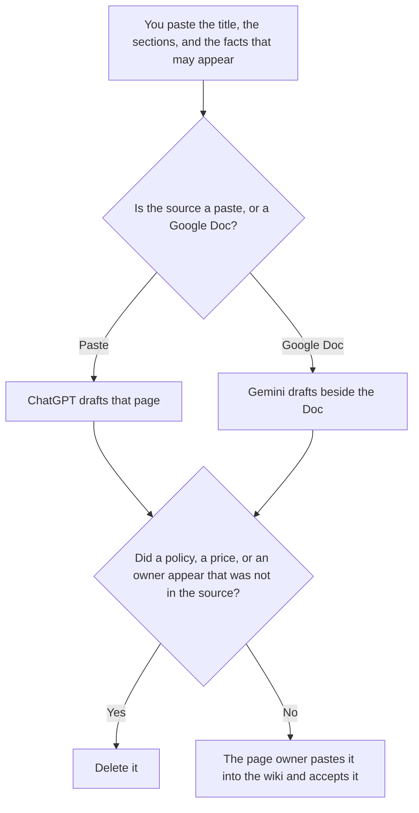

**Use ChatGPT when you are drafting one wiki page from an outline a person wrote, and you will paste the draft into the wiki yourself. Use Gemini when the source already lives in a Google Doc and the page should be drafted beside that Doc.** The model may order the sections you named. It may not add a policy, a price, or an owner. The place the page has to live, when that place is Notion, is [Notion AI vs ChatGPT for wikis](/blog/notion-ai-vs-chatgpt-for-wikis-2026/). This page does not pick the wiki product. It picks the draft seat. The build order is [how to build an internal wiki with AI](/blog/how-to-build-an-internal-wiki-with-ai-2026/).

Two pages that disagree need a person. The place a fact is allowed to live is [what a system of record for AI is](/blog/what-is-a-system-of-record-for-ai-2026/).

ChatGPT's Plus price is the October 24, 2026 plan-page figure recorded in [ChatGPT pricing explained](/blog/chatgpt-pricing-explained-2026/). Gemini's prices are the October 16, 2026 directory figures recorded in [Gemini pricing explained](/blog/gemini-pricing-explained-2026/). Notion and Grammarly prices are from directory pages checked October 16, 2026. Published October 24, 2026. We did not score which page a teammate can find.

## Which source you are drafting from

| The source | Start here | First paid step | The limit |
|---|---|---|---|
| An outline a person wrote, pasted into chat | [ChatGPT](/tools/chatgpt/) | Plus is $20 a month | No section that was not in the outline |
| A Google Doc the team already shares | [Gemini](/tools/gemini/) | Google AI Pro is $19.99 a month | No fact that was not in the Doc or the outline |
| The page people will open, if the wiki is Notion | [Notion AI](/tools/notion-ai/) | Business is $20 a seat a month | The draft seat is not the home. Plus at $10 is not the full AI tier |
| A clarity pass that must not add a rule | [Grammarly](/tools/grammarly/) | Pro is $12 a member a month billed annually, or $30 monthly | Compare the policy lines before and after |

A wiki page that answers a question the outline did not ask has widened the page. If the owner is missing, the draft says Owner not set. It does not assign the team that "usually" owns this topic. Put ideas for a second page in a note labeled Not on this page.

Google AI Plus is $4.99 a month on the October 16 card. Pro at $19.99 is the row that includes Gemini in Docs. Free can draft from a short paste. The invoice is [Gemini pricing explained](/blog/gemini-pricing-explained-2026/).

ChatGPT Go is $8 a month. Plus is the seat for a saved page. The review is [ChatGPT review](/blog/chatgpt-review-2026/).

## What the page is allowed to contain

The title you wrote, the sections you listed, and the facts you pasted or marked in the Doc. A link that was not in the source says Link not in the source. A step that was not in the source stays out. The page owner can add it after they check it. The draft should not merge two Docs into one page unless you said those Docs are one topic.

**ChatGPT Plus** is the one-page paste. The outline is the contract. A version that adds a troubleshooting section you did not ask for is the version you delete.

**Gemini Pro** is the Doc path. The page follows the Doc the team will still open. A sentence that is not in the Doc and not in your outline is the sentence you delete.

**Notion Business** is the home, when the wiki is Notion. It is not a reason to skip the draft check. The invoice is [Notion AI pricing explained](/blog/notion-ai-pricing-explained-2026/). The comparison with ChatGPT as the home is the article linked above.

**Grammarly Pro** is the pass after the facts are stable. Reject a suggestion that turns a note into a requirement. The invoice is [Grammarly pricing explained](/blog/grammarly-pricing-explained-2026/).

A prompt that holds the line:

"Draft the wiki page from the title, the sections, and the facts I pasted. If the owner is missing, write Owner not set. Do not add a policy. Do not add a price. Do not add a section."

## What not to delegate

Do not ask the model to "fill the gaps" in a thin outline. Do not paste a chat transcript and call it the source of truth. Do not publish the page because the headings look complete. The page owner accepts it. A draft in a chat nobody can find on Monday is not a wiki page.

## FAQ

### How is this different from Notion AI vs ChatGPT for wikis?

That page chooses Notion when the page has to live in the workspace people already open, and ChatGPT when you want a draft you will paste in. This page chooses ChatGPT or Gemini for the draft, based on whether the source is a paste or a Google Doc. Notion can still be the home. It is not the decision this page makes. Use that page to pick the home. Use this page to pick the draft seat.

### How is this different from the wiki how-to?

That page is the order: one home, then the drafts. This page is which chat seat drafts a page once the home exists. Both pages require an owner. A how-to step does not choose Gemini. This page does, when the source is a Doc.

### Which draft is easier to trust?

We did not measure that. The page is safer when every fact matches the outline or the Doc, and a missing owner says so. A smoother paragraph is not a source.

### Who may publish the page?

The owner named on the page. A chat draft is not published. Two pages that disagree stay in conflict until a person picks one. Do not ask the model to merge them into a third page.

## Last verified

October 24, 2026 for ChatGPT's plan page, via the pricing article. October 16, 2026 for Gemini, Notion, and Grammarly. Published October 24, 2026.

**Sources:** [ChatGPT and Codex pricing](https://learn.chatgpt.com/docs/pricing), [Gemini subscriptions](https://gemini.google.com), [Notion pricing](https://www.notion.com/pricing), [Grammarly pricing](https://www.grammarly.com/plans).

*Published by Andrew for [AI Tools Optimizer](https://aitoolsoptimizer.com).*

[ChatGPT](/tools/chatgpt/) is in the [chatbots and assistants directory](/tools/category/chatbots-assistants/). Directory pages may use affiliate links. A purchase through them may earn us a commission at no extra cost to you.
