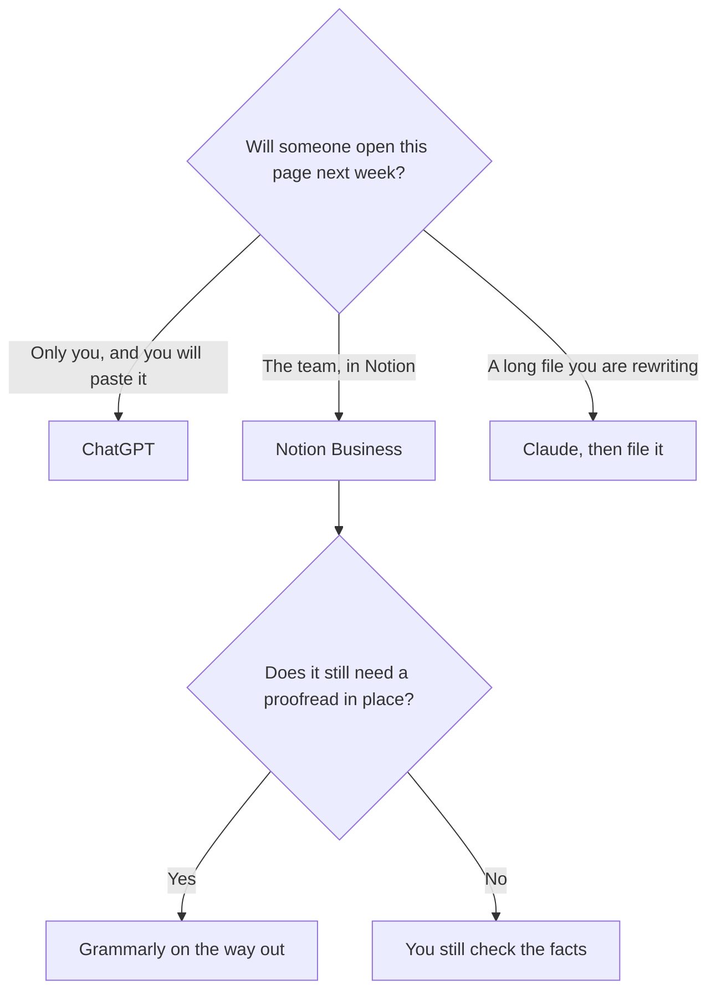

**Use ChatGPT when the writing starts as a blank prompt and you will paste the keeper somewhere else. Use Notion AI when the writing has to stay on the page the team already comments on.** A brilliant draft in a chat that nobody can find next Tuesday is not a publishing system. A wiki model that you also ask for images, code, and a custom GPT is the wrong bundle.

The notes version of this choice is [Notion AI vs ChatGPT for notes](/blog/notion-ai-vs-chatgpt-for-notes-2026/). Notion's card is [Notion AI pricing explained](/blog/notion-ai-pricing-explained-2026/). The other $20 writing seat is [ChatGPT vs Claude for writing](/blog/chatgpt-vs-claude-for-writing-2026/).

Prices are US list prices excluding tax from directory pages checked October 16, 2026. Published October 24, 2026. We did not score prose.

## Where the sentence has to end up

| The page | Start here | Why |
|---|---|---|
| A one-off draft, plus images or a reusable custom GPT | [ChatGPT](/tools/chatgpt/) Plus at $20 | Those tools share the seat. Go at $8 is the lighter plan |
| A wiki page, a spec, or a meeting note people will comment on | [Notion AI](/tools/notion-ai/) Business at $20 a seat | The full AI tier, including Agent and AI Meeting Notes, is Business. Plus at $10 is not |
| A long revision in a project of files | [Claude](/tools/claude/) | Pro is $20, or $17 billed annually. Then paste the keeper into Notion if Notion is home |
| A proofread in the box where you already type | [Grammarly](/tools/grammarly/) | Pro is $12 a member a month billed annually, or $30 monthly |
| On-brand campaign copy for a marketing team | [Jasper](/tools/jasper/) | Pro is $59 a seat billed yearly, or $69 monthly. That comparison is linked below |

ChatGPT Free exists. Claude Free includes up to five Projects. Notion Free includes a trial of Notion AI, not the full agent. Spend a real page on the free surface before you buy the matching $20 seat. Most writers need one of those seats, not both, until the chat and the wiki are genuinely different jobs.

## What you are paying for, and what you are not

**ChatGPT Plus** is the general writing seat. Projects hold instructions. Custom GPTs reuse a setup. Image generation sits on the same subscription, which is why a newsletter that also needs a picture often stays here. The plan ladder is [ChatGPT Go vs Plus vs Pro](/blog/chatgpt-go-vs-plus-vs-pro-2026/). Pro from $100 is capacity after Plus actually runs out. It is not a better prose tier this site is willing to claim.

**Notion Business** is the system of record. Notion Agent can draft and edit pages in the workspace. AI Meeting Notes and search across connected apps are on this tier, on the pricing explainer. Custom Agents, the ones that run while you are away, are a second bill at $10 per 1,000 credits after a trial, and only on Business and Enterprise. A team that only rewrites the page in front of them does not need that second line.

Do not buy Notion Plus at $10 because someone called it the AI plan. The explainer is explicit: the full AI experience is Business. If the team lives in ClickUp instead, the other wiki is [Notion AI vs ClickUp Brain](/blog/notion-ai-vs-clickup-brain-2026/).

**Grammarly** is the editing pass, not the blank page. The in-place comparison is [Grammarly vs ChatGPT for editing](/blog/grammarly-vs-chatgpt-for-editing-2026/). **Jasper** is the marketing system, with Brand Voices on Pro. The marketing head-to-head is [Jasper vs ChatGPT for marketing](/blog/jasper-vs-chatgpt-for-marketing-2026/).

## A writing rule that survives either tool

Bring the facts in the prompt. A price, a date, a customer name, and a policy quote have to be yours. The model will fill a hole with something that looks finished. That is [a hallucination](/blog/what-is-ai-hallucination-2026/). The checklist is [how to fact-check AI writing](/blog/how-to-fact-check-ai-writing-2026/).

If the page is a customer email, the send button stays human. The workflow is [how to write customer emails with AI](/blog/how-to-write-customer-emails-with-ai-2026/). If the page is a changelog, the commits are yours too. That workflow is [how to write a changelog with AI](/blog/how-to-write-a-changelog-with-ai-2026/). A voice you want repeated belongs in a note you control, which is [how to create a brand voice with AI](/blog/how-to-create-a-brand-voice-with-ai-2026/).

One example you already like, pasted above the ask, is [what few-shot prompting is](/blog/what-is-few-shot-prompting-2026/).

## FAQ

### Is Notion AI included on every Notion plan?

You get a trial on Free. Plus at $10 a seat is the workspace plan, not the full AI experience. Business at $20 a seat is the tier this directory treats as Notion AI for a team that will rely on it.

### Should writers pay for ChatGPT and Notion?

Pay for the place the sentence lives. If it lives in Notion, start there. Add Plus when you also need images, a custom GPT, or a draft that should not touch the wiki until it is ready. Two $20 seats that produce the same paragraph are a duplicate.

### Which one is better at long documents?

Take the long file to Claude if you are revising it in a project, then file the result. The long-document map, including Gemini, is [Claude vs Gemini for long documents](/blog/claude-vs-gemini-for-long-documents-2026/). Notion is where that result should live if the team works there. It is not automatically the best first draft.

### Can Notion AI match our voice without Jasper?

Put a short voice note and two keeper pages in the prompt or in the page. That covers a team wiki. Jasper's stored Brand Voices, Knowledge, and Audiences are a marketing system on a marketing plan. Buy them when the wiki note keeps drifting, not on day one.

## Last verified

October 16, 2026 for ChatGPT, Notion, Claude, Grammarly, and Jasper prices named above. Published October 24, 2026.

**Sources:** [Notion pricing](https://www.notion.com/pricing), [ChatGPT pricing](https://chatgpt.com/pricing), [Grammarly premium](https://www.grammarly.com/premium).

*Published by Andrew for [AI Tools Optimizer](https://aitoolsoptimizer.com).*

[Notion AI](/tools/notion-ai/) is in the [productivity and notes directory](/tools/category/productivity-notes/). Directory pages may use affiliate links. A purchase through them may earn us a commission at no extra cost to you.
