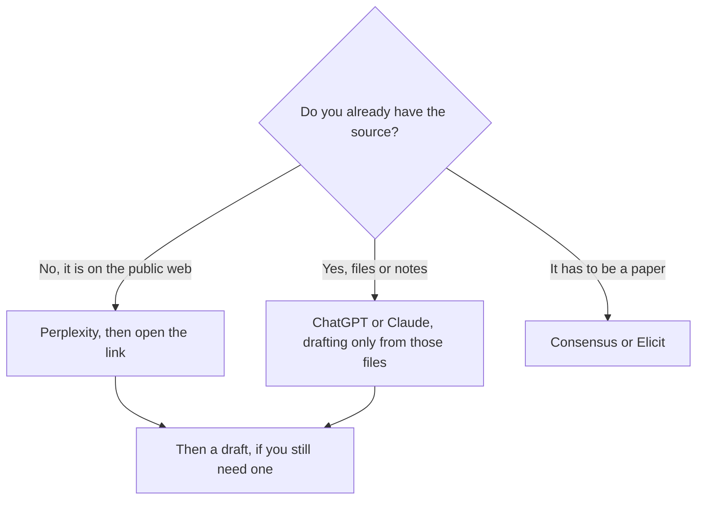

**Use Perplexity to collect public claims with links. Use ChatGPT to draft from sources you already trust.** Research that starts in ChatGPT and never opens a page is a draft with footnotes you invented. Research that starts in Perplexity and treats the summary as the source has the same problem one click later. Open the page either way.

[Perplexity](/tools/perplexity/) Pro is $17 a month billed annually. [ChatGPT](/tools/chatgpt/) Plus is $20 a month. Go is $8. Pro starts at $100. Those are US list prices excluding tax. Perplexity's ladder, including the free-tier limit, is from the October 24, 2026 read recorded in [Perplexity pricing explained](/blog/perplexity-pricing-explained-2026/). ChatGPT's prices are from the directory page checked October 16, 2026. We did not score answer quality.

## What each one is for

| Research job | Start here | Why |
|---|---|---|
| What does this company say in public about price or a feature? | Perplexity | The answer is supposed to include links. You still open them |
| What did these three PDFs say? | ChatGPT, or [Gemini Notebook](/tools/gemini-notebook/) if you want the notebook to stay on the files | You already have the corpus. Paste or upload it |
| A peer-reviewed claim | [Consensus](/tools/consensus/) or [Elicit](/tools/elicit/) | A general web engine is the wrong corpus |
| A memo after the sources are collected | ChatGPT or [Claude](/tools/claude/) | The writing step is not the search step |
| A number you will repeat to a client | Whichever tool found it, then the primary page | The summary is not the source |

The market-research steps on the Perplexity side are [how to use Perplexity for market research](/blog/how-to-use-perplexity-for-market-research-2026/). The writing steps on the draft side are [how to write a blog post with Claude](/blog/how-to-write-a-blog-post-with-claude-2026/), and the same discipline applies in ChatGPT. The failure you are avoiding is [what an AI hallucination is](/blog/what-is-ai-hallucination-2026/).

## The bills

| Plan | Price | What you are buying for research |
|---|---|---|
| Perplexity Free | $0 | Limited cited search. The October 24 help-center read lists 3 Pro Searches a day and 1 research query a month |
| Perplexity Pro | $17/month billed annually | Higher limits, model choice, files and apps, Computer, premium data |
| Perplexity Max | $167/month billed annually | Heavy Computer and Deep Research use. Not the default |
| ChatGPT Free | $0 | Text chats with usage guardrails and limited tools |
| ChatGPT Go | $8/month | More messages and uploads. The directory page says it may include ads |
| ChatGPT Plus | $20/month | The working research-and-draft seat: projects, deeper use, file uploads |
| ChatGPT Pro | $100, $200, or $500/month | Heavy use. Ultrafast is on the $500 tier |

ChatGPT's own ladder is [ChatGPT Go vs Plus vs Pro](/blog/chatgpt-go-vs-plus-vs-pro-2026/). Whether Perplexity Pro is the right $17 is [is Perplexity Pro worth it](/blog/is-perplexity-pro-worth-it-2026/). If neither web search nor a general chat is the corpus, the paper tools are [how to research with Elicit and Consensus](/blog/how-to-research-with-elicit-and-consensus-2026/). Consensus Pro is $12 a month on a $144 year, or $20 monthly. Elicit Plus is $11 a user a month billed annually on the non-Industry card.

## A sequence that does not double-pay for the same step

1. Ask Perplexity one narrow question. "What do these three vendors list as the monthly price?" is a question. "Tell me everything about the market" is not.
2. Open every link you might quote. Delete any claim whose page does not say it.
3. Paste the kept claims, with the URLs, into ChatGPT. Ask for a memo that uses only that list and marks anything missing as "not in the sources."
4. You edit the memo. The model does not sign it.

Paying for both Plus and Pro is reasonable when you do step 1 and step 3 on most workdays. Paying for both to do step 3 twice is two subscriptions for one draft. Perplexity Max at $167 is for a Computer limit you have already hit on Pro. It is not a writing upgrade over ChatGPT Plus.

Claude Pro at $20 a month, or $17 billed annually, can take step 3 if you prefer that draft. The assistant comparison is [ChatGPT vs Claude for writing](/blog/chatgpt-vs-claude-for-writing-2026/). Retrieval as a method, including both of these products, is [what RAG is](/blog/what-is-rag-explained-2026/).

## FAQ

### Can ChatGPT replace Perplexity for research?

ChatGPT can search, depending on the plan and the tool that is enabled. Perplexity's product is built so the citation is the default output. If your standard is "every material claim has a link I opened," start in Perplexity. If your standard is "I already have the PDFs," start in ChatGPT.

### Is Perplexity Pro cheaper than ChatGPT Plus?

Pro at $17 a month on annual billing is a lower sticker than Plus at $20. They are different jobs. The $3 is not a reason to cancel the tool that does the step you still need.

### What about Gemini?

[Gemini](/tools/gemini/) is the other general assistant, and [Gemini Notebook](/tools/gemini-notebook/) is the file notebook. Google AI Plus is $4.99 a month. This page stays on ChatGPT and Perplexity because that is the comparison people mean by "research chat versus cited search."

### Do I need Consensus too?

When the claim has to be a paper, yes. Perplexity is the public web. Consensus and Elicit are the paper corpus. Using Perplexity as a literature review is how a blog summary gets cited as a study.

## Last verified

October 16, 2026 for ChatGPT, Consensus, Elicit, Claude, and Gemini prices. October 24, 2026 for Perplexity's plan table, via the pricing article linked above. Published October 24, 2026.

**Sources:** [Perplexity pricing](https://www.perplexity.ai/pro), [ChatGPT pricing](https://openai.com/chatgpt/pricing/), [Consensus pricing](https://consensus.app/pricing/).

*Published by Andrew for [AI Tools Optimizer](https://aitoolsoptimizer.com).*

[Perplexity](/tools/perplexity/) and [ChatGPT](/tools/chatgpt/) are in the [research directory](/tools/category/research-search/) and the [chatbots directory](/tools/category/chatbots-assistants/). Directory pages may use affiliate links. A purchase through them may earn us a commission at no extra cost to you.
