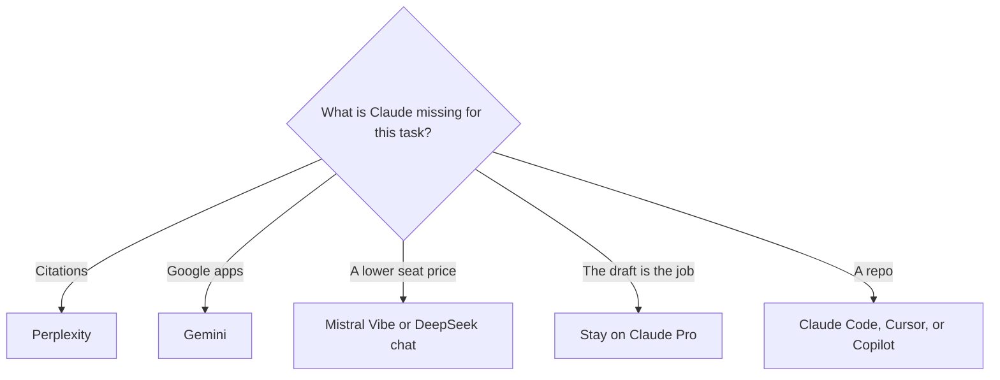

**Leave Claude when the job is a citation you can open, a suite you already pay for, a lower published seat, or a coding agent in the terminal.** Stay when the job is a long draft you will edit. A leaderboard will not tell you whether to cancel Pro.

[Claude](/tools/claude/) Pro is $20 a month, or $17 billed annually ($200 a year). Max starts at $100 a month. Free includes chat, files, and artifacts. The tier above Pro is [Claude Pro vs Max](/blog/claude-pro-vs-max-2026/). The product page is [Claude review](/blog/claude-review-2026/).

Prices are US list prices excluding tax. Most figures are from directory pages checked October 16, 2026. Perplexity's $17 annual price matches that page and the October 24, 2026 pricing article. We did not score writing quality.

## Pick by the miss

| The miss | Try | First paid step |
|---|---|---|
| You wanted links, and Claude drafted from memory | [Perplexity](/tools/perplexity/) | Pro is $17/month billed annually |
| You live in Docs, Gmail, and Drive | [Gemini](/tools/gemini/) | Google AI Plus is $4.99/month. Free needs a Google account |
| You want the other general assistant | [ChatGPT](/tools/chatgpt/) | Plus is $20/month. Go is $8. Pro starts at $100 |
| You want a lower published assistant price | [Mistral Vibe](/tools/mistral-vibe/) | Pro is $14.99/month excluding tax. Students are listed at $5.99 |
| You write inside Microsoft 365 | [Microsoft Copilot](/tools/microsoft-copilot/) | Free with a Microsoft account. Microsoft 365 Personal is $9.99/month |
| You want a cheap API with a posted token rate | [DeepSeek](/tools/deepseek/) | The chat app is free. API input from $0.15 per 1 million tokens off-peak on a cache miss |
| You already pay for X, or you code in Cursor | [Grok](/tools/grok/) | Plus is $8/month, or $80/year, on The X Subscription |
| The work is a repository, not a chat | [Claude Code](/tools/claude-code/), which is still Anthropic | Included with Pro. The terminal comparison is [Cursor vs Claude Code vs Codex](/blog/cursor-vs-claude-code-vs-codex-2026/) |

The three-way among the large assistants is [ChatGPT vs Gemini vs Claude](/blog/chatgpt-vs-gemini-vs-claude-2026/). The writing split with ChatGPT is [ChatGPT vs Claude for writing](/blog/chatgpt-vs-claude-for-writing-2026/). A wider chat shortlist is [ChatGPT alternatives](/blog/chatgpt-alternatives-2026/).

## What each alternative is for

**Perplexity is the research switch.** Answers are supposed to ship with sources. Open them. Pro adds higher limits, model choice, and Computer. Max at $167 a month billed annually is a heavy-research plan. The ladder is [Perplexity pricing explained](/blog/perplexity-pricing-explained-2026/). If your complaint was a made-up citation, start on Free before you buy Max. That failure mode is [what an AI hallucination is](/blog/what-is-ai-hallucination-2026/).

**Gemini is the Google-suite switch.** The free plan includes the assistant with a Google account. Plus at $4.99 adds usage and video generation. Pro at $19.99 is the step when Plus limits block a workday. It is a different draft voice. Try one real memo before you cancel Claude.

**ChatGPT is the default other seat, not a discount.** Plus is the same $20 monthly number as Claude Pro. Go at $8 is the cheaper ChatGPT step, with the directory note that it may include ads. Move if you need a ChatGPT-specific surface, such as a particular project setup your team already uses. The plan names are [ChatGPT Go vs Plus vs Pro](/blog/chatgpt-go-vs-plus-vs-pro-2026/).

**Mistral Vibe is the lower published seat.** Pro at $14.99 is under Claude's monthly Pro price. The directory records a free plan with limited access. Confirm the current checkout. A lower price is not a measurement of draft quality.

**Copilot is the Microsoft switch.** If the draft has to land in Word or Outlook and the company already pays for Microsoft 365, price Personal at $9.99 or the business Copilot SKU your admin lists before you buy a second assistant. The business line on the directory page starts from $18 per user per month on a promotional yearly figure.

**DeepSeek and Grok are the price switches, with different shapes.** DeepSeek's consumer chat is free. Its API posts token rates, which matter if you are a developer. Grok Plus at $8 is a bundle with X and, for new subscribers, [Cursor](/tools/cursor/). Read [Grok review](/blog/grok-review-2026/) and [DeepSeek review](/blog/deepseek-review-2026/) before you move a client workflow.

## When to stay

Stay on Claude Pro if you are inside the usage cap and the drafts are landing. Max is for people who can show that Pro's limit is the blocker, not for people who want a more careful adjective. Free is enough to test an alternative on one real document. Pay for a second assistant only after a week of using it on work you were going to do anyway.

The instruction that makes any of these drafts usable is [what prompt engineering is](/blog/what-is-prompt-engineering-2026/). The model class is [what an LLM is](/blog/what-is-an-llm-2026/).

## FAQ

### What is the closest alternative to Claude for writing?

ChatGPT Plus, at the same $20 monthly price, is the usual comparison. Gemini is the one to try if the draft has to live in Google Docs. Run one document through both. The writing article is [ChatGPT vs Claude for writing](/blog/chatgpt-vs-claude-for-writing-2026/).

### Is there a cheaper paid plan than Claude Pro?

Mistral Vibe Pro is $14.99 a month on the directory page. Google AI Plus is $4.99. Grok Plus is $8. DeepSeek's chat app is free. Each is a different product. Cheaper is the seat price, not a quality rank.

### Should I switch if Claude hallucinated a citation?

Use a retrieval product for that question. Perplexity, Consensus, or a file you paste. Switching general assistants does not remove the need to open a source.

### Does Claude Code count as leaving Claude?

No. Claude Code is included with Claude Pro and Max. Leave it when you want a different editor. That choice is [Cursor vs Claude Code vs Codex](/blog/cursor-vs-claude-code-vs-codex-2026/).

## Last verified

October 16, 2026 for assistant plan prices, with Perplexity's annual Pro price also recorded in an October 24, 2026 pricing article. Published October 24, 2026.

**Sources:** [Claude pricing](https://claude.com/pricing), [Google Gemini](https://gemini.google.com/), [Mistral Vibe](https://mistral.ai/products/vibe/), [Perplexity pricing](https://www.perplexity.ai/pro).

*Published by Andrew for [AI Tools Optimizer](https://aitoolsoptimizer.com).*

[Claude](/tools/claude/), [ChatGPT](/tools/chatgpt/), and [Gemini](/tools/gemini/) are in the [chatbots directory](/tools/category/chatbots-assistants/). Directory pages may use affiliate links. A purchase through them may earn us a commission at no extra cost to you.
