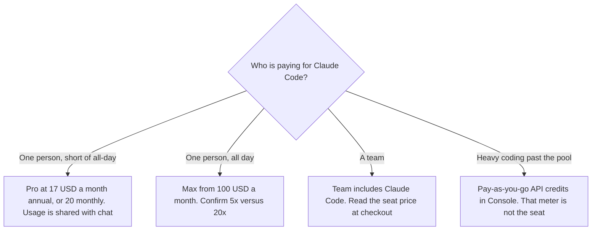

**Claude Code is not a separate consumer price on claude.com/pricing fetched October 24, 2026. The compare table lists it as No on Free and Yes on Pro, Max 5x, Max 20x, Team, and both Enterprise columns.** Pro is $17 a month with the annual discount, $200 billed up front, or $20 billed monthly. Max is from $100 a month. The page says Claude Code shares the plan's usage with chat, so a long coding session and a long chat draw from one pool.

The seat ladder for the chat product, including Team dollars this extract did not reprint, is [Claude pricing explained](/blog/claude-pricing-explained-2026/). An editor with its own sticker is [Cursor pricing explained](/blog/cursor-pricing-explained-2026/). The product review is [Claude Code review](/blog/claude-code-review-2026/).

Published October 24, 2026. We did not score pull requests. Prices exclude tax, on that page. The October 16 directory card says the same shape: included with Pro, Max, Team, and Enterprise, or available through the API, with no free plan.

## Where Claude Code sits on the October 24 table

| Plan | Claude Code on the compare table | Price this fetch showed |
|---|---|---|
| Free | No | $0 |
| Pro | Yes | $17 a month annual, $200 up front, or $20 monthly |
| Max | Yes, on the 5x and 20x columns | From $100 a month. Monthly API credits on the table: $100 on Max 5x, $200 on Max 20x |
| Team | Yes | 2 to 150 people. Seat dollars were not in this extract. See the Claude pricing article for the October 24 stickers it recorded |
| Enterprise | Yes, self-serve and sales-assisted | The FAQ says $20 a seat a month plus usage at API rates, billed annually |

The FAQ on that page says Claude Code is included in all paid plans and that terminal work and chats share limits. It says there is no fixed message count. When you hit a limit you can wait, move up, or turn on usage credits at standard API rates. It also says you can switch heavy coding to pay-as-you-go API credits through a Console account. Those API rates are a second bill. Do not add a token price to the Pro seat and call the sum "Claude Code."

The Max columns list monthly API credits of $100 and $200. The [Claude](/tools/claude/) pricing article, from the same day's page, says those credits are for the Claude Platform and are not a second copy of the seat price. This article treats them the same way. If checkout shows a different Max dollar, checkout wins.

## Team dollars, and two meters that are not the seat

**Team seat prices.** This fetch's Team cards named the 2-to-150 range and listed Claude Code as included. They did not reprint a standard or premium dollar in the markdown we saved. [Claude pricing explained](/blog/claude-pricing-explained-2026/) recorded, from claude.com/pricing on October 24, 2026, standard seats at $20 a seat a month billed annually or $25 monthly, and premium seats at $100 annually or $125 monthly. Cite that article's date, then read checkout. A premium seat is not required by the compare table's Claude Code row. The row is Yes on Team generally.

**[Cursor](/tools/cursor/)**, if you want a different editor, is Plus at $8 a month or $80 a year on the October 16 directory card. That is not a Claude Code discount. The migration choice is [Cursor vs Claude Code for migrations](/blog/cursor-vs-claude-code-for-migrations-2026/).

**[GitHub Copilot](/tools/github-copilot/)** Pro is $10 a user a month on that card. Business is $19. The invoice is [GitHub Copilot pricing explained](/blog/github-copilot-pricing-explained-2026/).

**Platform meters** on the same Claude page, which are not the Claude Code subscription: Managed Agents at $0.08 per session-hour for active runtime, and code execution at $0.05 per hour per container after the free hours the page describes. Do not put those rates on a Pro invoice unless you are buying those platform features.

## What not to assume

Do not tell a Free user that Claude Code is included. The table says No. Do not describe annual Pro as "$17 today" without the $200 up-front charge. Do not assume Max 20x is $200 because the API-credit cell says $200. The seat line we will quote is "from $100."

## FAQ

### How much is Claude Code?

There is no separate Claude Code sticker on the October 24 pricing page. It is included with paid Claude plans. Pro is $20 a month, or $17 a month with annual billing, $200 up front. Max is from $100 a month. Usage is shared with the rest of the plan.

### Is there a free Claude Code plan?

Not on that table. Free is $0 and the Claude Code cell is No. The October 16 directory card says Claude Code requires a paid plan or API usage.

### What happens when Pro runs out mid-task?

The page says you can wait for the reset, move to a higher plan, or use usage credits at API rates. A higher plan is a purchase. It is not something the agent should start on its own. The count of tool calls inside one task is a separate cap you set: [what an AI tool call budget is](/blog/what-is-ai-tool-call-budget-2026/).

### Does Enterprise include it?

The compare table says Yes. The FAQ prices Enterprise at $20 per seat per month plus usage billed at API rates, billed annually. That usage line can matter more than the seat. Read the quote.

## Last verified

October 24, 2026, from claude.com/pricing. Team standard and premium seat dollars are cited from the Claude pricing article's reading of that same page, because this extract did not reprint them. Cursor and GitHub Copilot comparisons are October 16 directory prices. Published October 24, 2026.

**Sources:** [Claude pricing](https://claude.com/pricing), [Claude Code](https://claude.com/product/claude-code), [Cursor pricing](https://cursor.com/help/account-and-billing/pricing), [GitHub Copilot](https://github.com/features/copilot).

*Published by Andrew for [AI Tools Optimizer](https://aitoolsoptimizer.com).*

[Claude Code](/tools/claude-code/) is in the [coding directory](/tools/category/coding/). Directory pages may use affiliate links. A purchase through them may earn us a commission at no extra cost to you.
