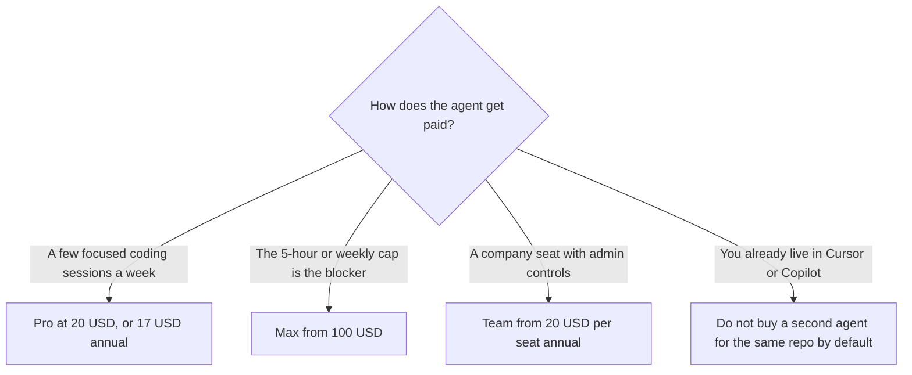

**[Claude Code](/tools/claude-code/) is Anthropic's coding agent for the terminal, the editor, and longer tasks against a repository.** It is not a separate checkout with its own sticker. On October 24, 2026 Claude's pricing page listed **Claude Code as included**, with Pro at **$17 a month on an annual plan or $20 month to month**, and Max **from $100 a month**. Team standard seats were **$20 per seat per month billed annually, or $25 monthly**, with a higher seat at **$100 annually or $125 monthly** described as 5× the usage of a standard seat.

The beginner walkthrough is [Claude Code for beginners](/blog/claude-code-for-beginners-2026/). The plan comparison for the chatbot itself is [Claude Pro vs Max](/blog/claude-pro-vs-max-2026/). The editor choice is [Cursor vs Claude Code vs Codex](/blog/cursor-vs-claude-code-vs-codex-2026/). This page is only the buying decision: which Claude plan is the coding plan, and when a second subscription is double-paying.

## Where the agent sits on the price list

| Plan | Price we could verify | Coding note printed on the page |
|---|---|---|
| Free | $0 | Claude chat. The Pro card is the one that pairs "Claude Code included" with the $17 / $20 price |
| Pro | $17/month annual, or $20 monthly | Claude Code included. Positioned for everyday work and shorter sessions |
| Max | From $100/month | Higher usage. The comparison table lists monthly API credits of $100 and of $200 on Max rows |
| Team, standard seat | $20/seat annual, or $25 monthly | More usage than Pro. Mix-and-match seat types are mentioned |
| Higher Team seat | $100/seat annual, or $125 monthly | Described as 5× the usage of a standard seat |
| Enterprise | Custom | A pooled API-credit line up to $500 a month appears near the enterprise materials |

The invoice is [Claude Code pricing explained](/blog/claude-code-pricing-explained-2026/).

API use is a different bill. The same pricing page lists token rates for Claude models, including cache reads and writes. If you run Claude Code against an API key instead of a subscription, you are on that meter. A subscription does not cap an API key you added yourself. Know which credential the CLI is using before you compare "$20" with a weekend of API charges.

## What you are choosing

Pro is the default coding seat for an individual: Claude Code is included, the annual price is $17, and the monthly price is $20 if you want to leave. Max is the seat when Pro's usage limits stop a workday. The page's Max rows include API credit grants of $100 a month and $200 a month. Those credits are for building on the API. They are not a gift card you spend at another vendor, and they are not a promise that interactive Claude Code is unmetered. Heavy agent sessions are why Max exists. Read the [Pro vs Max](/blog/claude-pro-vs-max-2026/) piece for the chat-side limits, then come back here if the workload is a repository rather than a conversation.

Team is the seat when a company needs more than a personal login. Standard is $20 annual. The $100 seat is the one to buy when a standard seat's cap, not a missing feature, is the issue, and when you want that person's usage closer to 5×. Mixing seat types is explicitly allowed in the materials we read. A team of ten does not have to put every designer on the $100 coding seat. Put the people who run the agent all day on the higher seat and everyone else on standard, if your admin console allows that mix on the day you buy.

Enterprise is the security and procurement conversation. The pooled credit figure, up to $500 a month, showed up next to that part of the page. Confirm it on the order form. A website table is not the contract.

## Double-paying

[GitHub Copilot](/tools/github-copilot/) Business is its own per-user price, and Copilot's plans have advertised access to third-party agents. [Cursor](/tools/cursor/) is an editor with its own usage pool. [Codex](/tools/openai-codex/) rides ChatGPT plans. If Claude Code is the agent you actually run, Pro or Max may be the only coding subscription you need. If Cursor is the editor and Claude Code is an occasional terminal, you might still want both, and you should be able to say which job each one does. "We bought all three because the demos were good" is the failure mode in [which AI subscription is worth paying for](/blog/which-ai-subscription-is-worth-paying-for/).

Claude Code can also show up inside other tools' subscriptions. That does not make those tools free, and it does not make a Claude Pro seat unnecessary if the CLI on your laptop is logged into Anthropic directly. Check the account email in the CLI.

## Who should pay

**Skip a paid plan** if you are still reading the beginner guide and have not installed anything. **Pay for Pro** when you want the terminal agent on a real repo for part of the week and $20 is the trial of whether it sticks. Annual at $17 is $204 a year instead of $240. Take annual after a month, not before the first limit warning. **Move to Max** when Pro's cap, not your curiosity, ends the session. From $100 is $1,200 a year at the floor. **Buy Team** when the company needs seats, and match the seat size to who actually runs the agent. **Use the API** when you need the usage on an invoice you already reconcile per token, and watch it. **Do not buy Max** to feel faster on a hobby script Pro would have finished.

## FAQ

### How much does Claude Code cost?

It is included with paid Claude plans. Pro is $17 a month billed annually or $20 monthly. Max starts at $100 a month. Team standard seats are $20 a month billed annually or $25 monthly. Checked October 24, 2026 on claude.com/pricing.

### Is there a separate Claude Code subscription?

Not as a standalone sticker on the pricing page we read. The product is included with the Claude plan. API usage is the other way to pay, at token rates.

### What is the difference between Pro and Max for coding?

Pro is the everyday included agent. Max is the higher-usage plan, from $100, with API credit amounts of $100 or $200 a month listed on the Max rows. Move up when you hit Pro's limits, not before.

### Does Team include Claude Code?

Team is a Claude seat. The coding agent is part of the Claude product on the plans that include it. Confirm the seat type in the admin console, because a $20 standard seat and a $100 higher seat are both "Team" in casual speech.

### Can I expense this as Copilot?

No. Copilot, Cursor, and Claude are separate vendors. A receipt for one does not cover the CLI logged into another.

## Last verified

October 24, 2026, from Anthropic's Claude pricing page. Max's upper step and the exact weekly caps move more often than the $20 Pro price. If a purchase is for a whole engineering org, ask for the current limit table in writing.

**Sources:** [Claude pricing](https://claude.com/pricing), [Claude Code](https://claude.com/product/claude-code).

[Claude Code](/tools/claude-code/) is in the [coding directory](/tools/category/coding/). Directory pages may use affiliate links. A purchase through them may earn us a commission at no extra cost to you.
