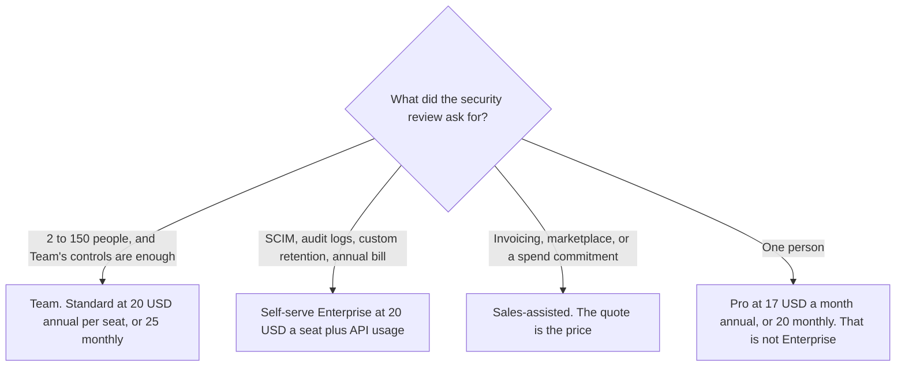

**Claude Enterprise, on the FAQ at claude.com/pricing fetched October 24, 2026, is $20 per seat per month plus usage billed at API rates.** The plan is billed annually. The FAQ says it includes everything in Team plus SCIM, audit logs, custom data retention, and role-based access, and that you can start self-serve or contact sales. The Team seat, which is a different range and a different usage line, is [Claude Team pricing explained](/blog/claude-team-pricing-explained-2026/). The full ladder is [Claude pricing explained](/blog/claude-pricing-explained-2026/).

Token rates on that same page are not a flat fee inside the $20. The rate walk is [Anthropic API pricing explained](/blog/anthropic-api-pricing-explained-2026/). Published October 24, 2026. Prices exclude tax, as the page states. We did not score answers.

## Self-serve and sales-assisted, on the compare table

| Item | Team, for contrast | Enterprise self-serve | Enterprise sales-assisted |
|---|---|---|---|
| Seat price this fetch will quote | Standard $20 annual or $25 monthly, and premium $100 annual or $125 monthly, as recorded the same day in the Team article. Range: 2 to 150 | The FAQ's line: $20 a seat a month plus usage at API rates, billed annually | The FAQ says contact sales for a tailored quote. This table does not invent a second dollar |
| Billing cycle on the compare table | Monthly and annual | Annual | Annual |
| Payment | Credit card | Credit card and ACH. Invoicing is no | Credit card, ACH, and invoicing or net terms |
| Monthly API credits | Up to $500 a month | No, on that row | No, on that row |
| Controls the Team column marks no | — | Domain capture, role-based access, SCIM, audit logs, Compliance API, custom data retention, HIPAA-ready offering, inference hooks, migrating accounts on your domains | Those, plus AWS Marketplace, consultation, tiered incentives on committed spend, trials, and customer success support at certain spend thresholds |
| Claude Code | Yes | Yes | Yes |
| Model training | None by default | None by default | None by default |

A same-day reading recorded in the Claude pricing article states a 20-seat minimum on the self-serve line. The FAQ captured for this article prices the $20-plus-usage line and does not restate a minimum in that answer. Read checkout for the minimum. Do not drop a 10-person group onto Enterprise because the security list looks stronger. Ten people are inside Team's 2-to-150 range.

The $20 is not the whole bill. Usage is billed at API rates, so the model and the task change the invoice. Team's "up to $500 a month" pooled API credits are on the Team row. The Enterprise columns on this fetch say no on that credit row. Do not carry the $500 onto an Enterprise order.

[Claude Code](/tools/claude-code/) is Yes on both Enterprise columns. The page says Claude Code shares the plan's usage with chat. An Enterprise seat does not mint a separate unlimited coding pool. The coding article is [Claude Code pricing explained](/blog/claude-code-pricing-explained-2026/).

## What you are not buying

**A stack of Pro seats.** Pro is $17 a month with annual billing, $200 up front, or $20 monthly. Pro is one person. Enterprise is the annual company plan with the controls in the table.

**Team premium as a substitute for SCIM.** Premium is $100 a seat a month billed annually, or $125 monthly, and the Team page says it is 5x the usage of a standard seat. The Team column still marks SCIM, audit logs, and custom data retention as no. Usage and SCIM are different purchases.

**[ChatGPT](/tools/chatgpt/) Enterprise,** if the other workspace is the comparison, has no list price in the section we read on October 24. The invoice is [ChatGPT Enterprise pricing explained](/blog/chatgpt-enterprise-pricing-explained-2026/).

**[Cursor](/tools/cursor/)**, if the work is an editor seat, is a different company. Plus is $8 a month or $80 a year on the October 16 directory card. The ladder is [Cursor pricing explained](/blog/cursor-pricing-explained-2026/).

## What not to assume

Do not describe Enterprise as $20 with usage included. The FAQ says plus usage at API rates. Do not assume monthly billing. The compare table says annual for both Enterprise columns. Do not assume the HIPAA-ready row is a signed agreement. It is a yes on the feature table. Your counsel reads the actual terms. Do not copy a token rate from memory into the seat price. Open the API article, then the live page.

## FAQ

### How much is Claude Enterprise?

$20 per seat per month plus usage billed at API rates, billed annually, on the FAQ fetched October 24, 2026. Sales-assisted contracts can be a tailored quote. The $20 line is not a cap on usage.

### How is this different from Team?

Team is 2 to 150 people, with standard and premium seat prices and up to $500 a month in pooled API credits on the page we read. Enterprise is annual, adds the admin controls Team's column marks as no, and the credit row says no. A company that needs SCIM does not get it by buying premium Team seats.

### Does Enterprise include Claude Code?

The compare table says yes on both Enterprise columns. Usage is shared with chat. A long coding month is still the usage line on top of the $20.

### Is there a 20-seat minimum?

The Claude pricing article recorded a 20-seat minimum on the self-serve line from this page the same day. The FAQ answer captured here does not repeat a minimum. If checkout and that article disagree, checkout wins.

## Last verified

October 24, 2026, from claude.com/pricing. Team seat dollars cited for contrast are the same day's Team article. ChatGPT's comparison is the plan page fetched October 24. Cursor's comparison price is the October 16 directory card. Published October 24, 2026.

**Sources:** [Claude pricing](https://claude.com/pricing), [Claude Code](https://claude.com/product/claude-code), [ChatGPT and Codex pricing](https://learn.chatgpt.com/docs/pricing), [Cursor pricing](https://cursor.com/help/account-and-billing/pricing).

*Published by Andrew for [AI Tools Optimizer](https://aitoolsoptimizer.com).*

[Claude](/tools/claude/) is in the [chatbots and assistants directory](/tools/category/chatbots-assistants/). Directory pages may use affiliate links. A purchase through them may earn us a commission at no extra cost to you.
