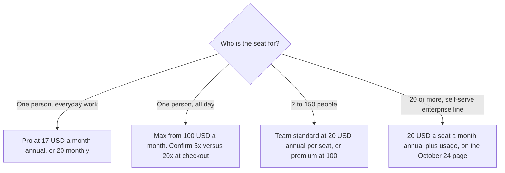

**Claude Pro is $17 a month with the annual discount, $200 billed up front, or $20 billed monthly. Max starts at $100 a month. Team standard seats are $20 a seat a month billed annually, or $25 monthly, for 2 to 150 people.** Those figures are from claude.com/pricing fetched October 24, 2026. The page says prices exclude tax and can change. Free is $0.

A [ChatGPT](/tools/chatgpt/) seat at $20 is [ChatGPT pricing explained](/blog/chatgpt-pricing-explained-2026/). The coding tool included with paid Claude plans is on the [Claude Code](/tools/claude-code/) card. The product review, separate from this bill, is [Claude review](/blog/claude-review-2026/).

Published October 24, 2026. We did not score answers. The October 16 directory card matches the Pro price and lists Max 5x at $100 and Max 20x at $200. The October 24 page says Max is "from $100" and shows $100 a month and $200 a month on the API-credits row for Max 5x and Max 20x. This article does not treat that credits row as the seat price.

## What the October 24 page lists

| Plan | Price on claude.com/pricing that day | What the page puts on the plan |
|---|---|---|
| Free | $0 | Chat on web, desktop, and mobile. Web search, files and code, memory, connectors, Artifacts, Claude Design, Slides, and Docs |
| Pro | $17 a month annual ($200 up front), or $20 monthly | More usage, task handoff and scheduling, Claude Code, Claude Science, Projects, more models, Chrome and Microsoft 365 |
| Max | From $100 a month | 5x or 20x more usage than Pro. Higher output limits. Priority access. API credits on the Max columns |
| Team standard seat | $20 a seat a month annual, or $25 monthly | More usage than Pro, central billing, SSO, no model training on your content by default. 2 to 150 people |
| Team premium seat | $100 a seat a month annual, or $125 monthly | 5x more usage than standard seats, on that page |
| Enterprise | Seat price plus usage at API rates. The self-serve line says US$20 a seat a month, billed annually, 20-seat minimum | Spend limits, SCIM, audit logs, and the other controls on that section |

The compare table on the October 24 page lists monthly API credits as none on Free and Pro, $100 a month on Max 5x, and $200 a month on Max 20x. Team lists up to $500 a month in pooled API credits. Those credits are for the Claude Platform, which the page marks with a dagger. They are not a second copy of the seat price. If your checkout shows a different Max dollar amount, the checkout wins, and this sentence is the record of October 24's "from $100."

Usage limits apply on every plan. The page says the context window is up to 1M tokens and varies by model. It does not print a single token cap you can put in a spreadsheet without naming the model. Projects are listed up to 5 on the Free column of the compare table we extracted.

## What a neighboring seat costs

**ChatGPT Plus** is $20 a month on the Codex plan page fetched the same day. Go is $8. That comparison is the ChatGPT article. It is not a Claude discount.

**Claude Code** has no separate consumer price on the October 16 directory card. The card says it is included with Pro, Max, Team, and Enterprise, or available through the API. The October 24 Claude page lists Claude Code on Pro. A Team or Enterprise buyer should still read the current Claude Code page before assuming every seat includes the same usage.

**[Gemini](/tools/gemini/)** Google AI Pro is $19.99 a month on the October 16 card, if the alternative is a Google seat. The invoice is [Gemini pricing explained](/blog/gemini-pricing-explained-2026/).

## What not to assume

Do not quote Max 20x at $200 as the seat price from this article. Quote "from $100," then read checkout. Do not ignore the $200 up-front charge on annual Pro and describe it as "$17 today." Do not assume mobile prices match the web. The October 16 card says mobile pricing may differ. Do not treat the Team premium seat as required for Claude Code. The page lists Claude Code on the Team feature set generally. Confirm the seat you were sold.

## FAQ

### How much is Claude Pro?

$20 a month billed monthly, or $17 a month with annual billing, $200 up front, on claude.com/pricing fetched October 24, 2026. Tax is extra, on that page.

### What is Max?

The page describes Max as the plan for people who work with Claude all day, from $100 a month, with a choice of 5x or 20x Pro usage. API credits on the Max columns are $100 or $200 a month. Confirm which tier the checkout is selling.

### Is there a team price?

Yes. Standard seats are $20 a seat a month billed annually or $25 monthly. Premium seats are $100 annually or $125 monthly. The range on the page is 2 to 150 people. Enterprise self-serve is a different line: $20 a seat a month billed annually, 20-seat minimum, plus usage at API rates.

### Does the free plan include Claude Code?

The October 24 Pro card says Claude Code is part of "everything in Free, plus" the Pro list. The Free feature list we read does not name Claude Code. The October 16 directory card says Claude Code requires a paid plan or API usage.

## Last verified

October 24, 2026, from claude.com/pricing. The Max 5x and Max 20x seat dollars of $100 and $200 are the October 16 directory card, not a second line we are willing to equate with the API-credits row. ChatGPT figures used as a comparison are from October 24's Codex plan page. Published October 24, 2026.

**Sources:** [Claude pricing](https://claude.com/pricing), [ChatGPT and Codex pricing](https://learn.chatgpt.com/docs/pricing), [Claude Code](https://claude.com/product/claude-code).

*Published by Andrew for [AI Tools Optimizer](https://aitoolsoptimizer.com).*

[Claude](/tools/claude/) is in the [chatbots and assistants directory](/tools/category/chatbots-assistants/). Directory pages may use affiliate links. A purchase through them may earn us a commission at no extra cost to you.
