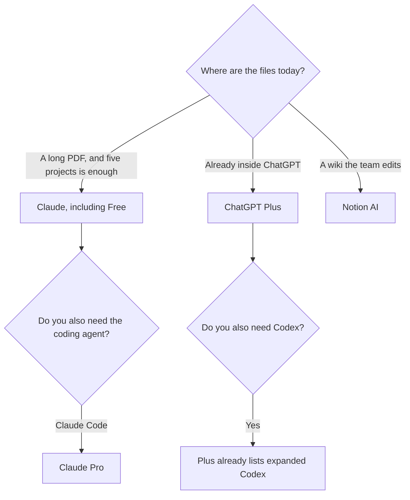

**Use a Claude Project when the work is long documents and you want the files and instructions in one place, including on the free plan up to the cap the directory records. Use a ChatGPT Project when the work already lives in ChatGPT and Plus is the plan you were going to buy.** Both are folders of context. Neither is a system of record.

The directory page for Claude, checked October 16, 2026, says free users get up to five Projects. Pro is $20 a month, or $17 billed annually ($200 a year), and that card is where Claude Code, more usage, and the fuller workspace sit. ChatGPT's directory card from the same day lists projects on Plus at $20 a month. Go is $8 and does not list projects as the reason to upgrade. The ChatGPT container versus a custom GPT is [ChatGPT Projects vs custom GPTs](/blog/chatgpt-projects-vs-custom-gpts-2026/).

Published October 24, 2026. We did not run a writing bake-off. The prose comparison is [ChatGPT vs Claude for writing](/blog/chatgpt-vs-claude-for-writing-2026/).

## The two containers

| | Claude Project | ChatGPT Project |
|---|---|---|
| What it holds | Chats, uploaded files, and instructions for that body of work | Chats, files, and instructions for that body of work |
| Free | Up to 5 Projects, on the October 16 directory note | The October 16 card puts projects on Plus |
| Paid entry that lists the feature | Pro, $20 a month or $17 billed annually | Plus, $20 a month |
| What else that paid plan is for | Claude Code, more of the usage pool, connectors on the card | Custom GPTs, scheduled tasks, expanded Codex |
| A side panel for a doc or a small app | Artifacts, including on Free | Canvas-style edits exist in the product. This article does not treat them as the same object |
| Heavy use | Max from $100. See [Claude Pro vs Max](/blog/claude-pro-vs-max-2026/) | Pro from $100. See [Go vs Plus vs Pro](/blog/chatgpt-go-vs-plus-vs-pro-2026/) |

## What the project does not do

A project applies instructions so you stop pasting them. Those instructions are [what a system prompt is](/blog/what-is-a-system-prompt-2026/). They do not check facts. Put the source in the project and ask for a blank where the file is silent. The habit is [how to fact-check AI writing](/blog/how-to-fact-check-ai-writing-2026/).

A project is also the wrong place to be the company wiki. [Notion AI](/tools/notion-ai/) Business at $20 per seat per month, directory October 16, is the workspace if that is where the pages already are. Notes that start in chat and should have stayed in the wiki are [Notion AI vs ChatGPT for notes](/blog/notion-ai-vs-chatgpt-for-notes-2026/).

Sharing is a plan question. Claude Team and ChatGPT Business add admin and central billing. Claude Team is per seat for 2 to 150 people on the October 16 card, without a single public seat price in the note we used, so this article does not invent one. ChatGPT Business is $20 per user per month billed annually, or $25 monthly, with a two-user minimum. Buy the team plan when an admin must turn a project off. Do not buy it to get a smarter model.

## Coding is the tie-breaker

If the project is a repository, the chat folder matters less than the agent that can touch the repo. [Claude Code](/tools/claude-code/) rides on Claude Pro and Max. The review is [Claude Code review](/blog/claude-code-review-2026/). ChatGPT Plus lists expanded Codex. The three-way with an editor is [Cursor vs Claude Code vs Codex](/blog/cursor-vs-claude-code-vs-codex-2026/). A Project full of pasted code is a brief. The agent is the edit.

Writers who are not shipping code can ignore that branch. Pick the assistant whose prose you will actually edit, put the style examples in the project, and keep the source files next to the draft. One example in the instructions is [what few-shot prompting is](/blog/what-is-few-shot-prompting-2026/).

## FAQ

### Can I use Claude Projects for free?

The directory says yes, up to five, as of the October 16, 2026 check. Pro is the plan when you hit usage limits or you need Claude Code. Confirm the cap on your account. Product limits move.

### Are the files private to the project?

They are in that project rather than in every chat. They are still on the vendor's side under that plan's data terms. A Business or Team plan is the conversation when the files are customer data. Read the current terms. This article is not a data-processing agreement.

### Should I keep the same work in both?

Only while you are choosing. Two projects means two copies of the file. Pick one container after a week, and export the draft into the wiki or the spec.

### Which one is better at long documents?

Use the one that fits the file and shows you the passage it used. Length alone is [what a context window is](/blog/what-is-a-context-window-2026/). A window is not an excuse to skip the source.

## Last verified

October 16, 2026 for Claude's five-project free note, Claude Pro at $20 or $17 annual, and ChatGPT Plus at $20 with projects listed on that plan. Published October 24, 2026.

**Sources:** [Claude pricing](https://claude.com/pricing), [ChatGPT pricing](https://chatgpt.com/pricing).

*Published by Andrew for [AI Tools Optimizer](https://aitoolsoptimizer.com).*

[Claude](/tools/claude/) and [ChatGPT](/tools/chatgpt/) are in the [assistants directory](/tools/category/chatbots-assistants/). Directory pages may use affiliate links. A purchase through them may earn us a commission at no extra cost to you.
