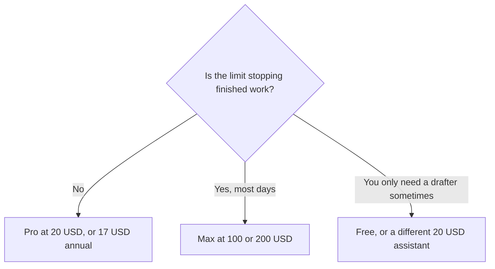

**[Claude](/tools/claude/) is Anthropic's assistant for writing, analysis, files, and code, including Claude Code on the same subscription.** Pro is $20 a month, or $17 a month if you pay $200 up front. Max is not a different product. It is more of the same usage pool. The limit math is [Claude Pro vs Max](/blog/claude-pro-vs-max-2026/). This review is what the assistant is for.

Prices and the usage rules were read from Claude's pricing page on October 24, 2026. List prices exclude tax. App-store prices can differ from the web. We did not count messages or score essays against ChatGPT.

The three-way choice is [ChatGPT vs Gemini vs Claude](/blog/chatgpt-vs-gemini-vs-claude-2026/). The drafting cut is [ChatGPT vs Claude for writing](/blog/chatgpt-vs-claude-for-writing-2026/).

## The plans, in one table

| Plan | Price | What Anthropic publishes |
|---|---|---|
| Free | $0 | Everyday questions. Chat, web search, files, and Artifacts are on the product |
| Pro | $20/month, or $17/month annual ($200 up front) | At least 5× Free per rolling 5-hour session, plus weekly caps. Claude Code included |
| Max | $100/month (5× Pro) or $200/month (20× Pro) | The same pool, larger. Monthly API credits of $100 or $200. Priority at busy times |
| Team | Standard and premium seats | 2 to 150 people. A different purchase from Pro |
| Enterprise | Custom | SSO, SCIM, audit logs. Not a checkbox on Pro |

There is no fixed message count. Length, model, and features change how fast the pool drains. Chat on the web, desktop, mobile, and Claude Code draw from the same pool. A person who "hits the limit" is often running a memo and a repository on one tank.

## What to use it for

Claude is the assistant to open when the output is a document: a memo, a spec, a careful summary of a file you uploaded. Projects keep that work together. Research, Chrome, and Microsoft 365 connectors are on Pro, on the pricing page. They do not make Claude a search engine. For a question that should come back as links you open, use [Perplexity](/tools/perplexity/) and the [research-desk review](/blog/perplexity-review-2026/). For papers, use [Consensus](/tools/consensus/) or [Elicit](/tools/elicit/).

Claude Code is included on Pro and Max. It is not a second subscription, and it is not free capacity. The beginner path is [Claude Code for beginners](/blog/claude-code-for-beginners-2026/). If the code lives in GitHub and you want completions in the editor you already use, price [GitHub Copilot](/tools/github-copilot/) before you buy Max. The editor comparison is [Cursor vs Claude Code vs Codex](/blog/cursor-vs-claude-code-vs-codex-2026/).

Paid plans can turn on usage credits and keep going at API rates after a cap. That is a second bill. Read the meter in Settings, then Usage, before you call Max the only way to finish a Thursday.

## Who should pay

**Pay for Pro** if you write or code with Claude most weeks and Free's session cap is the thing that stops you. Annual billing is $200, which is $40 less than twelve months at $20. **Pay for Max** when a measured week of Pro ran out, not because the name says 20×. **Skip Claude** if your day is Gmail and Drive. That bill is [Gemini](/tools/gemini/) on Google AI Pro, and the storage is part of the price. **Skip a second $20 seat** if ChatGPT Plus is already doing the same drafts. One subscription is the point of [which AI subscription is worth paying for](/blog/which-ai-subscription-is-worth-paying-for/).

Team is the buy when two or more people need seats and an admin. Enterprise is the buy when the requirement is SSO or an audit log. Do not describe Pro as those controls.

## FAQ

### Is Claude free?

Yes. Free covers everyday use. Pro is the paid individual plan, at $20 a month or $17 a month billed annually.

### Does Pro include Claude Code?

Yes. Claude Code draws from the same usage pool as chat. It does not add a separate allowance.

### What is Max for?

More usage: 5× Pro at $100 a month, or 20× Pro at $200 a month, on the five-hour window, with weekly caps still in force. The full limit explanation is the Pro vs Max article.

## Last verified

October 24, 2026, from Claude's pricing page. Model names move faster than the $20 and $17 prices. Recheck the page if a checkout does not match this table.

**Sources:** [Claude pricing](https://claude.com/pricing), [What is the Max plan?](https://support.claude.com/en/articles/11049741-what-is-the-max-plan).

[Claude](/tools/claude/) is in the [chatbots directory](/tools/category/chatbots-assistants/). Directory pages may use affiliate links. A purchase through them may earn us a commission at no extra cost to you.
