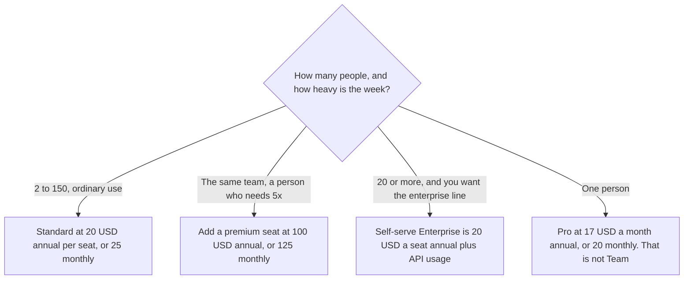

**Claude Team, on claude.com/pricing fetched October 24, 2026, is a plan for 2 to 150 people. A standard seat is $20 a seat a month billed annually, or $25 billed monthly. A premium seat is $100 a seat a month billed annually, or $125 billed monthly.** The page says premium seats include 5x more usage than standard seats. You can mix seat types. The full ladder, including Pro and Max, is [Claude pricing explained](/blog/claude-pricing-explained-2026/).

Published October 24, 2026. We did not score answers. This article is the team purchase. A pile of individual Pro seats is a different shape, and the coding tool on the paid plans is [Claude Code pricing explained](/blog/claude-code-pricing-explained-2026/).

## The Team rows on the October 24 page

| Seat | Price that day | What the page attaches |
|---|---|---|
| Standard | $20 a seat a month billed annually, or $25 monthly | All Claude features, plus more usage than Pro. Central billing. The range is 2 to 150 people |
| Premium | $100 a seat a month billed annually, or $125 monthly | 5x more usage than a standard seat, on that page |
| Mix | Both types on one team | The page says you can mix and match |
| Pooled API credits | Up to $500 a month | Those credits are for the Claude Platform. They are not a second copy of the seat price |
| Enterprise self-serve, for contrast | $20 a seat a month billed annually, plus usage at API rates, 20-seat minimum | A different plan. A 10-person group is still in the Team range |

The October 24 compare table lists [Claude Code](/tools/claude-code/) on Team. The Claude Code article, from the same page, says terminal work and chat share the plan's usage. A Team seat does not mint a separate unlimited coding pool. The Team block we read also shows the line "Enterprise search across your organization" beside the seat types. Treat that as a line to confirm on the plan you buy. The seat dollars, the 2-to-150 range, mix-and-match, and the pooled credit cap are the figures this article will stand on. SSO and the "no model training on your content by default" line are recorded in the Claude pricing article from this same page. Read that article's date, then read checkout if the control is why you are buying.

## What you are not buying

**A stack of Pro seats.** Pro is $17 a month with annual billing, $200 up front, or $20 monthly. Pro is one person. Team is the plan with central billing and the 2-to-150 range. Five Pro checkouts are not a Team admin console.

**[ChatGPT](/tools/chatgpt/) Business,** if the other workspace is the comparison, is $20 a user a month billed annually for two or more users, or $25 monthly, on learn.chatgpt.com/docs/pricing the same day. The page names it Business, not Team. The invoice is [ChatGPT Team pricing explained](/blog/chatgpt-team-pricing-explained-2026/).

**[Cursor](/tools/cursor/)**, if the work is an editor seat, is Plus at $8 a month or $80 a year on the October 16 directory card. That is not a Claude Team discount. The ladder is [Cursor pricing explained](/blog/cursor-pricing-explained-2026/).

**Max,** from $100 a month, is the individual all-day plan on the October 24 page. A premium Team seat is also $100 at the annual rate. They are different products at a similar sticker. Max is one person. Premium is a seat type inside Team. Do not swap the names on a purchase order.

## What not to assume

Do not describe annual standard as "$20 today" without saying it is the per-month price when you bill annually. Do not assume every person needs premium because one person does. The page says you can mix seats. Do not treat the $500 pooled API credit line as cash you can spend outside the platform the page names. Do not put a 200-person company on the Team range. The page stops Team at 150 and points the larger contract at Enterprise.

## FAQ

### How much is a Claude Team seat?

Standard is $20 per seat per month billed annually, or $25 billed monthly. Premium is $100 per seat per month billed annually, or $125 billed monthly. Both figures are from claude.com/pricing on October 24, 2026. The plan is for 2 to 150 people.

### Does Team include Claude Code?

The compare table on that page lists Claude Code on Team. Usage is shared with chat, as the Claude Code article records from the same page. A premium seat is not required by that row. Confirm the seat you were sold.

### What is the $500 figure?

The page says Team includes up to $500 a month in pooled API credits for the Claude Platform. It is not an extra $500 off the seat price. If your invoice shows a different credit number, the invoice wins.

### How is Enterprise different?

The self-serve Enterprise line on that page is $20 a seat a month billed annually, with a 20-seat minimum, plus usage at API rates. Team standard is a seat price without that usage line, inside 2 to 150 people. A buyer who needs SCIM, audit logs, or a sales-assisted contract should read the Enterprise section rather than stretch Team.

## Last verified

October 24, 2026, from claude.com/pricing. ChatGPT Business figures used as a comparison are from learn.chatgpt.com/docs/pricing the same day. Cursor's comparison price is the October 16 directory card. Published October 24, 2026.

**Sources:** [Claude pricing](https://claude.com/pricing), [Claude Code](https://claude.com/product/claude-code), [ChatGPT and Codex pricing](https://learn.chatgpt.com/docs/pricing), [Cursor pricing](https://cursor.com/help/account-and-billing/pricing).

*Published by Andrew for [AI Tools Optimizer](https://aitoolsoptimizer.com).*

[Claude](/tools/claude/) is in the [chatbots and assistants directory](/tools/category/chatbots-assistants/). Directory pages may use affiliate links. A purchase through them may earn us a commission at no extra cost to you.
