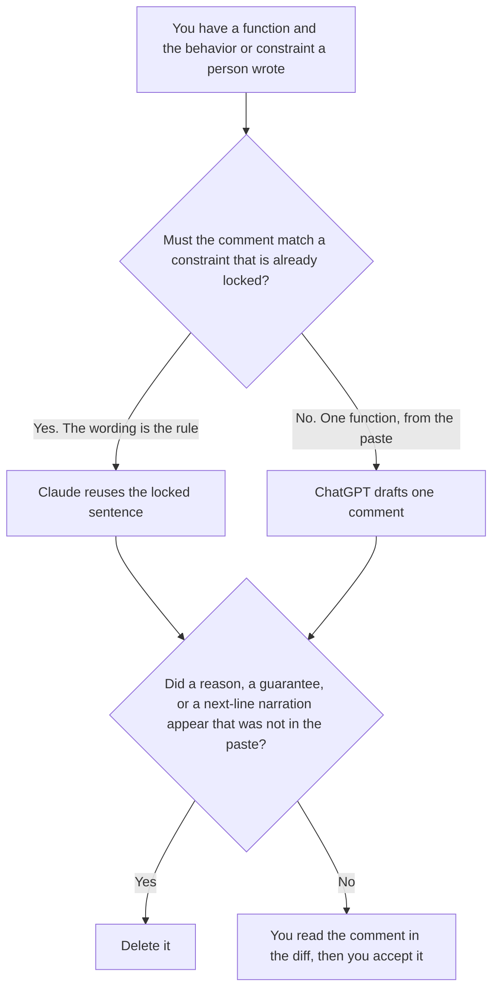

**Use Claude when a code comment must restate a constraint a person already wrote, and a paraphrase would change the rule. Use ChatGPT when you are writing one comment on one function from behavior you already pasted.** The model may shorten a sentence you supplied. It may not narrate the next line, invent a reason, or describe a security property you did not write.

Comments a reviewer leaves on a diff, which are not comments inside the file, are [Claude vs Gemini for code reviews](/blog/claude-vs-gemini-for-code-reviews-2026/). The editor seat that will hold the comment is a separate choice, covered below, and compared for refactors in [Cursor vs GitHub Copilot for refactors](/blog/cursor-vs-github-copilot-for-refactors-2026/).

Claude's prices are the October 24, 2026 read of claude.com/pricing recorded in [Claude pricing explained](/blog/claude-pricing-explained-2026/). ChatGPT's Plus price is the October 24 plan-page figure recorded in [ChatGPT pricing explained](/blog/chatgpt-pricing-explained-2026/). Cursor's Plus price is the October 24 help-center figure recorded in [Cursor pricing explained](/blog/cursor-pricing-explained-2026/). GitHub Copilot's prices are the October 16 directory card recorded in [GitHub Copilot pricing explained](/blog/github-copilot-pricing-explained-2026/). Published October 24, 2026. We did not score comments.

## Which comment you are writing

| The comment | Start here | First paid step | The limit |
|---|---|---|---|
| A constraint that must stay word for word | [Claude](/tools/claude/) | Pro is $17 a month billed annually, or $20 monthly | A paraphrase is a different rule |
| One function, from behavior you pasted | [ChatGPT](/tools/chatgpt/) | Plus is $20 a month | No reason that was not in the paste |
| The comment lands in a diff you will read | [Cursor](/tools/cursor/) | Plus is $8 a month, or $80 a year | You still read the diff. Plus omits Cloud Agents on the October 24 help page |
| Completions in the editor you already use on GitHub | [GitHub Copilot](/tools/github-copilot/) | Pro is $10 a month | A completion is not a constraint you have accepted |

Claude Pro is the right seat when the file already has a comment for a timeout, a tenant check, or a units rule, and this comment is only allowed to point at it. A friendlier sentence is a different rule. If the locked sentence is missing, the line says Constraint not pasted. ChatGPT Plus is the right seat when the paste is the whole source and the comment covers one function. A comment that explains what the next line obviously does stays out. If you cannot say why the comment exists from the paste, the function does not get a comment.

The code-review page is what a reviewer writes about a diff. This page is text that will live in the file. Do not paste a review comment into the source and call it documentation. Cursor or Copilot is where you look at the line before it merges. Neither editor makes the comment true.

## What the comment is allowed to say

The constraint you pasted, or the behavior you pasted, in fewer words only where you allowed a shorter sentence. A performance claim stays out. A security claim stays out. A TODO the model thinks you meant stays out.

**Claude Pro** holds the locked constraints in a Project. The review is [Claude review](/blog/claude-review-2026/).

**ChatGPT Plus** is the one-function draft. The bill is [ChatGPT pricing explained](/blog/chatgpt-pricing-explained-2026/).

**Cursor Plus** is the diff. The review is [Cursor review](/blog/cursor-review-2026/).

**Copilot Pro** is completions on the GitHub seat. Business at $19 and Enterprise at $39 are the company rows on the October 16 card, explained in [GitHub Copilot pricing explained](/blog/github-copilot-pricing-explained-2026/).

A prompt that holds the line:

"Write the code comment from the constraint or the behavior I pasted. If the constraint is missing, write Constraint not pasted. Do not describe the next line. Do not add a guarantee."

## What not to delegate

Do not ask for comments on every function so the file "looks documented." Do not turn a review remark into an in-file guarantee. Do not merge because the comment sounds careful. The person who owns the change reads the line.

## FAQ

### How is this different from a code review?

A review comment is a note on a diff, for a reviewer. A code comment stays in the file after the review is done. The review page does not choose the sentence that ships in the source. This page does, and only from text you pasted.

### How is this different from a refactor?

The refactor comparison is which editor should change the code. This page is the sentence above a function. A comment is not a reason to rewrite the function. If the code is wrong, fix the code in the editor comparison, and do not paper over it with a comment.

### When does the comment stay out?

When you have no constraint and no behavior to record. Narrating the next line is not a comment this page allows. Constraint not pasted means you skip the line.

### Who may merge the comment?

The person who owns the change, after they read it in the diff. A suggested comment is not an accepted constraint.

## Last verified

October 24, 2026 for Claude, for ChatGPT's plan page, and for Cursor's help page, via the posts cited above. October 16, 2026 for GitHub Copilot. Published October 24, 2026. We did not score comments.

**Sources:** [Claude pricing](https://claude.com/pricing), [ChatGPT and Codex pricing](https://learn.chatgpt.com/docs/pricing), [Cursor pricing](https://cursor.com/help/account-and-billing/pricing), [GitHub Copilot plans](https://github.com/features/copilot/plans).

*Published by Andrew for [AI Tools Optimizer](https://aitoolsoptimizer.com).*

[Claude](/tools/claude/) is in the [chatbots and assistants directory](/tools/category/chatbots-assistants/). Directory pages may use affiliate links. A purchase through them may earn us a commission at no extra cost to you.
