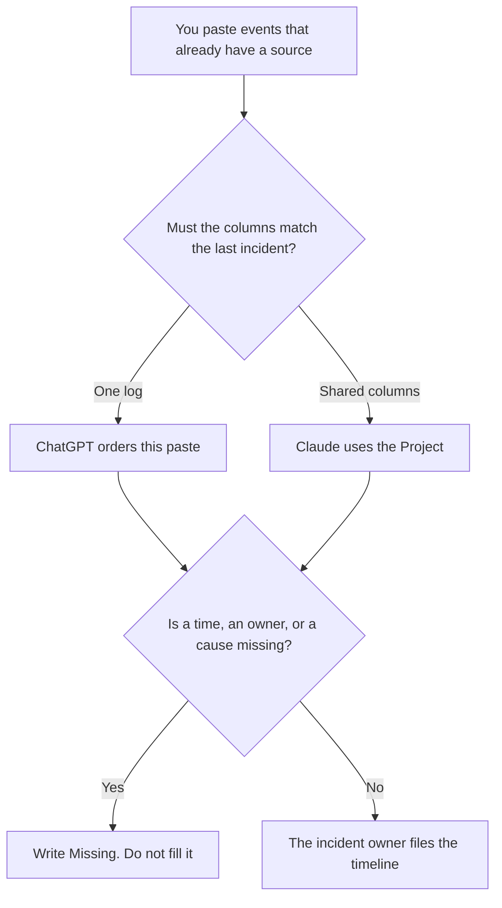

**Use Claude when every incident timeline has to follow the same columns, because those columns live in a Project. Use ChatGPT when you are ordering one log from one paste.** The model may sort events you already wrote and copy times you already wrote. It may not add a cause, a customer count, or a minute nobody recorded. The note you send after a rollback is [how to write a rollback comms note with AI](/blog/how-to-write-a-rollback-comms-note-with-ai-2026/). An RFC, which is a different long document, is [Claude vs ChatGPT for RFC drafts](/blog/claude-vs-chatgpt-for-rfc-drafts-2026/).

Claude's prices are from claude.com/pricing on October 24, 2026. ChatGPT Plus and Business are from learn.chatgpt.com/docs/pricing that day. Notion and Grammarly prices are from directory pages checked October 16, 2026. Published October 24, 2026. We did not score incidents.

## Which timeline you are building

| The log in front of you | Start here | First paid step | The limit |
|---|---|---|---|
| One paste, one incident | [ChatGPT](/tools/chatgpt/) | Plus is $20 a month | No event that was not in the paste |
| The same columns on every incident | [Claude](/tools/claude/) | Pro is $17 a month billed annually, or $20 monthly | The Project holds the columns |
| The page the company will keep | [Notion AI](/tools/notion-ai/) | Business is $20 a seat a month | Plus at $10 is not the full AI tier |
| A last pass on the words | [Grammarly](/tools/grammarly/) | Pro is $12 a member a month billed annually, or $30 monthly | A rewrite may not add a cause |

A timeline is a sequence. It is not a root-cause analysis. If the paste says "errors started" and does not say why, the row says the errors started. The why stays blank. A comms note can point at the timeline. The timeline does not become the comms note.

## What each seat keeps

**Claude Pro** is the shared-column path. Put the required fields in the Project: time, source, what changed, what is unknown. Team standard seats are $20 a seat a month billed annually, or $25 monthly, for 2 to 150 people, on the October 24 page, when the timeline is a company record and a personal login is the wrong place. The review is [Claude review](/blog/claude-review-2026/). The Team invoice is [Claude Team pricing explained](/blog/claude-team-pricing-explained-2026/).

**ChatGPT Plus** is the one-log path. Business is $20 a user a month billed annually for two or more users, or $25 monthly, on that page. The page says Business does not train on business data by default. An incident log is a reason to read that line before you paste it into a personal chat. The review is [ChatGPT review](/blog/chatgpt-review-2026/).

**Notion Business** is the incident page if that is the system of record. The timeline on that page is still only as complete as the paste. The invoice is [Notion AI pricing explained](/blog/notion-ai-pricing-explained-2026/).

**Grammarly Pro** is a wording pass. If it changes "unknown" into "likely a deploy," put the original word back. The invoice is [Grammarly pricing explained](/blog/grammarly-pricing-explained-2026/).

A prompt that holds the line:

"Build a timeline from the events I pasted. Keep each time exactly as written. If a time or a cause is absent, write Missing. Do not infer a cause from the order of the rows. Do not add a customer impact count."

## What not to delegate

Do not merge two incidents so the story "reads cleanly." Do not convert a timezone you did not specify. Do not let the model declare the incident resolved because the last row sounds calm.

## FAQ

### Which one builds a more accurate timeline?

We did not measure that. Accuracy here means every row traces to the paste. Claude fits rules you will reuse. ChatGPT fits one log. A fluent timeline can still be wrong.

### Can the model pull times from the deploy tool?

Only from text you paste or from a line a person has already confirmed. A model that "knows" the deploy is using a stale thread. Paste the event.

### Where does the customer note go?

In the comms document, after the incident owner decides what the audience should hear. The timeline can be an input to that note. It is not the note. The rollback version of that note is linked above.

### Who may call the timeline final?

The incident owner. A sorted table is not a postmortem. A cause someone adds later is a new row with a new time, the time they added it, if you record amendments that way.

## Last verified

October 24, 2026 for Claude, including Team, and for ChatGPT Plus and Business. October 16, 2026 for Notion and Grammarly. Published October 24, 2026.

**Sources:** [Claude pricing](https://claude.com/pricing), [ChatGPT and Codex pricing](https://learn.chatgpt.com/docs/pricing), [Notion pricing](https://www.notion.com/pricing), [Grammarly plans](https://www.grammarly.com/plans).

*Published by Andrew for [AI Tools Optimizer](https://aitoolsoptimizer.com).*

[Claude](/tools/claude/) is in the [chatbots and assistants directory](/tools/category/chatbots-assistants/). Directory pages may use affiliate links. A purchase through them may earn us a commission at no extra cost to you.
