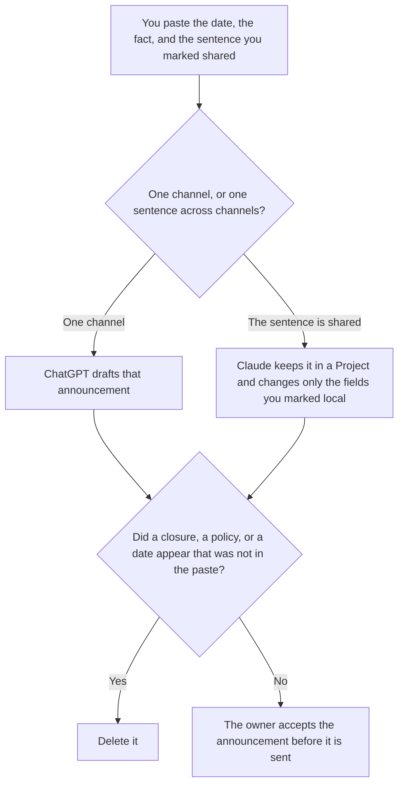

**Use ChatGPT when you are writing one internal announcement, for one channel, from a date and a fact a person already set. Use Claude when that same sentence must appear, unchanged, in Slack, in email, and on the intranet page.** The model may order the sentence. It may not invent a closure, a policy, a vendor, or a date. A note to a named audience that includes an ask is [ChatGPT vs Claude for stakeholder updates](/blog/chatgpt-vs-claude-for-stakeholder-updates-2026/). An external news page is [Claude vs ChatGPT for press releases](/blog/claude-vs-chatgpt-for-press-releases-2026/). This page is the internal announcement.

The office fact, the vendor list, and a flyer are [best AI tools for office managers](/blog/best-ai-tools-for-office-managers-2026/). A change email, when the change is the whole message, is [how to write a change management email with AI](/blog/how-to-write-a-change-management-email-with-ai-2026/).

Claude's prices are the October 24, 2026 read of claude.com/pricing recorded in [Claude pricing explained](/blog/claude-pricing-explained-2026/). ChatGPT's Plus price is the October 24 plan-page figure recorded in [ChatGPT pricing explained](/blog/chatgpt-pricing-explained-2026/). Notion and Grammarly prices are from directory pages checked October 16, 2026. A live fetch of Grammarly's plans URL returned HTTP 401 on October 24, as the Business pricing article records. Published October 24, 2026. We did not score announcements. We did not send one.

## Which announcement is in front of you

| The file | Start here | First paid step | The limit |
|---|---|---|---|
| One channel, from one date and one fact | [ChatGPT](/tools/chatgpt/) | Plus is $20 a month | No fact that was not in the paste |
| The same sentence in Slack, email, and the intranet page | [Claude](/tools/claude/) | Pro is $17 a month billed annually, $200 up front, or $20 monthly | A channel may not reword the shared sentence |
| The page people will open next week | [Notion AI](/tools/notion-ai/) | Business is $20 a seat a month | Plus at $10 is not the full AI tier |
| A clarity pass that must not move the date | [Grammarly](/tools/grammarly/) | Pro is $12 a member a month billed annually, or $30 monthly | Compare the date and the fact before and after |

An announcement that says the office is "closed Friday" has added a closure. If you did not write the status, the line says Status not set. A benefit you did not paste stays out. Put proposals in a note labeled Not in the announcement.

The stakeholder-update page is a decision plus an ask. This page can be a fact with no ask: the cafeteria time, the system window, the new desk. Do not add an ask so the note looks like an update. The press-release page is for people outside the company. An internal sentence is not a quote for a reporter.

## What the announcement is allowed to contain

The date, the fact, and the sentence you marked shared. A channel can add a greeting you already approved. It cannot soften the fact. The owner is a person. The model does not sign it.

**ChatGPT Plus** is the one-channel path. Go is $8 a month on the October 24 plan page. Plus is the seat for a saved announcement. The review is [ChatGPT review](/blog/chatgpt-review-2026/).

**Claude Pro** is the shared sentence. Team standard seats are $20 a seat a month billed annually, or $25 monthly, when the announcement is a company record, as recorded in [Claude Team pricing explained](/blog/claude-team-pricing-explained-2026/). The review is [Claude review](/blog/claude-review-2026/).

**Notion Business** stores the accepted sentence, the owner, and the date. The invoice is [Notion AI pricing explained](/blog/notion-ai-pricing-explained-2026/).

**Grammarly Pro** is the pass after the fact is stable. Reject a suggestion that moves a date or adds a status. The invoice is [Grammarly pricing explained](/blog/grammarly-pricing-explained-2026/).

A prompt that holds the line:

"Draft the announcement from the date and the fact I pasted. If a status is missing, write Status not set. Do not add a closure. Do not add a policy. Do not reword a sentence I marked shared."

## What not to delegate

Do not ask which wording will "land" with the company. Do not paste a competitor's announcement so yours matches the tone. Do not send it because three channels look full. The owner who wrote the fact accepts it.

## FAQ

### How is this different from a stakeholder update?

That page is a decision, an audience, and an ask. This page is an internal fact: one channel, or one sentence that must match across channels. An announcement can ship with no ask. An update that needs a decision from the reader belongs on that page. Do not add an ask to fill the template.

### How is this different from a press release?

A press release is an external news page, with a peg and quotes people approved. An internal announcement is for people who already work here. A sentence you were not willing to put in the release does not become true because the audience is internal. Link the fact sheet if you have one. Do not invent a quote.

### How is this different from an office-manager stack?

That page is the office announcement, the vendor contact list, and a flyer. This page is the writing choice between one channel and a shared sentence. The office manager still owns the facts. The tool only drafts from those facts.

### Who may send it?

The owner named on the fact. Status not set stays unset. A sentence you marked shared does not get three versions. A formatted paragraph is not a new policy.

## Last verified

October 24, 2026 for Claude and for ChatGPT's plan page, via the posts cited above. October 16, 2026 for Notion and Grammarly. Published October 24, 2026. Grammarly's plans URL returned HTTP 401 on October 24.

**Sources:** [Claude pricing](https://claude.com/pricing), [ChatGPT and Codex pricing](https://learn.chatgpt.com/docs/pricing), [Notion pricing](https://www.notion.com/pricing), [Grammarly pricing](https://www.grammarly.com/plans).

*Published by Andrew for [AI Tools Optimizer](https://aitoolsoptimizer.com).*

[ChatGPT](/tools/chatgpt/) is in the [chatbots and assistants directory](/tools/category/chatbots-assistants/). Directory pages may use affiliate links. A purchase through them may earn us a commission at no extra cost to you.
