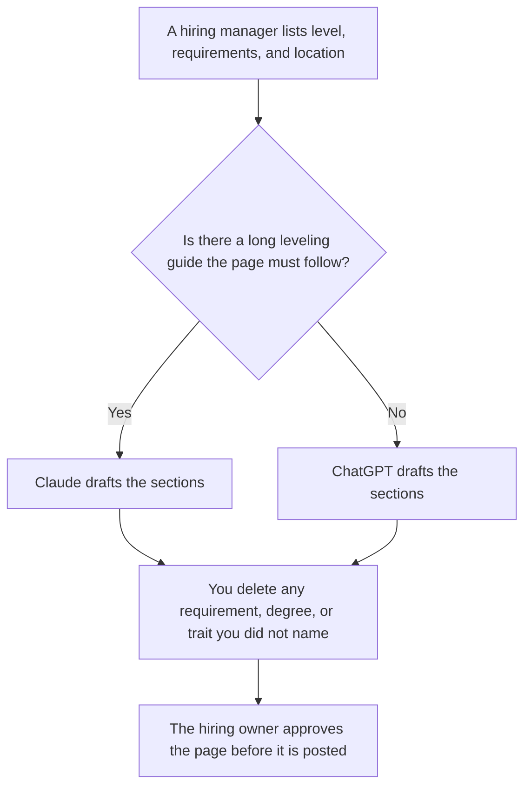

**Use Claude when the job description has to follow a long leveling guide you keep in a Project. Use ChatGPT when the description is a short template your team reuses.** The requirements, the level, and the location rule come from the hiring manager. The model formats sections. It does not decide who you will hire, and it does not add a degree, a year-count, or a trait you did not write down. This page is not HR or legal advice.

The step-by-step for the document is [how to write a job description with AI](/blog/how-to-write-a-job-description-with-ai-2026/). The system around the loop is [best AI tools for talent ops](/blog/best-ai-tools-for-talent-ops-2026/). The sourcing shelf is [best AI tools for recruiters](/blog/best-ai-tools-for-recruiters-2026/). A later letter from a candidate, which is a different document, is [ChatGPT vs Claude for cover letters](/blog/chatgpt-vs-claude-for-cover-letters-2026/).

Prices are US list prices excluding tax from directory pages checked October 16, 2026. Published October 24, 2026. We did not score which posting attracts better applicants. A lawyer and your hiring owner were not asked to bless a sample.

## Which seat matches the role

| The description you are actually writing | Start here | What you still do |
|---|---|---|
| One role, a few requirements, no long guide | [ChatGPT](/tools/chatgpt/) Free or [Claude](/tools/claude/) Free | You write the requirements. The model only formats sections |
| The same internal template every time | ChatGPT Plus at $20 a month | Swap the requirements. Do not reuse another role's tools list |
| A long leveling guide the new page must not contradict | Claude Pro at $20 a month, or $17 billed annually | The Project holds the guide. The draft adds no requirement the guide does not contain |
| A grammar pass after the requirements are frozen | [Grammarly](/tools/grammarly/) Pro at $12 a member a month billed annually | It must not add a requirement. Monthly Pro is $30 on that card |
| The signed page lives in the wiki | [Notion AI](/tools/notion-ai/) Business at $20 a seat a month | The wiki is the record. The chat is the draft |

Claude Max starts at $100. ChatGPT Pro starts at $100. A job description does not need either. ChatGPT Business, at $20 a user a month billed annually with a two-user minimum, is the row when the role is confidential and a personal account is against policy. Do not paste an unannounced backfill into a consumer account your company forbids.

## What the draft should contain

The title, the level you named, the requirements you listed, the location or remote rule you listed, and how to apply if you wrote it. It should not contain "competitive salary" unless you supplied the band, a culture paragraph you did not approve, or a preferred university. If a section has no decision, the line says Not decided.

**Claude Pro** is the right paid seat when the leveling guide is long. Projects are on Pro. The product review is [Claude review](/blog/claude-review-2026/).

**ChatGPT Plus** is the right paid seat when the template is short and you already keep templates there. The product review is [ChatGPT review](/blog/chatgpt-review-2026/).

A prompt that holds the line:

"Format a job description from the title, level, requirements, and location I pasted. Do not add a requirement, a degree, a year of experience, or a personality trait. Do not invent a salary. If a section is missing, write Not decided. This is a draft for the hiring owner, not a posting and not HR advice."

## What not to delegate

Do not ask the model what the requirements should be. Do not ask it to make the page "attract more diverse candidates" by rewriting the bar. Do not post the draft because it looks like a job ad. The hiring owner posts it, after whatever review your company requires. The scorecard that comes later is [how to create a hiring pipeline scorecard with AI](/blog/how-to-create-a-hiring-pipeline-scorecard-with-ai-2026/). That page is also not a hiring decision.

## FAQ

### Which one writes a fairer job description?

We did not measure fairness. A usable description is a level and a requirement list a hiring manager is willing to screen against. Pick Claude for a long guide. Pick ChatGPT for a short template. Have the owner read it. This is not legal or HR advice.

### Can the model suggest a salary band?

Only by formatting a band you already decided and are allowed to publish. A number the model guessed from "market rates" does not go on the page. Leave compensation Not decided until the owner fills it.

### Is this the same as writing the interview scorecard?

No. The description says what the role is. The scorecard says how interviewers mark evidence. Write the description first, with requirements you will actually score. Then use the scorecard workflow.

### What if we already have a careers-page style?

Paste the style rules you use: tense, length, and the sections you always include. The model may follow them. It may not add a section those rules do not have. Grammarly is the polish after the requirements are frozen, not a second author.

## Last verified

October 16, 2026 for Claude, ChatGPT, Grammarly, and Notion AI. Published October 24, 2026.

**Sources:** [Claude pricing](https://claude.com/pricing), [ChatGPT pricing](https://chatgpt.com/pricing/), [Grammarly Pro cost](https://support.grammarly.com/hc/en-us/articles/115000090011-How-much-does-Grammarly-Pro-cost), [Notion pricing](https://www.notion.com/pricing).

*Published by Andrew for [AI Tools Optimizer](https://aitoolsoptimizer.com).*

[Claude](/tools/claude/) is in the [chatbots and assistants directory](/tools/category/chatbots-assistants/). Directory pages may use affiliate links. A purchase through them may earn us a commission at no extra cost to you.
