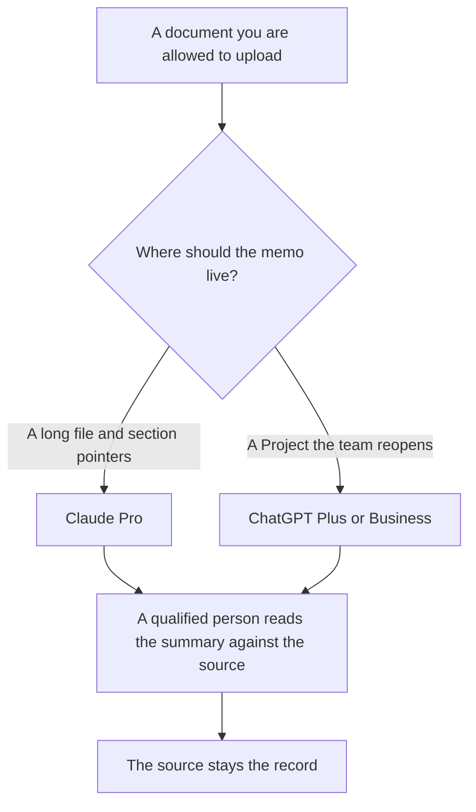

**Use Claude or ChatGPT to summarize a document you have the right to upload, then have a qualified person read both the summary and the source before anyone relies on it.** This is document summarization. It is not legal advice, not a prediction of how a dispute comes out, and not a substitute for counsel. Pick Claude Pro at $20 a month ($17 billed annually) when the file is long and you want the summary to stay tied to sections you can point at. Pick ChatGPT Plus at $20 a month when the memo should live in a Project your team reopens. If a clause is not in the file, the summary says Missing.

The ops shelf around intake and playbooks, which is a different job, is [best AI tools for legal ops](/blog/best-ai-tools-for-legal-ops-2026/). A wrong sentence that was not in the file is [what an AI hallucination is](/blog/what-is-ai-hallucination-2026/). The check is [how to fact-check AI writing](/blog/how-to-fact-check-ai-writing-2026/).

Prices are US list prices excluding tax from directory pages checked October 16, 2026. Published October 24, 2026. We did not score summary accuracy. We are not a law firm. Nothing on this page creates an attorney-client relationship.

## What the summary is allowed to say

| The summary may | The summary may not |
|---|---|
| List the parties named in the file | Decide who is right |
| Restate a date, a dollar figure, or a notice period that appears in the text | Compute a deadline the text does not state |
| Point at a section when you ask for a pointer | Claim a clause exists because similar contracts usually have one |
| Say Missing when a topic you asked about is absent | Fill the gap with a standard term |
| Stay shorter than the source | Drop a limitation of liability because it was boring |

Claude's directory card lists a context window of up to 1 million tokens depending on the model. That is why a long file is the Claude-shaped job. It is not a claim that the summary will be right. ChatGPT Plus is the seat with Projects and higher upload limits on the card. Business is $20 a user a month billed annually for two or more users, or $25 billed monthly, with no training on business data by default. A contract under a confidentiality duty belongs on the company plan your counsel already allows, not on a personal free account.

Claude Team is per seat for 2 to 150 people. The directory does not list a public Team dollar. Budget that seat from checkout. The container for either chat is [Claude Projects vs ChatGPT Projects](/blog/claude-projects-vs-chatgpt-projects-2026/).

## The file around the memo

**The page that holds the summary and the source link.** [Notion AI](/tools/notion-ai/) Business is $20 a seat a month. Name the person who checked it and the date. A chat thread is not the file. The invoice is [Notion AI pricing explained](/blog/notion-ai-pricing-explained-2026/). That habit is [what a system of record for AI is](/blog/what-is-a-system-of-record-for-ai-2026/).

**A notebook grounded in files you upload.** [Gemini Notebook](/tools/gemini-notebook/) is free with a Google account in supported countries. Google AI Plus at $4.99 a month adds more notebooks and Audio Overviews. Google AI Pro at $19.99 a month offers 5x more, on the card. Citations point at your sources. You still open them. The notebook is a reading aid, not advice.

**The line edit after the facts are checked.** [Grammarly](/tools/grammarly/) Pro is $12 a member a month billed annually. It will not know whether a notice period was omitted.

**The model card for a workflow you repeat.** If your team summarizes the same kind of file every week, write down the intended use and the refusal. That document is [what a model card is](/blog/what-is-model-cards-2026/).

A prompt that holds the line:

"Summarize this document for an internal reader. Use only the text. For each item, include a section pointer. If I ask about a topic that is not in the file, write Missing. Do not give legal advice, do not predict an outcome, and do not add standard clauses."

The person who signs the memo is [what human-in-the-loop AI is](/blog/what-is-human-in-the-loop-ai-2026/).

## What this page refuses

It refuses to tell you which model "understands contracts." We did not measure that. It refuses to draft a filing, a demand, or a strategy. It refuses to summarize a document you do not have the right to upload. Privilege, confidentiality, and privacy rules are for your counsel and your admin, not for a blog post to waive.

A public-company comms summary is a different audience. That shelf is [best AI tools for investor relations](/blog/best-ai-tools-for-investor-relations-2026/).

## FAQ

### Can I rely on the summary in a negotiation?

Only as a reading aid you have checked against the source. The document is the record. A summary that omits a sentence can omit the sentence that matters. Counsel reads both when the decision has consequences.

### Which one is better for a 200-page file?

We did not run that test. Claude's card is the one that states a context window up to 1 million tokens depending on the model, so it is the first seat to try for a long file you are allowed to upload. You still spot-check sections, including the ones the summary did not mention.

### Is ChatGPT Plus enough?

For a short memo in a Project, Plus at $20 is the individual step. For a file under a company confidentiality rule, use Business or the Claude plan your admin approved. Free personal chats are the wrong drawer.

### Should the summary sound like a lawyer?

No. Ask for plain language and section pointers. A summary that imitates a legal opinion is easier to misuse. Label it as a summary, with the date and the file name.

## Last verified

October 16, 2026 for Claude, ChatGPT, Notion, Grammarly, and Gemini Notebook. Claude Team has no public per-seat dollar on the directory card. This page is not legal advice. Published October 24, 2026.

**Sources:** [Claude pricing](https://claude.com/pricing), [ChatGPT pricing](https://chatgpt.com/pricing/), [Notion pricing](https://www.notion.com/pricing).

*Published by Andrew for [AI Tools Optimizer](https://aitoolsoptimizer.com).*

[Claude](/tools/claude/) is in the [chatbots and assistants directory](/tools/category/chatbots-assistants/). Directory pages may use affiliate links. A purchase through them may earn us a commission at no extra cost to you.
