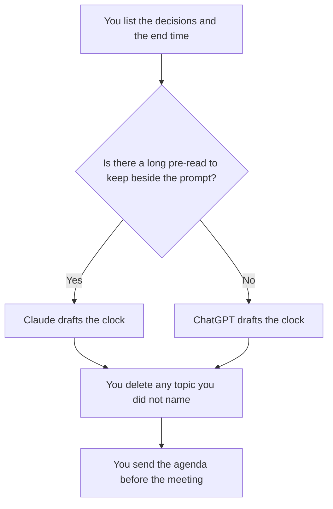

**Use Claude when the agenda has to follow a long pre-read in a Project. Use ChatGPT when the agenda is a short clock around decisions you will paste and reuse as a project.** Both can timebox a meeting. Neither knows which meeting should exist. The method, once you have a seat, is [how to create meeting agendas with AI](/blog/how-to-create-meeting-agendas-with-ai-2026/). We did not score which draft runs a better meeting.

The notes after you meet are [how to summarize meetings with AI](/blog/how-to-summarize-meetings-with-ai-2026/). A retro is its own agenda: [how to run a retro with AI](/blog/how-to-run-a-retro-with-ai-2026/). A smooth agenda that invents a decision is [what an AI hallucination is](/blog/what-is-ai-hallucination-2026/).

Prices are US list prices excluding tax from directory pages checked October 16, 2026. Published October 24, 2026. An agenda is not a recording policy. Turn on a notetaker only with the notice your meeting requires.

## Which seat matches the agenda

| The meeting you actually have | Start here | What you still do |
|---|---|---|
| Three decisions, a clock, no long pre-read | [ChatGPT](/tools/chatgpt/) Free or [Claude](/tools/claude/) Free | You name the decisions. The model only timeboxes them |
| The same staff meeting every week, with a saved prompt | ChatGPT Plus at $20 a month, projects included | Swap this week's decisions. Do not reuse last week's owners |
| A pre-read, a doc, and constraints that must stay next to the prompt | Claude Pro at $20 a month, or $17 billed annually | The Project holds the pre-read. The agenda does not add a topic the pre-read does not contain |
| The agenda page lives in the wiki | [Notion AI](/tools/notion-ai/) Business at $20 a seat a month | The page is the record. The chat is the draft |
| You need the transcript after, not the agenda before | [Fathom](/tools/fathom/) has a free recording tier. Paid rows are in [Fathom pricing explained](/blog/fathom-pricing-explained-2026/) | Record only when the room knows. The agenda is still written first |

Claude Max starts at $100 a month. ChatGPT Pro starts at $100. An agenda does not need either. ChatGPT Go at $8 may include ads. Do not take an ad as a meeting topic. Business, at $20 a user a month billed annually with a two-user minimum, matters when the pre-read is confidential and a personal account is against policy.

## What each draft should contain

A real agenda has the decision, the owner, the minutes, and the pre-read link. It does not have a topic called "sync" with no outcome. The model will add filler topics if you ask for "a full hour." Give it the end time and the decisions, and tell it to leave unused time empty.

**Claude Pro** is the right paid seat when the pre-read is a spec, a memo, or a pile of comments you refuse to re-paste every week. Projects are on Pro. Free can draft one agenda from a short paste. The review is [Claude review](/blog/claude-review-2026/).

**ChatGPT Plus** is the right paid seat when you want projects and you already live in ChatGPT for the rest of the day's drafts. The email cousin of this habit is [ChatGPT vs Claude for email](/blog/chatgpt-vs-claude-for-email-2026/). The review is [ChatGPT review](/blog/chatgpt-review-2026/).

A prompt that holds the line:

"Build an agenda that ends at the time I gave. Use only the decisions I listed. Each block has an owner I named, a minute count, and the pre-read link I pasted. If I did not name an owner, write Missing. Do not add topics. Do not invent decisions."

## What not to delegate

Do not ask the model whether the meeting should happen. Do not let it invite people who were not on your list. Do not turn the agenda into a status report. Status is a different doc: [how to write a status update with AI](/blog/how-to-write-a-status-update-with-ai-2026/).

If you record the meeting, the agenda is what you compare the notes against. A summary that adds a decision the agenda did not have is a failed note, not a better meeting.

## FAQ

### Which one runs a tighter meeting?

We did not measure meetings. The tight agenda is the one whose topics you named. Pick Claude for a long pre-read in a Project. Pick ChatGPT for a short reusable clock. Read it before you send it.

### Can the model assign owners?

Only owners you pasted. A name it invents is a person who may not be in the meeting. Leave the cell Missing and fill it yourself.

### Is a notetaker a substitute for the agenda?

No. Fathom and the other note tools start when the meeting starts. The agenda is how you decide the meeting was worth starting. Write it first.

### What if we only have Free?

Use Free. One agenda fits in a paste. Pay when you want the pre-read or the template to persist in a project, or when the limit stops you on a busy Monday. Max and Pro-at-$100 are the wrong upgrade for a one-page agenda.

## Last verified

October 16, 2026 for Claude, ChatGPT, and Notion AI. Fathom's paid rows are in the pricing explainer, not restated here. Published October 24, 2026.

**Sources:** [Claude pricing](https://claude.com/pricing), [ChatGPT pricing](https://chatgpt.com/pricing/), [Notion pricing](https://www.notion.com/pricing).

*Published by Andrew for [AI Tools Optimizer](https://aitoolsoptimizer.com).*

[Fathom](/tools/fathom/) is in the [meetings and transcription directory](/tools/category/meetings-transcription/). Directory pages may use affiliate links. A purchase through them may earn us a commission at no extra cost to you.
